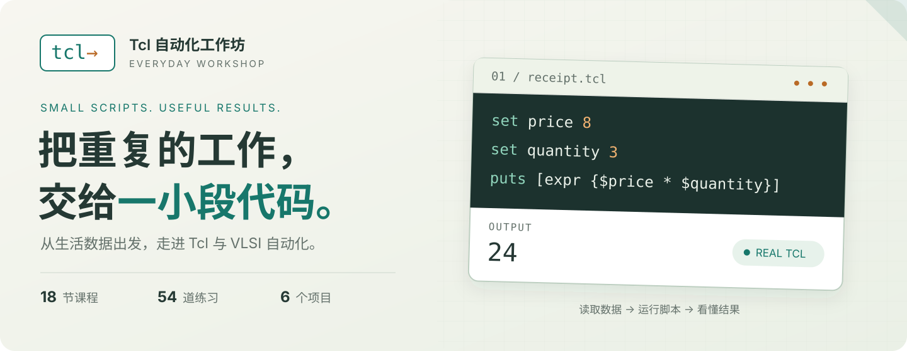

<p align="center">
  <a href="https://fanqinzeng.github.io/TCL-Tutorial/">
    
  </a>
</p>

<h1 align="center">Tcl 自动化工作坊</h1>

<p align="center">从一张购物小票，到一条报告处理流水线。<br>用真实 Tcl，把看得懂的问题变成可运行的脚本。</p>

<p align="center">
  <a href="https://fanqinzeng.github.io/TCL-Tutorial/"><strong>打开在线工作坊 ↗</strong></a> ·
  <a href="https://fanqinzeng.github.io/TCL-Tutorial/#lesson/1">开始第一课</a> ·
  <a href="docs/TEACHING.md">学习指南</a> ·
  <a href="README.en.md">English</a>
</p>

<p align="center">
  <a href="https://github.com/FanqinZeng/TCL-Tutorial/actions/workflows/checks.yml"></a>
  <a href="https://github.com/FanqinZeng/TCL-Tutorial/actions/workflows/pages.yml"></a>
  <a href="LICENSE"></a>
</p>

## 先解决一个小问题，再学会一种新能力

整理一份名单、清理一段文本、汇总一次实验、筛选一份路径报告。这里是一套原创、任务驱动的 Tcl 课程：每节课从具体问题出发，先预测、再运行、改一处输入，最后解释结果。

| 课程 | 可运行示例 | 动手练习 | 综合项目 | 视觉讲解 | 代码演示 |
| :---: | :---: | :---: | :---: | :---: | :---: |
| **18 节 · 6 单元** | **55 个** | **54 道** | **6 个** | **24 张 SVG** | **6 段 × 60 秒** |

- **打开就能运行**：浏览器内置真实 Tcl 8.6.6 WASM 解释器，查看标准输出、最终变量和虚拟文件。
- **边读边动手**：例子一键载入，练习配有分层提示、折叠答案、输出与行为检查。
- **看见数据变化**：教材图解与真实运行结果并排展示，可切换运行后的执行观察记录。
- **按自己的节奏学习**：草稿与阅读记录保存在当前浏览器，支持导入、导出；无需注册。

## 选择你的起点

| 你的经验 | 推荐路线 | 直接开始 |
| --- | --- | --- |
| 第一次写程序 | 按 01–18 顺序，先让电脑帮一个小忙 | [输出与脚本 →](https://fanqinzeng.github.io/TCL-Tutorial/#lesson/1) |
| 学过其他语言 | 重点读 03、06、08、10–15，掌握替换、列表、作用域与 TclOO | [Tcl 的三种重要符号 →](https://fanqinzeng.github.io/TCL-Tutorial/#lesson/3) |
| 正在学习 VLSI | 复习列表、字典、过程与文件，再读 16–18，完成项目 E/F | [Tcl 与 EDA 工具 →](https://fanqinzeng.github.io/TCL-Tutorial/#lesson/16) |

## 工作坊里有什么

<a href="https://fanqinzeng.github.io/TCL-Tutorial/">
  
</a>

<p align="center"><sub>真实网站页面 · 米白阅读区、墨绿代码工作台，以及随手可运行的小实验</sub></p>

| 写一段代码，看懂每个变量 | 把语言能力用到 VLSI 教学数据 |
| :---: | :---: |
| [](https://fanqinzeng.github.io/TCL-Tutorial/#lesson/2) | [](https://fanqinzeng.github.io/TCL-Tutorial/#lesson/17) |

[浏览全部课程](https://fanqinzeng.github.io/TCL-Tutorial/#course) · [观看六段代码演示](https://fanqinzeng.github.io/TCL-Tutorial/#videos) · [查看手机页面](docs/screenshots/mobile-11.jpg)

## 从第一行代码，到完整自动化流程

下方链接打开仓库讲义；需要在线实验时，进入 [工作坊课程目录](https://fanqinzeng.github.io/TCL-Tutorial/#course)。

| 单元 | 你会学到什么 | 三节课程 |
| --- | --- | --- |
| **01 · 第一次让电脑帮忙** | 输出、计算与 Tcl 替换规则 | [01 输出与脚本](lessons/01/README.md)<br>[02 变量与计算](lessons/02/README.md)<br>[03 三种重要符号](lessons/03/README.md) |
| **02 · 选择与重复** | 用判断、循环和列表处理一组数据 | [04 条件判断](lessons/04/README.md)<br>[05 重复处理](lessons/05/README.md)<br>[06 列表](lessons/06/README.md) |
| **03 · 文本与结构化数据** | 清理文本，组织记录，提取字段 | [07 字符串处理](lessons/07/README.md)<br>[08 字典与数组](lessons/08/README.md)<br>[09 正则表达式](lessons/09/README.md) |
| **04 · 可复用脚本** | 把代码变成工具，读写文件并处理失败 | [10 过程与参数](lessons/10/README.md)<br>[11 文件读写](lessons/11/README.md)<br>[12 错误处理与调试](lessons/12/README.md) |
| **05 · 组织项目** | 组织名字、配置入口与对象状态 | [13 作用域与命名空间](lessons/13/README.md)<br>[14 脚本组织与参数](lessons/14/README.md)<br>[15 TclOO 入门](lessons/15/README.md) |
| **06 · VLSI 应用** | 分清工具命令，理解教学报告并生成摘要 | [16 Tcl 与 EDA 工具](lessons/16/README.md)<br>[17 约束与报告](lessons/17/README.md)<br>[18 自动生成分析摘要](lessons/18/README.md) |

每节课包含原创图解、至少 3 个带预期输出的示例、3 道练习、分层提示与答案、理解题、常见错误、探索活动和速查。六段视频提供中文字幕与逐字稿，便于暂停阅读。

## 用六个项目，把知识串起来

| 项目 | 最终做出什么 | 重点能力 |
| --- | --- | --- |
| [A · 报名名单清理器](projects/A/README.md) | 去掉空行与重复姓名，按字典序整理名单 | 字符串 · 列表 |
| [B · 家庭开支摘要](projects/B/README.md) | 按类别汇总开支，单独报告非法记录 | 字典 · 数据校验 |
| [C · 实验测量数据统计](projects/C/README.md) | 计算数量、极值与均值，标记越界数据 | 过程 · 边界处理 |
| [D · 日志诊断助手](projects/D/README.md) | 统计错误与警告，保留问题附近的上下文 | 正则 · 文件处理 |
| [E · 设计路径报告筛选器](projects/E/README.md) | 筛出负 slack，并按严重程度排序 | 教学报告 · 排序 |
| [F · 可配置的报告生成流程](projects/F/README.md) | 读取配置、验证数据，写出摘要和错误记录 | 模块 · 自动化流水线 |

每个项目都有起始代码、逐步提示、参考实现，以及不同输入、空输入和非法输入验证。也可以直接 [进入在线项目工作台 →](https://fanqinzeng.github.io/TCL-Tutorial/#projects)

## 在自己的电脑上学习

只想体验课程？直接 [打开在线网站](https://fanqinzeng.github.io/TCL-Tutorial/)。本地预览网站只需要 Python 3：

```sh
git clone https://github.com/FanqinZeng/TCL-Tutorial.git
cd TCL-Tutorial
python3 scripts/serve.py
```

浏览器打开 **http://127.0.0.1:8765/**。网页自带 Tcl 运行器，无需安装 Tcl、Node 或 npm 包；运行时与媒体随仓库提供。请通过 HTTP 访问网站。

要在终端运行课程代码，请安装 **Tcl 8.6+**，然后尝试：

```sh
tclsh examples/01/01.tcl
python3 scripts/check.py --all
```

Tcl 发行版见 [官方软件页](https://www.tcl-lang.org/software/tcltk/)。macOS 系统 Tcl 8.5 不支持课程中的 TclOO。有输入文件的示例需使用 `data/` 对应数据；文件写入当前工作目录，建议使用独立练习目录。验证器会创建临时目录。

<details>
<summary><strong>想修改课程或参与维护？展开开发说明</strong></summary>

课程和项目以 JSON 为单一来源。修改 `lessons/*.json`、`projects/*.json` 后，重新生成讲义、Tcl 文件与网站数据：

```sh
python3 scripts/build.py
python3 scripts/check.py --all
python3 tests/integrity.py
node tests/runtime.mjs
```

Node 18+ 用于开发测试。主要目录：

```text
lessons/     课程 JSON 与生成的 Markdown 讲义
projects/    项目 JSON、讲义、起始代码与参考实现
examples/    可独立运行的 Tcl 示例
exercises/   练习起始代码
solutions/   练习参考答案
data/        原创教学输入文件
site/        静态网站、WASM 运行时、图解与视频
docs/        教学、部署、运行与维护文档
scripts/     内容生成、验证、预览与媒体制作
tests/       内容完整性与真实 WASM 回归检查
```

详见 [贡献指南](CONTRIBUTING.md) · [内容格式](docs/CONTENT_SCHEMA.md) · [部署说明](docs/DEPLOYMENT.md)。

</details>

## 运行方式与验证

浏览器使用 Wacl 随附的 **Tcl 8.6.6**。每次运行创建独立 Worker 与内存文件系统，5 秒执行上限；文件结果可下载。草稿和阅读记录留在当前浏览器，可手动导出、导入。

已验证原生 Tcl 9.0.4 与浏览器 WASM 各 **138/138** 用例通过，另有 **10 项 WASM 回归检查**；持续集成也验证 Tcl 8.6。执行记录展示真实运行后的观察信息。VLSI 内容使用简化教学模型，未连接商业 EDA，也不提供真实 STA、Calibre 或 GDS 生成。

[验证记录与截图](docs/QA.md) · [运行原理](docs/RUNTIME.md) · [无障碍说明](docs/ACCESSIBILITY.md) · [Tcl 速查](docs/REFERENCE.md)

---

<p align="center">
  原创代码、讲义与图解采用 <a href="LICENSE">MIT 许可证</a> · <a href="THIRD_PARTY_NOTICES.md">第三方声明</a><br>
  <sub>FanqinZeng · 语言规则参考 <a href="https://www.tcl-lang.org/man/tcl8.6/TclCmd/contents.htm">Tcl 官方手册</a></sub>
</p>
