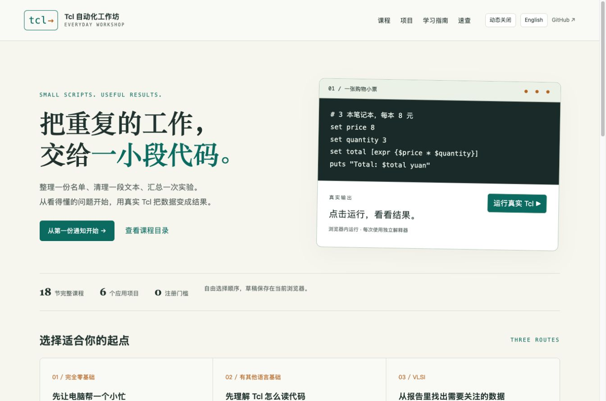
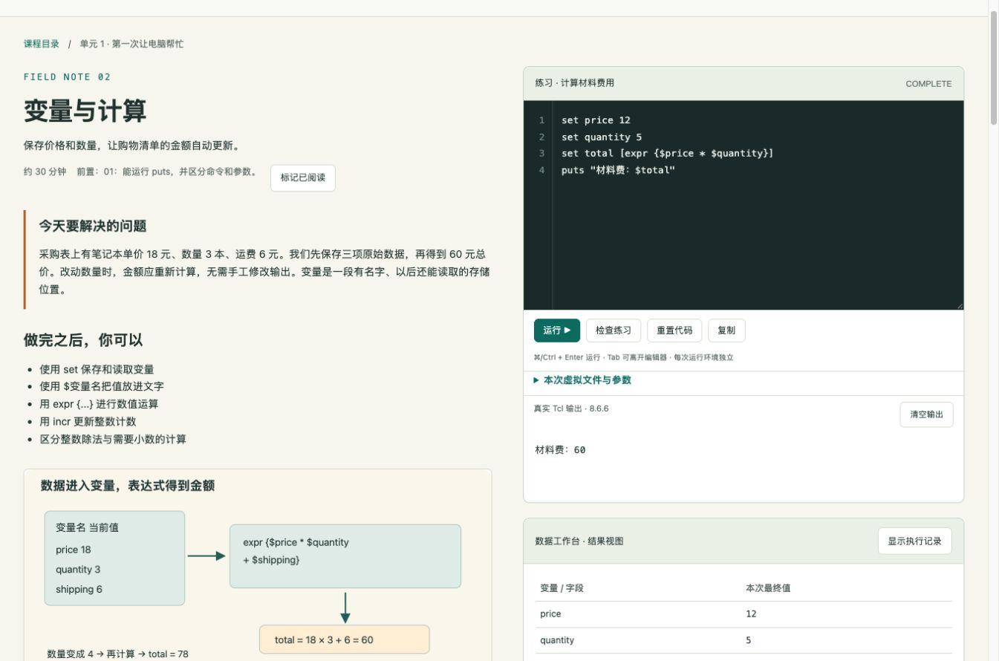
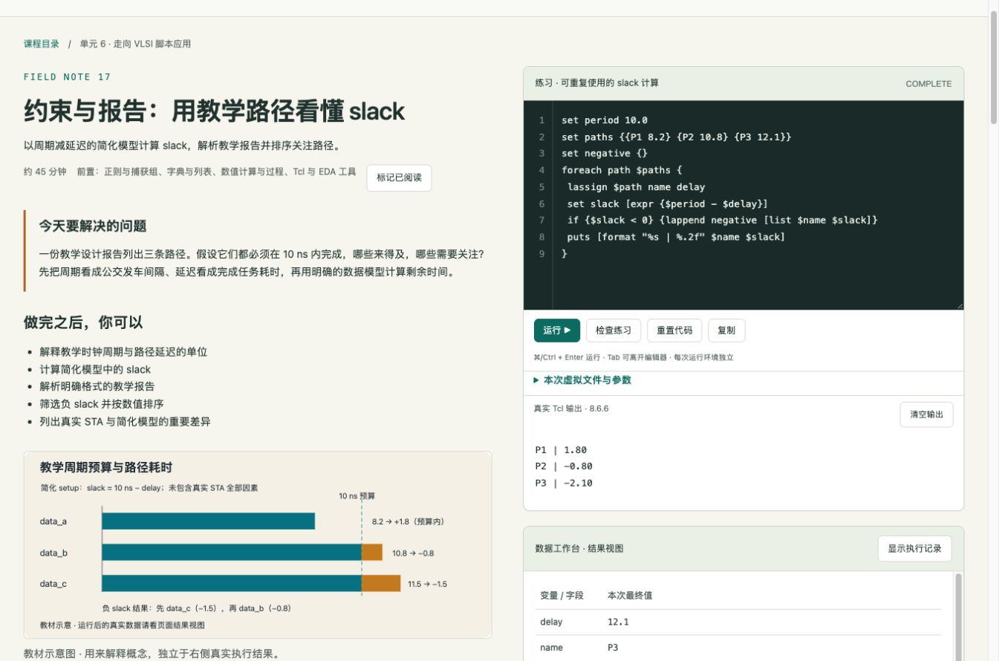
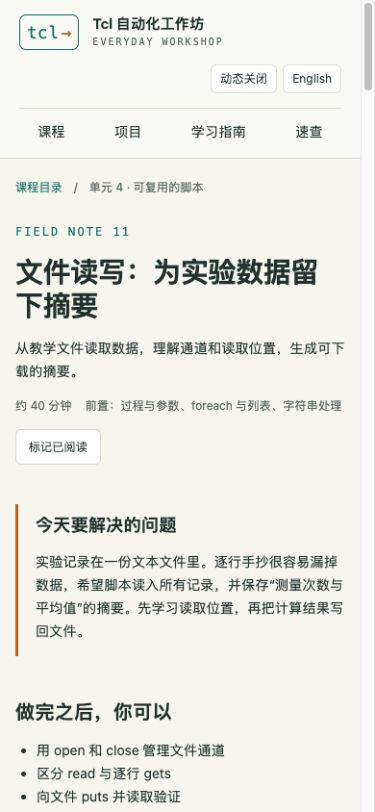

# Verification and maintenance / 验证记录

## 可复现的代码验证

2026-10-13：18 节主课、55 个运行示例、54 道练习、6 个项目；24 张原创 SVG；6 套 60 秒 H.264 视频、字幕、封面与文字稿。

- 本地 Tcl 9.0.4：138/138 示例、参考答案与项目用例通过，含语义检查。使用 Python 打包的原生 Tcl，逐次独立进程和临时目录。
- 与网页完全相同的 Tcl 8.6.6 WASM：138/138 用例通过。Node 的本地资源适配器只负责加载文件，不模拟 Tcl。
- 10 项真实 WASM 回归：执行观察、未执行分支、中文、错误、虚拟文件、新解释器隔离、用户变量、两个独立对象、嵌套命名空间、读取 trace 隔离。
- 结构检查：完整课程材料、实际视频文件、SVG title/desc、输入文件、离线运行时与供应链文件哈希。
- 媒体：43 次原生 Tcl 执行产生 72 个镜头；六段 MP4 均独立解码检查，60.0 秒、1280×720、字幕覆盖完整时长。详见 [VIDEOS](VIDEOS.md)。

```sh
python3 scripts/build.py
python3 scripts/check.py --all
python3 tests/integrity.py
node tests/runtime.mjs
node --check site/app.js
```

本地 CLI 检查要求 Tcl 8.6+。本次 macOS 原生验证通过打包 Python 的 Tcl 9.0.4 执行：`python3 scripts/check.py --all --tk`。运行结果 JSON 属于可再生成测试产物，不提交源仓库。

## 实际浏览器检查

在 HTTP 服务中使用实际网页界面完成，不以 DOM 假数据替代程序执行：

- 首页迷你示例得到 `Total: 24 yuan`。
- 变量练习语义检查通过；数量从 4 改为 5 后，输出与变量表从 48 改为 60。
- 未定义变量产生真实错误，先前成功结果被清除。
- 文件示例生成 `summary.txt`；实际下载核对为“数量：3 / 平均值：1.40”。
- 无限循环触发 5 秒 Worker 终止；运行中导航不出现旧回调异常。
- Markdown 指南和速查表正确显示表格与内部课程链接。
- 1360×900 桌面双栏、390×844 手机堆叠检查；手机正文和结果表没有整页横向溢出。

截图来自实际本地页面，数据与静态教材示意分开标注：






GitHub Actions 对提交重新构建并运行原生与 WASM 验证。线上部署状态以仓库 Actions / Pages 中的实际结果为准。

## 可维护边界

解释器为真实 Tcl；本项目的检查用于教学反馈，不提供考试防作弊保证。EDA 示例是自行实现的教学模型，未连接商业 EDA 工具。执行记录为运行后观察，不能替代暂停式单步调试。浏览器文件保存在当前运行的内存文件系统，下载才保存到磁盘。
