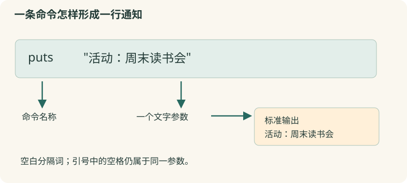

# 01 · 输出与脚本

用三行命令，把活动安排变成一张可复制的通知。

约 25 分钟。前置知识：无需编程经验；能在编辑框中输入和运行文字。

## 要解决的问题

社区读书会每次都要重复写活动名、时间和地点。原始信息是“周末读书会 / 周六 14:00 / 二楼阅览室”。我们把它写成三条命令，运行后得到格式一致的通知；下一次只要修改三行文字。脚本就是保存起来、能够重复执行的一组命令。

## 学习目标

- 使用 puts 输出一行或不换行的文字
- 区分命令名称、参数和命令分隔符
- 使用注释说明脚本意图
- 把几条命令保存为 .tcl 脚本并本地执行



## 先看一条命令

puts 是命令名称，含义是把文字写到输出通道。puts "活动：周末读书会" 中，双引号里的内容是一个参数。工作台的输出区接收标准输出（stdout），它就像程序的公共留言板。puts 默认在末尾加一个换行。

## 空白分词，换行分命令

Tcl 通常用空格或制表符分隔命令的词：第一个词是命令名，后面的词是参数。双引号可以把含空格的文字组成一个词。换行或分号分隔命令；引号或花括号内部的换行属于该参数，不能简单地按每个换行切开整段代码。先每行写一条命令，最容易阅读。

## 给未来的自己留说明

在 Tcl 正准备读取命令名的位置，# 开始一条注释。因此独占一行的 # 活动通知 是注释；需要行末注释时，先用分号结束当前命令，再写 #。普通参数中的 # 并不自动变成注释。注释帮助人理解代码，不会出现在输出中。

## 从工作台到文件

将代码保存为 notice.tcl，在已安装 Tcl 的终端执行 tclsh notice.tcl，就得到同样的文字。网页中的代码在浏览器内执行；它不会自动在你的电脑上创建 notice.tcl。复制代码再保存即可。运行成功表示解释器完成了这些命令，仍需要检查通知内容是否正确。

## 示例 1 · 一行通知

```tcl
puts "活动：周末读书会"
```
默认模拟参数（JSON 数组表示）：

```text
argv = []
argc = 0
```

没有额外预置文件。

预期输出：

```text
活动：周末读书会
```
<details><summary>本地准备与运行（Tcl 8.6+）</summary>

```sh
# 从本仓库根目录执行；文件读写发生在新建的临时练习目录。
workshop_repo="$PWD"
practice_dir="$(mktemp -d)"
cd "$practice_dir"
tclsh "$workshop_repo"/examples/01/01.tcl
# 生成文件留在 practice_dir；执行后回到仓库。
cd "$workshop_repo"
```


</details>
## 示例 2 · 三行组成完整通知

```tcl
# 统一通知格式
puts "活动：周末读书会"
puts "时间：周六 14:00"
puts "地点：二楼阅览室"
```
默认模拟参数（JSON 数组表示）：

```text
argv = []
argc = 0
```

没有额外预置文件。

预期输出：

```text
活动：周末读书会
时间：周六 14:00
地点：二楼阅览室
```
<details><summary>本地准备与运行（Tcl 8.6+）</summary>

```sh
# 从本仓库根目录执行；文件读写发生在新建的临时练习目录。
workshop_repo="$PWD"
practice_dir="$(mktemp -d)"
cd "$practice_dir"
tclsh "$workshop_repo"/examples/01/02.tcl
# 生成文件留在 practice_dir；执行后回到仓库。
cd "$workshop_repo"
```


</details>
## 示例 3 · 同一行分两次写

```tcl
puts -nonewline "报名截止："
puts "周五 18:00"; # 第二次输出补上换行
```
默认模拟参数（JSON 数组表示）：

```text
argv = []
argc = 0
```

没有额外预置文件。

预期输出：

```text
报名截止：周五 18:00
```
<details><summary>本地准备与运行（Tcl 8.6+）</summary>

```sh
# 从本仓库根目录执行；文件读写发生在新建的临时练习目录。
workshop_repo="$PWD"
practice_dir="$(mktemp -d)"
cd "$practice_dir"
tclsh "$workshop_repo"/examples/01/03.tcl
# 生成文件留在 practice_dir；执行后回到仓库。
cd "$workshop_repo"
```


</details>
## 修改一个条件

把例子三的 -nonewline 删除再运行，比较输出行数。再把“周五 18:00”改成“周四 09:30”，确认工作台输出随真正运行的代码改变。

## 常见错误

- **直接写 puts 活动 地点，出现参数错误**：空白把三个词分开，puts 会把“活动”当作通道名。希望打印一段文字时写 puts "活动 地点"。
- **写 puts "通知" # 说明，运行报错**：这里的 # 位于参数位置，不是注释开头。改为 puts "通知"; # 说明，或把注释放到上一行。

## 练习 1 · 一行报名提醒

用 puts 输出“请在周五前报名”，不要增加标题或其他文字。

```tcl
puts "请编辑提醒"
```
默认模拟参数（JSON 数组表示）：

```text
argv = []
argc = 0
```

没有额外预置文件。

目标输出：

```text
请在周五前报名
```
<details><summary>逐层提示</summary>

文字是 puts 的一个参数。

把完整提醒放在同一对双引号中。

</details>
<details><summary>参考答案</summary>

```tcl
puts "请在周五前报名"
```
<details><summary>本地准备与运行（Tcl 8.6+）</summary>

```sh
# 从本仓库根目录执行；文件读写发生在新建的临时练习目录。
workshop_repo="$PWD"
practice_dir="$(mktemp -d)"
cd "$practice_dir"
tclsh "$workshop_repo"/solutions/01/01.tcl
# 生成文件留在 practice_dir；执行后回到仓库。
cd "$workshop_repo"
```


</details>


</details>

## 练习 2 · 制作两场活动通知

按示例格式输出两行：活动：散步交流；活动：手作分享。每条独立一行，并在脚本首行写一条说明用途的注释。

```tcl
# 活动清单
puts "第一项"
puts "第二项"
```
默认模拟参数（JSON 数组表示）：

```text
argv = []
argc = 0
```

没有额外预置文件。

目标输出：

```text
活动：散步交流
活动：手作分享
```
<details><summary>逐层提示</summary>

每条通知对应一次 puts。

注释放在单独一行；输出行末不要额外加空格。

</details>
<details><summary>参考答案</summary>

```tcl
# 输出本周两场活动
puts "活动：散步交流"
puts "活动：手作分享"
```
<details><summary>本地准备与运行（Tcl 8.6+）</summary>

```sh
# 从本仓库根目录执行；文件读写发生在新建的临时练习目录。
workshop_repo="$PWD"
practice_dir="$(mktemp -d)"
cd "$practice_dir"
tclsh "$workshop_repo"/solutions/01/02.tcl
# 生成文件留在 practice_dir；执行后回到仓库。
cd "$workshop_repo"
```


</details>


</details>

## 练习 3 · 拼接地点说明

第一次 puts 使用 -nonewline 输出“集合地点：”，第二次输出“南门 服务台”。结果只能有一行，且地点里的空格必须保留。

```tcl
puts "集合地点："
puts "南门 服务台"
```
默认模拟参数（JSON 数组表示）：

```text
argv = []
argc = 0
```

没有额外预置文件。

目标输出：

```text
集合地点：南门 服务台
```
<details><summary>逐层提示</summary>

-nonewline 是 puts 的选项，放在文字之前。

南门 服务台必须作为一个参数传入。

</details>
<details><summary>参考答案</summary>

```tcl
puts -nonewline "集合地点："
puts "南门 服务台"
```
<details><summary>本地准备与运行（Tcl 8.6+）</summary>

```sh
# 从本仓库根目录执行；文件读写发生在新建的临时练习目录。
workshop_repo="$PWD"
practice_dir="$(mktemp -d)"
cd "$practice_dir"
tclsh "$workshop_repo"/solutions/01/03.tcl
# 生成文件留在 practice_dir；执行后回到仓库。
cd "$workshop_repo"
```


</details>


</details>

## 理解检查

puts "南门 服务台" 有多少个传给 puts 的参数？

1. 一个：南门 服务台
2. 两个：南门和服务台
3. 三个：包括 puts

<details><summary>答案与解释</summary>

一个：南门 服务台。引号把含空格的文字组成一个参数；命令名称不计入参数。

</details>
下面哪种写法能可靠地添加行末注释？

1. puts "通知" # 说明
2. puts "通知"; # 说明
3. puts # "通知"

<details><summary>答案与解释</summary>

puts "通知"; # 说明。分号先结束 puts 命令，之后 Tcl 正在等新的命令名，# 才开始注释。

</details>

## 速查

- puts "文字"：输出一行
- puts -nonewline "文字"：输出且不追加换行
- 独占一行的 #：说明用途
- 通常每行一个命令；空白分隔词
- tclsh notice.tcl：在本地执行已保存的脚本

下一节：通知中的人数、费用每天会变化。下一节把这些数据放进变量，再让 Tcl 自动计算。
