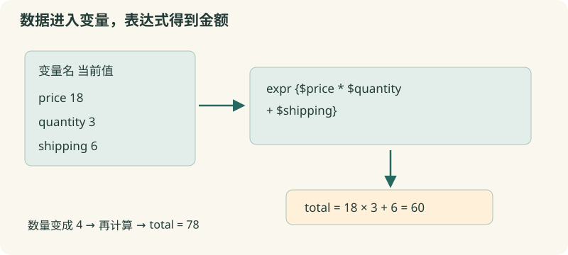

# 02 · 变量与计算

保存价格和数量，让购物清单的金额自动更新。

约 30 分钟。前置知识：01：能运行 puts，并区分命令和参数。

## 要解决的问题

采购表上有笔记本单价 18 元、数量 3 本、运费 6 元。我们先保存三项原始数据，再得到 60 元总价。改动数量时，金额应重新计算，无需手工修改输出。变量是一段有名字、以后还能读取的存储位置。

## 学习目标

- 使用 set 保存和读取变量
- 使用 $变量名把值放进文字
- 用 expr {...} 进行数值运算
- 用 incr 更新整数计数
- 区分整数除法与需要小数的计算



## 为数据取名字

set price 18 把值 18 保存到名为 price 的变量；set price 不带新值时读取它。$price 是变量替换：Tcl 把当前位置换成变量的值。变量名区分大小写；price 与 Price 是两个名字。

## 在表达式里计算

set total [expr {$price * $quantity + $shipping}] 先执行方括号中的 expr，再把结果交给外面的 set。expr 接收算术表达式；推荐用花括号包住它。这样变量替换由表达式求值器执行，避免 Tcl 在求值前多处理一遍表达式，也能保留短路计算并利于编译。不要为了计算去拼接一大段代码。

## 整数和小数有区别

expr {5 / 2} 得到整数 2；expr {5 / 2.0} 得到 2.5。要计算平均数，可让除数是小数或使用 double(...)。金额展示可使用 format %.2f，但显示两位小数并不等于已经建立严谨的财务计算模型；本课程只处理教学数据。

## 计数器逐步增加

incr count 默认把整数变量增加 1；incr count 2 增加 2；incr count -1 减少 1。incr 的第一个参数是变量名称，因此写 incr count，而不是 incr $count。本节先明确初始化，容易看清状态从哪里开始。

## 示例 1 · 采购总价

```tcl
set price 18
set quantity 3
set shipping 6
set total [expr {$price * $quantity + $shipping}]
puts "总价：$total 元"
```
默认模拟参数（JSON 数组表示）：

```text
argv = []
argc = 0
```

没有额外预置文件。

预期输出：

```text
总价：60 元
```
<details><summary>本地准备与运行（Tcl 8.6+）</summary>

```sh
# 从本仓库根目录执行；文件读写发生在新建的临时练习目录。
workshop_repo="$PWD"
practice_dir="$(mktemp -d)"
cd "$practice_dir"
tclsh "$workshop_repo"/examples/02/01.tcl
# 生成文件留在 practice_dir；执行后回到仓库。
cd "$workshop_repo"
```


</details>
## 示例 2 · 整数除法与均价

```tcl
puts [expr {5 / 2}]
puts [expr {5 / 2.0}]
set subtotal 47
set pieces 4
set average [expr {double($subtotal) / $pieces}]
puts [format "平均：%.2f 元" $average]
```
默认模拟参数（JSON 数组表示）：

```text
argv = []
argc = 0
```

没有额外预置文件。

预期输出：

```text
2
2.5
平均：11.75 元
```
<details><summary>本地准备与运行（Tcl 8.6+）</summary>

```sh
# 从本仓库根目录执行；文件读写发生在新建的临时练习目录。
workshop_repo="$PWD"
practice_dir="$(mktemp -d)"
cd "$practice_dir"
tclsh "$workshop_repo"/examples/02/02.tcl
# 生成文件留在 practice_dir；执行后回到仓库。
cd "$workshop_repo"
```


</details>
## 示例 3 · 记录报名人数变化

```tcl
set count 8
incr count
incr count 2
incr count -1
puts "当前人数：$count"
```
默认模拟参数（JSON 数组表示）：

```text
argv = []
argc = 0
```

没有额外预置文件。

预期输出：

```text
当前人数：10
```
<details><summary>本地准备与运行（Tcl 8.6+）</summary>

```sh
# 从本仓库根目录执行；文件读写发生在新建的临时练习目录。
workshop_repo="$PWD"
practice_dir="$(mktemp -d)"
cd "$practice_dir"
tclsh "$workshop_repo"/examples/02/03.tcl
# 生成文件留在 practice_dir；执行后回到仓库。
cd "$workshop_repo"
```


</details>
## 修改一个条件

把总价例子的 quantity 依次改成 1、0、5，观察 total。再把 price 改成 18.5，确认输出类型和小数变化。思考：数据合法性应在哪里检查？第 04 节会引入条件判断。

## 常见错误

- **写 puts price，却只显示 price**：读取变量要用 $price，或执行 [set price]；普通文字不会自动读取同名变量。
- **写 expr {5 / 2}，期望 2.5**：两个操作数都是整数时做整数除法。改成 expr {5 / 2.0}，或显式使用 double(5)。
- **写 incr $count**：incr 接收变量名称。若 count=8，incr $count 会去更新名为 8 的变量；应写 incr count。

## 练习 1 · 计算材料费用

保留 price=12、quantity=4，用 expr 把乘积保存为 total，再输出“材料费：48”。

```tcl
set price 12
set quantity 4
set total 0
puts "材料费：$total"
```
默认模拟参数（JSON 数组表示）：

```text
argv = []
argc = 0
```

没有额外预置文件。

目标输出：

```text
材料费：48
```
<details><summary>逐层提示</summary>

相乘使用 *。

set total [expr {$price * $quantity}] 把求值结果存进变量。

</details>
<details><summary>参考答案</summary>

```tcl
set price 12
set quantity 4
set total [expr {$price * $quantity}]
puts "材料费：$total"
```
<details><summary>本地准备与运行（Tcl 8.6+）</summary>

```sh
# 从本仓库根目录执行；文件读写发生在新建的临时练习目录。
workshop_repo="$PWD"
practice_dir="$(mktemp -d)"
cd "$practice_dir"
tclsh "$workshop_repo"/solutions/02/01.tcl
# 生成文件留在 practice_dir；执行后回到仓库。
cd "$workshop_repo"
```


</details>


</details>

## 练习 2 · 算折扣，并处理零件数边界

订单单价 25 元、数量 3 件，减免 10 元；另一个订单数量为 0。把两个应付金额分别存为 payable、emptyPayable：首单减免 10，空单按单价×0 计算且没有减免。输出两行金额。

```tcl
set price 25
set quantity 3
set discount 10
set emptyQuantity 0
set payable 0
set emptyPayable 1
puts "应付：$payable"
puts "空单：$emptyPayable"
```
默认模拟参数（JSON 数组表示）：

```text
argv = []
argc = 0
```

没有额外预置文件。

目标输出：

```text
应付：65
空单：0
```
<details><summary>逐层提示</summary>

首单是乘积减去 discount。

空单只乘 emptyQuantity；不能照搬首单的减免。

</details>
<details><summary>参考答案</summary>

```tcl
set price 25
set quantity 3
set discount 10
set emptyQuantity 0
set payable [expr {$price * $quantity - $discount}]
set emptyPayable [expr {$price * $emptyQuantity}]
puts "应付：$payable"
puts "空单：$emptyPayable"
```
<details><summary>本地准备与运行（Tcl 8.6+）</summary>

```sh
# 从本仓库根目录执行；文件读写发生在新建的临时练习目录。
workshop_repo="$PWD"
practice_dir="$(mktemp -d)"
cd "$practice_dir"
tclsh "$workshop_repo"/solutions/02/02.tcl
# 生成文件留在 practice_dir；执行后回到仓库。
cd "$workshop_repo"
```


</details>


</details>

## 练习 3 · 报名统计与平均费用

初始 6 人，新加入 3 人后退出 1 人。用 incr 更新 count，把总场地费 100 元除以最终人数得到 average，并用 format 输出两位小数。

```tcl
set count 6
set fee 100
# 用 incr 更新人数，再求平均
set average 0
puts "人数：$count"
puts [format "人均：%.2f" $average]
```
默认模拟参数（JSON 数组表示）：

```text
argv = []
argc = 0
```

没有额外预置文件。

目标输出：

```text
人数：8
人均：12.50
```
<details><summary>逐层提示</summary>

先完成两次 incr，再读取 count。

用 double($fee) 保留小数；输出用 format %.2f。

</details>
<details><summary>参考答案</summary>

```tcl
set count 6
set fee 100
incr count 3
incr count -1
set average [expr {double($fee) / $count}]
puts "人数：$count"
puts [format "人均：%.2f" $average]
```
<details><summary>本地准备与运行（Tcl 8.6+）</summary>

```sh
# 从本仓库根目录执行；文件读写发生在新建的临时练习目录。
workshop_repo="$PWD"
practice_dir="$(mktemp -d)"
cd "$practice_dir"
tclsh "$workshop_repo"/solutions/02/03.tcl
# 生成文件留在 practice_dir；执行后回到仓库。
cd "$workshop_repo"
```


</details>


</details>

## 理解检查

set n 4 后，哪个命令把 n 增加 2？

1. incr $n 2
2. incr n 2
3. set n n+2

<details><summary>答案与解释</summary>

incr n 2。incr 的参数是变量名字 n，第二个参数指定增量。

</details>
为什么推荐 expr {$a + $b}？

1. 花括号让 expr 永远看不到变量
2. 表达式求值器仍读取变量，同时避免 Tcl 提前替换表达式
3. 只有带花括号才支持加法

<details><summary>答案与解释</summary>

表达式求值器仍读取变量，同时避免 Tcl 提前替换表达式。花括号抑制外层 Tcl 替换；expr 自己按表达式规则处理变量，能保留短路语义并更高效地编译。

</details>

## 速查

- set name value：保存；set name：读取
- $name：变量替换
- expr {$a * $b + 2}：计算表达式
- incr n ?增量?：更新整数
- double($n) / $count：需要小数的除法
- format %.2f $value：格式化两位小数

下一节：变量替换、方括号求值、花括号保护表达式已经出现。下一节把这三种符号的职责拆开看清。
