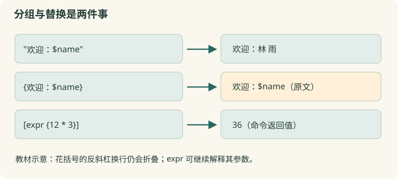

# 03 · Tcl 的三种重要符号

看清双引号、花括号和方括号分别怎样组织一条消息。

约 35 分钟。前置知识：01–02：puts、set、$变量名和 expr。

## 要解决的问题

要给姓名为“林 雨”的报名者发送消息：“林 雨，你的材料费为 36 元”。姓名包含空格，金额需要计算，还想打印一段原样的模板。三件事看起来都像文字，实际需要不同的分组和替换规则。

## 学习目标

- 区分双引号分组与花括号分组
- 判断变量替换、命令替换与反斜杠替换发生的位置
- 使用方括号取得命令的返回值
- 解释替换结果为什么不会再按空格拆成多个参数



## 双引号：组成一个词，允许替换

"姓名：$name" 是一个参数，空格不会把它拆开；其中 $name 发生变量替换，[命令] 发生命令替换，\n 这样的反斜杠序列也会被处理。双引号解决“这些字符属于同一个词”，不承诺保留每个字符原样。

## 花括号：组成一个词，交给命令再解释

{$name [expr {2+3}]} 作为一个词传入，外层 Tcl 不做变量或命令替换，也不做通常的反斜杠替换。重要例外是反斜杠紧接换行及其后的缩进会折叠成一个空格。花括号可嵌套并需配对。expr、if 等命令收到花括号里的文字后，会按自己的规则求值；因此 expr {$price * 2} 仍能读取 price。

## 方括号：先执行，放入返回值

[expr {$price * $quantity}] 先执行一个 Tcl 命令，把返回值放到所在位置。它不是分组引号，也不是列表索引写法；列表索引使用 lindex。嵌套方括号按依赖从里面求值。puts 的输出和命令返回值是两件事：puts 返回空字符串，不能拿 [puts ...] 当作刚打印的文字。

## 替换结果不会再分词

Tcl 首先确定词边界，再把变量和命令的结果填入各个词中。name 的值是“林 雨”时，puts $name 仍把整段值当作一个参数。通常不会把值再次当 Tcl 源码执行；不要因此使用 eval 拼接命令。命令的参数值仍可能被该命令按特定语法解析，比如 expr 解析表达式、lindex 解析列表。

## 示例 1 · 同一段文字，两种分组

```tcl
set name "林 雨"
puts "欢迎：$name"
puts {欢迎：$name}
```
默认模拟参数（JSON 数组表示）：

```text
argv = []
argc = 0
```

没有额外预置文件。

预期输出：

```text
欢迎：林 雨
欢迎：$name
```
<details><summary>本地准备与运行（Tcl 8.6+）</summary>

```sh
# 从本仓库根目录执行；文件读写发生在新建的临时练习目录。
workshop_repo="$PWD"
practice_dir="$(mktemp -d)"
cd "$practice_dir"
tclsh "$workshop_repo"/examples/03/01.tcl
# 生成文件留在 practice_dir；执行后回到仓库。
cd "$workshop_repo"
```


</details>
## 示例 2 · 计算结果嵌入消息

```tcl
set name "林 雨"
set price 12
set quantity 3
puts "$name，你的材料费为 [expr {$price * $quantity}] 元"
```
默认模拟参数（JSON 数组表示）：

```text
argv = []
argc = 0
```

没有额外预置文件。

预期输出：

```text
林 雨，你的材料费为 36 元
```
<details><summary>本地准备与运行（Tcl 8.6+）</summary>

```sh
# 从本仓库根目录执行；文件读写发生在新建的临时练习目录。
workshop_repo="$PWD"
practice_dir="$(mktemp -d)"
cd "$practice_dir"
tclsh "$workshop_repo"/examples/03/02.tcl
# 生成文件留在 practice_dir；执行后回到仓库。
cd "$workshop_repo"
```


</details>
## 示例 3 · 换行序列与原样模板

```tcl
puts "第一行\n第二行"
puts {第一行\n第二行}
set heading "开放 日"
puts $heading
```
默认模拟参数（JSON 数组表示）：

```text
argv = []
argc = 0
```

没有额外预置文件。

预期输出：

```text
第一行
第二行
第一行\n第二行
开放 日
```
<details><summary>本地准备与运行（Tcl 8.6+）</summary>

```sh
# 从本仓库根目录执行；文件读写发生在新建的临时练习目录。
workshop_repo="$PWD"
practice_dir="$(mktemp -d)"
cd "$practice_dir"
tclsh "$workshop_repo"/examples/03/03.tcl
# 生成文件留在 practice_dir；执行后回到仓库。
cd "$workshop_repo"
```


</details>
## 示例 4 · 花括号里的续行例外

```tcl
set text {第一段\
    第二段}
puts $text
```
默认模拟参数（JSON 数组表示）：

```text
argv = []
argc = 0
```

没有额外预置文件。

预期输出：

```text
第一段 第二段
```
<details><summary>本地准备与运行（Tcl 8.6+）</summary>

```sh
# 从本仓库根目录执行；文件读写发生在新建的临时练习目录。
workshop_repo="$PWD"
practice_dir="$(mktemp -d)"
cd "$practice_dir"
tclsh "$workshop_repo"/examples/03/04.tcl
# 生成文件留在 practice_dir；执行后回到仓库。
cd "$workshop_repo"
```


</details>
## 修改一个条件

在例子一中把 name 改成“顾 [甲]”。赋值时用花括号保护这个值，然后比较 puts $name 和 puts {$name}。再把例子三第一条的 \n 改成 \t，观察输出如何改变。

## 常见错误

- **把所有文字都用花括号包住，期待 $name 自动变化**：外层 Tcl 不替换花括号里的变量。需要消息插值时用双引号；要交给 expr 或 if 求值时，花括号是合适的。
- **set msg [puts "你好"] 后发现 msg 是空字符串**：puts 把内容写到输出，不把它作为返回值。直接 set msg "你好"，再 puts $msg。
- **手动把含方括号的用户文字拼成源代码**：使用变量作为数据传给命令，避免 eval；变量值通常不会被再次当源码扫描。需要原样输入时先用花括号保护。

## 练习 1 · 同时保存模板和成品

保留 name="陈 晨"。template 应是原样文字“你好，$name”，message 应是替换后的“你好，陈 晨”。输出 template，再输出 message。

```tcl
set name "陈 晨"
set template "请补全"
set message "请补全"
puts $template
puts $message
```
默认模拟参数（JSON 数组表示）：

```text
argv = []
argc = 0
```

没有额外预置文件。

目标输出：

```text
你好，$name
你好，陈 晨
```
<details><summary>逐层提示</summary>

template 要保留美元符号，选择抑制替换的分组。

message 用双引号分组，允许 $name 替换。

</details>
<details><summary>参考答案</summary>

```tcl
set name "陈 晨"
set template {你好，$name}
set message "你好，$name"
puts $template
puts $message
```
<details><summary>本地准备与运行（Tcl 8.6+）</summary>

```sh
# 从本仓库根目录执行；文件读写发生在新建的临时练习目录。
workshop_repo="$PWD"
practice_dir="$(mktemp -d)"
cd "$practice_dir"
tclsh "$workshop_repo"/solutions/03/01.tcl
# 生成文件留在 practice_dir；执行后回到仓库。
cd "$workshop_repo"
```


</details>


</details>

## 练习 2 · 把运算嵌入通知

price=9、quantity=4；把“总计 36 元”保存到 message，把文字“[expr {9 * 4}]”原样保存到 formula。输出 message 和 formula。

```tcl
set price 9
set quantity 4
set message "总计 0 元"
set formula "请补全"
puts $message
puts $formula
```
默认模拟参数（JSON 数组表示）：

```text
argv = []
argc = 0
```

没有额外预置文件。

目标输出：

```text
总计 36 元
[expr {9 * 4}]
```
<details><summary>逐层提示</summary>

双引号中允许 [expr {...}] 求值。

formula 的最外层花括号保护整个表达式，包括方括号。

</details>
<details><summary>参考答案</summary>

```tcl
set price 9
set quantity 4
set message "总计 [expr {$price * $quantity}] 元"
set formula {[expr {9 * 4}]}
puts $message
puts $formula
```
<details><summary>本地准备与运行（Tcl 8.6+）</summary>

```sh
# 从本仓库根目录执行；文件读写发生在新建的临时练习目录。
workshop_repo="$PWD"
practice_dir="$(mktemp -d)"
cd "$practice_dir"
tclsh "$workshop_repo"/solutions/03/02.tcl
# 生成文件留在 practice_dir；执行后回到仓库。
cd "$workshop_repo"
```


</details>


</details>

## 练习 3 · 保留用户文字，不把它当代码

raw 的值是“会议 [上午] $room”。请把 report 保存为“备注：会议 [上午] $room”，literal 保存为原样的“备注：$raw”。不要执行上午命令，也不要创建 room 变量。输出 report、literal。

```tcl
set raw {会议 [上午] $room}
set report {请补全}
set literal {请补全}
puts $report
puts $literal
```
默认模拟参数（JSON 数组表示）：

```text
argv = []
argc = 0
```

没有额外预置文件。

目标输出：

```text
备注：会议 [上午] $room
备注：$raw
```
<details><summary>逐层提示</summary>

先用花括号保存 raw，避免初次读取时替换。

$raw 的值不会再次扫描其中的方括号或美元符号。

</details>
<details><summary>参考答案</summary>

```tcl
set raw {会议 [上午] $room}
set report "备注：$raw"
set literal {备注：$raw}
puts $report
puts $literal
```
<details><summary>本地准备与运行（Tcl 8.6+）</summary>

```sh
# 从本仓库根目录执行；文件读写发生在新建的临时练习目录。
workshop_repo="$PWD"
practice_dir="$(mktemp -d)"
cd "$practice_dir"
tclsh "$workshop_repo"/solutions/03/03.tcl
# 生成文件留在 practice_dir；执行后回到仓库。
cd "$workshop_repo"
```


</details>


</details>

## 理解检查

set n 7 后执行 puts {$n} 会输出什么？

1. 7
2. $n
3. 空字符串

<details><summary>答案与解释</summary>

$n。花括号抑制外层 Tcl 的变量替换，所以 puts 收到字面文字 $n。

</details>
set name {林 雨} 后，puts $name 会怎样？

1. 因为空格分成两个参数而报错
2. 输出完整的林 雨
3. 执行名为林的命令

<details><summary>答案与解释</summary>

输出完整的林 雨。词边界在替换之前确定。变量替换得到的空格不会让这个词再分裂。

</details>
哪种说法准确？

1. 花括号内部绝不会处理反斜杠
2. 花括号抑制通常替换，但反斜杠紧接换行会折叠
3. 方括号只是另一种字符串引号

<details><summary>答案与解释</summary>

花括号抑制通常替换，但反斜杠紧接换行会折叠。反斜杠换行是花括号分组的重要例外；方括号则触发命令替换。

</details>

## 速查

- "..."：一个词，允许变量、命令和反斜杠替换
- {...}：一个词，抑制通常替换；反斜杠换行例外
- [command ...]：执行命令，用返回值替换
- $name：取变量值；替换结果通常不再按源码扫描
- expr {...}：由表达式求值器读取表达式里的变量

下一节：这些符号能保护 if 的条件与命令体。下一节用条件决定哪些消息需要发出。
