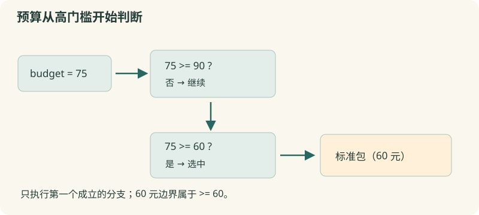

# 04 · 条件判断

按预算和报名状态选择合适的处理方式。

约 30 分钟。前置知识：01–03：输出、变量、表达式与分组规则。

## 要解决的问题

活动有三种材料包：基础包 30 元、标准包 60 元、扩展包 90 元。预算是 75 元时，选择标准包。预算不足 30 元时应提示暂缓。程序需要按清楚的规则作选择，而不是把所有方案都打印出来。

## 学习目标

- 编写 if / elseif / else 分支
- 用数值比较检查预算
- 用 eq / ne 比较文字状态
- 用 && 和 || 组合条件
- 检查相等边界与不满足条件的情况



## 先判断最优先的条件

if {$budget >= 90} { ... } elseif {$budget >= 60} { ... } else { ... } 按顺序检查条件，只执行第一个成立的分支。条件中比较数字使用 <、<=、>、>=、==、!=。花括号保护条件，if 通过表达式求值器读取变量。

## 把完整条件链写在一起

推荐把 } elseif { 和 } else { 写在同一行。Tcl 的换行通常结束命令；单独放在下一行的 else 会被当作新的命令，除非使用续行等写法。代码体由花括号包住，直到选中分支才执行，不会提前输出。

## 文字和数字采用不同意图的比较

状态字符串用 eq（相同）和 ne（不同），例如 $status eq "confirmed"。== 更适合表达数值比较；它会尝试数字语义，因此 "01" == "1" 为真而 "01" eq "1" 为假。文字身份码、编号要保留原样意义。

## 测试边界与组合条件

预算恰好 60 元是否包含在标准包？>= 表示包含，> 则不包含。&& 要求两侧都成立，|| 只要求一侧成立。在花括号表达式里它们短路求值；可以先检查条件再决定是否执行后半部分。对零数量、负预算也应明确规则。

## 示例 1 · 根据预算选择材料包

```tcl
set budget 75
if {$budget >= 90} {
    set plan "扩展包"
} elseif {$budget >= 60} {
    set plan "标准包"
} elseif {$budget >= 30} {
    set plan "基础包"
} else {
    set plan "暂缓采购"
}
puts $plan
```
默认模拟参数（JSON 数组表示）：

```text
argv = []
argc = 0
```

没有额外预置文件。

预期输出：

```text
标准包
```
<details><summary>本地准备与运行（Tcl 8.6+）</summary>

```sh
# 从本仓库根目录执行；文件读写发生在新建的临时练习目录。
workshop_repo="$PWD"
practice_dir="$(mktemp -d)"
cd "$practice_dir"
tclsh "$workshop_repo"/examples/04/01.tcl
# 生成文件留在 practice_dir；执行后回到仓库。
cd "$workshop_repo"
```


</details>
## 示例 2 · 报名状态与人数一起检查

```tcl
set status "confirmed"
set people 2
if {$status eq "confirmed" && $people > 0} {
    puts "可以制作名牌"
} else {
    puts "等待有效报名"
}
```
默认模拟参数（JSON 数组表示）：

```text
argv = []
argc = 0
```

没有额外预置文件。

预期输出：

```text
可以制作名牌
```
<details><summary>本地准备与运行（Tcl 8.6+）</summary>

```sh
# 从本仓库根目录执行；文件读写发生在新建的临时练习目录。
workshop_repo="$PWD"
practice_dir="$(mktemp -d)"
cd "$practice_dir"
tclsh "$workshop_repo"/examples/04/02.tcl
# 生成文件留在 practice_dir；执行后回到仓库。
cd "$workshop_repo"
```


</details>
## 示例 3 · 编号文字与数值意义

```tcl
set a "01"
set b "1"
puts [expr {$a eq $b}]
puts [expr {$a == $b}]
set remaining 0
if {$remaining == 0} {puts "名额已满"}
```
默认模拟参数（JSON 数组表示）：

```text
argv = []
argc = 0
```

没有额外预置文件。

预期输出：

```text
0
1
名额已满
```
<details><summary>本地准备与运行（Tcl 8.6+）</summary>

```sh
# 从本仓库根目录执行；文件读写发生在新建的临时练习目录。
workshop_repo="$PWD"
practice_dir="$(mktemp -d)"
cd "$practice_dir"
tclsh "$workshop_repo"/examples/04/03.tcl
# 生成文件留在 practice_dir；执行后回到仓库。
cd "$workshop_repo"
```


</details>
## 修改一个条件

把例子一 budget 依次改成 29、30、59、60、89、90，记录每个结果。把练习二 value 改成 10 和 30，检查两个端点都得到“正常”。

## 常见错误

- **else 单独写在下一行，提示 invalid command name**：前一行已经结束 if 命令。使用 } else { 连接，elseif 同理。
- **使用 == 比较编号，误把 01 和 1 看作一样**：数值比较会忽略这种表示差别。身份编号、状态、姓名使用 eq / ne。
- **先写 budget >= 30，后写 budget >= 90**：条件链只选第一个成立的分支，高预算提前进入基础包。按优先级从更严格的条件开始，或写互不重叠的区间。

## 练习 1 · 判断是否免运费

subtotal=80、threshold=80；金额达到或超过门槛时 shipping=0，否则 shipping=6。输出“运费：0”。

```tcl
set subtotal 80
set threshold 80
set shipping 6
# 添加条件判断
puts "运费：$shipping"
```
默认模拟参数（JSON 数组表示）：

```text
argv = []
argc = 0
```

没有额外预置文件。

目标输出：

```text
运费：0
```
<details><summary>逐层提示</summary>

恰好达到门槛也免运费，因此比较符号包含等号。

两条分支都设置 shipping，便于修改 subtotal 后重新运行。

</details>
<details><summary>参考答案</summary>

```tcl
set subtotal 80
set threshold 80
if {$subtotal >= $threshold} {
    set shipping 0
} else {
    set shipping 6
}
puts "运费：$shipping"
```
<details><summary>本地准备与运行（Tcl 8.6+）</summary>

```sh
# 从本仓库根目录执行；文件读写发生在新建的临时练习目录。
workshop_repo="$PWD"
practice_dir="$(mktemp -d)"
cd "$practice_dir"
tclsh "$workshop_repo"/solutions/04/01.tcl
# 生成文件留在 practice_dir；执行后回到仓库。
cd "$workshop_repo"
```


</details>


</details>

## 练习 2 · 给测量值分级

value=35；低于 10 为“偏低”，10 到 30（含端点）为“正常”，大于 30 为“偏高”。把结果保存为 label 并输出。

```tcl
set value 35
set label "待判断"
# 按低、正常、高依次判断
puts $label
```
默认模拟参数（JSON 数组表示）：

```text
argv = []
argc = 0
```

没有额外预置文件。

目标输出：

```text
偏高
```
<details><summary>逐层提示</summary>

第一个分支排除了 <10；第二个只需检查 <=30。

else 接收剩余的大于 30 的输入。

</details>
<details><summary>参考答案</summary>

```tcl
set value 35
if {$value < 10} {
    set label "偏低"
} elseif {$value <= 30} {
    set label "正常"
} else {
    set label "偏高"
}
puts $label
```
<details><summary>本地准备与运行（Tcl 8.6+）</summary>

```sh
# 从本仓库根目录执行；文件读写发生在新建的临时练习目录。
workshop_repo="$PWD"
practice_dir="$(mktemp -d)"
cd "$practice_dir"
tclsh "$workshop_repo"/solutions/04/02.tcl
# 生成文件留在 practice_dir；执行后回到仓库。
cd "$workshop_repo"
```


</details>


</details>

## 练习 3 · 有效报名才生成提醒

status="pending"、people=0；只有 status 为 confirmed 且 people>0 时 action 为“制作名牌”，其他情况为“核实报名”。另有 code="01"，仅当它与文字“1”完全相同才把 sameCode 设为 1。输出 action 和 sameCode。

```tcl
set status "pending"
set people 0
set code "01"
set action "待判断"
set sameCode 1
# 判断报名与编号
puts $action
puts $sameCode
```
默认模拟参数（JSON 数组表示）：

```text
argv = []
argc = 0
```

没有额外预置文件。

目标输出：

```text
核实报名
0
```
<details><summary>逐层提示</summary>

报名的两个要求用 && 连接。

编号是文字，eq 保留前导零的区别。

</details>
<details><summary>参考答案</summary>

```tcl
set status "pending"
set people 0
set code "01"
if {$status eq "confirmed" && $people > 0} {
    set action "制作名牌"
} else {
    set action "核实报名"
}
set sameCode [expr {$code eq "1"}]
puts $action
puts $sameCode
```
<details><summary>本地准备与运行（Tcl 8.6+）</summary>

```sh
# 从本仓库根目录执行；文件读写发生在新建的临时练习目录。
workshop_repo="$PWD"
practice_dir="$(mktemp -d)"
cd "$practice_dir"
tclsh "$workshop_repo"/solutions/04/03.tcl
# 生成文件留在 practice_dir；执行后回到仓库。
cd "$workshop_repo"
```


</details>


</details>

## 理解检查

预算恰好达到免运费门槛，应该用哪个条件？

1. $subtotal > $threshold
2. $subtotal >= $threshold
3. $subtotal ne $threshold

<details><summary>答案与解释</summary>

$subtotal >= $threshold。>= 包含相等的边界，> 不包含。

</details>
if 的第一条条件成立后，后面的 elseif 会怎样？

1. 仍全部执行
2. 只执行最后一个
3. 不再执行其他分支

<details><summary>答案与解释</summary>

不再执行其他分支。if 条件链只选择第一个成立的分支；若都不成立才执行 else。

</details>

## 速查

- if {条件} {命令体} elseif {条件} {命令体} else {命令体}
- 数字比较：< <= > >= == !=
- 文字比较：eq ne
- &&：同时成立；||：至少一个成立
- 条件和命令体通常用花括号分组
- 把相等、零值与不满足条件也作为测试输入

下一节：现在能处理一条数据。下一节把同样的规则用于整组测量记录。
