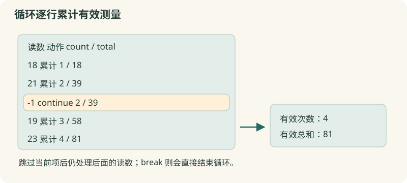

# 05 · 重复处理

逐条查看测量数据，累计结果并跳过不合格记录。

约 35 分钟。前置知识：01–04：变量、expr 与 if；本节先用固定的数值序列。

## 要解决的问题

一组测量值是 18、21、-1、19、23。-1 表示采集失败，不能参加平均值计算。我们逐项查看，跳过 -1，统计 4 次有效测量和总和 81。重复处理就是把同一套规则应用到多条输入。

## 学习目标

- 用 foreach 逐项处理数据
- 在循环中更新计数与累计值
- 区分 foreach、for、while 的适用场景
- 用 continue 跳过本次，用 break 结束循环
- 为 while 和 for 检查终止条件



## 先使用 foreach

foreach value {18 21 -1 19 23} {...} 每次把一个元素放到 value，执行一次循环体。序列写在花括号里；下一节会系统学习列表。循环开始前把 count 和 total 初始化为 0，循环中逐步更新。

## continue 和 break 控制不同范围

continue 停止当前这次循环体的剩余命令，开始下一项，因此可跳过无效读数。break 则立刻结束整个最近一层循环，适合已经找到所需记录或达到终止标记。把它们误换位置会遗漏后面的有效数据。

## for 适合明确次数

for {set i 1} {$i <= 3} {incr i} {...} 依次执行初始化、条件、循环体、更新。Tcl 的 for 接收四个参数；条件应放在花括号里，以便每轮重新读取 i。常见错误是计数不更新或上界多算一次。

## while 适合条件驱动

while {$pending > 0} {...} 每轮开始先检查条件。循环体必须有机会改变条件，否则可能永不结束。工作台会限制运行时间，也可点击停止；这只是保护，正确的脚本仍应设计明确的终止条件。

## 示例 1 · 跳过失败读数

```tcl
set count 0
set total 0
foreach value {18 21 -1 19 23} {
    if {$value < 0} {continue}
    incr count
    set total [expr {$total + $value}]
}
puts "有效次数：$count"
puts "总和：$total"
```
默认模拟参数（JSON 数组表示）：

```text
argv = []
argc = 0
```

没有额外预置文件。

预期输出：

```text
有效次数：4
总和：81
```
<details><summary>本地准备与运行（Tcl 8.6+）</summary>

```sh
# 从本仓库根目录执行；文件读写发生在新建的临时练习目录。
workshop_repo="$PWD"
practice_dir="$(mktemp -d)"
cd "$practice_dir"
tclsh "$workshop_repo"/examples/05/01.tcl
# 生成文件留在 practice_dir；执行后回到仓库。
cd "$workshop_repo"
```


</details>
## 示例 2 · 生成三次测量编号

```tcl
for {set i 1} {$i <= 3} {incr i} {
    puts "测量 $i"
}
```
默认模拟参数（JSON 数组表示）：

```text
argv = []
argc = 0
```

没有额外预置文件。

预期输出：

```text
测量 1
测量 2
测量 3
```
<details><summary>本地准备与运行（Tcl 8.6+）</summary>

```sh
# 从本仓库根目录执行；文件读写发生在新建的临时练习目录。
workshop_repo="$PWD"
practice_dir="$(mktemp -d)"
cd "$practice_dir"
tclsh "$workshop_repo"/examples/05/02.tcl
# 生成文件留在 practice_dir；执行后回到仓库。
cd "$workshop_repo"
```


</details>
## 示例 3 · 清空待处理数量，并找到首个异常

```tcl
set pending 3
while {$pending > 0} {
    puts "剩余：$pending"
    incr pending -1
}
foreach value {12 15 31 18} {
    if {$value > 30} {
        puts "首个异常：$value"
        break
    }
}
```
默认模拟参数（JSON 数组表示）：

```text
argv = []
argc = 0
```

没有额外预置文件。

预期输出：

```text
剩余：3
剩余：2
剩余：1
首个异常：31
```
<details><summary>本地准备与运行（Tcl 8.6+）</summary>

```sh
# 从本仓库根目录执行；文件读写发生在新建的临时练习目录。
workshop_repo="$PWD"
practice_dir="$(mktemp -d)"
cd "$practice_dir"
tclsh "$workshop_repo"/examples/05/03.tcl
# 生成文件留在 practice_dir；执行后回到仓库。
cd "$workshop_repo"
```


</details>
## 修改一个条件

在第一个例子里把 -1 改成 0，预测有效次数与总和，再运行核对。把第三个例子的 break 改为 continue，观察打印了几个异常；然后恢复 break。

## 常见错误

- **把 continue 写成 break，负值后面的正常读数都没统计**：continue 只跳过当前项，break 结束整轮遍历。坏数据需要跳过时用 continue。
- **while 的条件变量从不改变**：在循环体里更新相关变量，例如 incr pending -1；先用很小的输入验证。工作台超时后需要修正代码再运行。
- **for 条件写成 "$i <= 3"，循环停不下来**：双引号会提前把 i 替换为初始值，条件可能变成永远成立的固定表达式。用 {$i <= 3} 每轮读取当前 i。

## 练习 1 · 累计当天步行时间

times={12 8 15 0}；用 foreach 将总分钟数保存为 total，并把记录条数保存为 count。0 分钟仍是一条记录。输出“4 条，共 35 分钟”。

```tcl
set times {12 8 15 0}
set total 0
set count 0
# 逐项累计，别漏掉 0
puts "$count 条，共 $total 分钟"
```
默认模拟参数（JSON 数组表示）：

```text
argv = []
argc = 0
```

没有额外预置文件。

目标输出：

```text
4 条，共 35 分钟
```
<details><summary>逐层提示</summary>

foreach minutes $times 遍历每条记录。

每轮都 incr count，即使 minutes=0。

</details>
<details><summary>参考答案</summary>

```tcl
set times {12 8 15 0}
set total 0
set count 0
foreach minutes $times {
    set total [expr {$total + $minutes}]
    incr count
}
puts "$count 条，共 $total 分钟"
```
<details><summary>本地准备与运行（Tcl 8.6+）</summary>

```sh
# 从本仓库根目录执行；文件读写发生在新建的临时练习目录。
workshop_repo="$PWD"
practice_dir="$(mktemp -d)"
cd "$practice_dir"
tclsh "$workshop_repo"/solutions/05/01.tcl
# 生成文件留在 practice_dir；执行后回到仓库。
cd "$workshop_repo"
```


</details>


</details>

## 练习 2 · 跳过负值，并检验空数据

两组数据分别为 {7 -1 0 9 -2} 和 {}。分别累计非负值，得到 total=16、count=3、emptyTotal=0、emptyCount=0。使用 continue 跳过负值，输出两组统计。

```tcl
set readings {7 -1 0 9 -2}
set emptyReadings {}
set total 0
set count 0
set emptyTotal 0
set emptyCount 0
# 分别遍历两组数据
puts "有效：$count，总和：$total"
puts "空组：$emptyCount，总和：$emptyTotal"
```
默认模拟参数（JSON 数组表示）：

```text
argv = []
argc = 0
```

没有额外预置文件。

目标输出：

```text
有效：3，总和：16
空组：0，总和：0
```
<details><summary>逐层提示</summary>

只有 <0 的项被跳过，0 是有效读数。

空列表的 foreach 不进入循环体，初始化值就是结果。

</details>
<details><summary>参考答案</summary>

```tcl
set readings {7 -1 0 9 -2}
set emptyReadings {}
set total 0
set count 0
foreach value $readings {
    if {$value < 0} {continue}
    set total [expr {$total + $value}]
    incr count
}
set emptyTotal 0
set emptyCount 0
foreach value $emptyReadings {
    if {$value < 0} {continue}
    set emptyTotal [expr {$emptyTotal + $value}]
    incr emptyCount
}
puts "有效：$count，总和：$total"
puts "空组：$emptyCount，总和：$emptyTotal"
```
<details><summary>本地准备与运行（Tcl 8.6+）</summary>

```sh
# 从本仓库根目录执行；文件读写发生在新建的临时练习目录。
workshop_repo="$PWD"
practice_dir="$(mktemp -d)"
cd "$practice_dir"
tclsh "$workshop_repo"/solutions/05/02.tcl
# 生成文件留在 practice_dir；执行后回到仓库。
cd "$workshop_repo"
```


</details>


</details>

## 练习 3 · 找到首个越界读数后停止

readings={9 14 35 41 12}，limit=30。按顺序检查，把检查次数保存为 visited，找到第一条大于 limit 的值保存为 found 并 break；不要继续检查 41。输出“检查 3 条，首个越界：35”。

```tcl
set readings {9 14 35 41 12}
set limit 30
set visited 0
set found "未发现"
# 先计数，再判断并停止
puts "检查 $visited 条，首个越界：$found"
```
默认模拟参数（JSON 数组表示）：

```text
argv = []
argc = 0
```

没有额外预置文件。

目标输出：

```text
检查 3 条，首个越界：35
```
<details><summary>逐层提示</summary>

进入每轮后先 incr visited。

赋值 found 后，break 结束整个循环；continue 会继续查下一条。

</details>
<details><summary>参考答案</summary>

```tcl
set readings {9 14 35 41 12}
set limit 30
set visited 0
set found "未发现"
foreach value $readings {
    incr visited
    if {$value > $limit} {
        set found $value
        break
    }
}
puts "检查 $visited 条，首个越界：$found"
```
<details><summary>本地准备与运行（Tcl 8.6+）</summary>

```sh
# 从本仓库根目录执行；文件读写发生在新建的临时练习目录。
workshop_repo="$PWD"
practice_dir="$(mktemp -d)"
cd "$practice_dir"
tclsh "$workshop_repo"/solutions/05/03.tcl
# 生成文件留在 practice_dir；执行后回到仓库。
cd "$workshop_repo"
```


</details>


</details>

## 理解检查

continue 的作用是什么？

1. 结束整个脚本
2. 跳过当前循环剩余命令，进入下一次
3. 把当前值加一

<details><summary>答案与解释</summary>

跳过当前循环剩余命令，进入下一次。continue 只控制最近一层循环的本次迭代，break 才结束循环。

</details>
foreach value {} {incr count}，若 count 初始为 0，会得到什么？

1. 0
2. 1
3. 错误

<details><summary>答案与解释</summary>

0。空列表没有元素，循环体执行零次，初始化值保留。

</details>

## 速查

- foreach item $items { ... }：按元素遍历
- for {初始化} {条件} {更新} {循环体}
- while {条件} {循环体}
- continue：跳过本次剩余部分
- break：结束最近一层循环
- 循环前初始化累计变量；测试空输入和终止条件

下一节：这些序列是 Tcl 列表。下一节学习安全地构造、查询和整理包含空格的报名名单。
