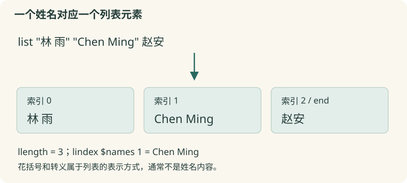

# 06 · 列表

把带空格的姓名当作完整元素，整理并查询报名名单。

约 35 分钟。前置知识：01–05：变量、替换与 foreach。

## 要解决的问题

报名者是“林 雨”“Chen Ming”“赵安”，其中两人的姓名含空格。直接把它们拼成空格分隔文字会丢失姓名边界。列表是一种有明确元素边界的数据值；Tcl 用可解析的文本表示列表，但列表绝不等于随便按空格拆出来的字符串。

## 学习目标

- 用 list 和 lappend 正确构造列表
- 用 llength、lindex、lrange 查询元素
- 理解索引从 0 开始和 end 的用途
- 用 lsearch -exact 查询完整姓名
- 用 lsort 排序，并按实际需求去重



## 使用 list 构造边界

set names [list "林 雨" "Chen Ming" 赵安] 生成三个元素。list 会选择需要的花括号或转义，保证以后仍能解析出原有元素。显示列表时看到的花括号通常是表示形式，不是姓名本身；lindex 返回的是实际元素值。

## 查询位置与区间

llength $names 得到元素数；lindex $names 0 是第一项；lindex $names end 是最后一项。索引从 0 开始。lrange $names 0 1 返回前两项组成的新列表，上界包含在内。lindex 越过列表边界返回空字符串，因此应先检查长度，不能把空值误当成真实姓名。

## 追加与查找

lappend names "许 岚" 把一个新元素追加到名为 names 的变量。注意第一个参数是变量名。lsearch -exact $names "Chen Ming" 查找完全相同的元素，找到时返回索引，没找到时返回 -1。默认 lsearch 使用模式匹配，姓名中的 * 等符号会有特殊意义；完整姓名查询显式用 -exact。

## 排序不一定是数值排序

lsort $names 按默认字符串规则排序；测量值使用 lsort -integer $values 或 -real。lsort -unique 同时排序并删除比较意义上相等的项，不保留原始报名顺序。如果需要“先报名者在前”，遍历原名单，只有没出现过才 lappend 到新名单。

## 示例 1 · 含空格姓名仍是三个元素

```tcl
set names [list "林 雨" "Chen Ming" 赵安]
puts "人数：[llength $names]"
puts "第一位：[lindex $names 0]"
puts "最后一位：[lindex $names end]"
```
默认模拟参数（JSON 数组表示）：

```text
argv = []
argc = 0
```

没有额外预置文件。

预期输出：

```text
人数：3
第一位：林 雨
最后一位：赵安
```
<details><summary>本地准备与运行（Tcl 8.6+）</summary>

```sh
# 从本仓库根目录执行；文件读写发生在新建的临时练习目录。
workshop_repo="$PWD"
practice_dir="$(mktemp -d)"
cd "$practice_dir"
tclsh "$workshop_repo"/examples/06/01.tcl
# 生成文件留在 practice_dir；执行后回到仓库。
cd "$workshop_repo"
```


</details>
## 示例 2 · 追加、区间与精确查找

```tcl
set names [list "林 雨" "Chen Ming" 赵安]
lappend names "许 岚"
puts [join [lrange $names 1 2] " / "]
puts [lsearch -exact $names "许 岚"]
puts [lsearch -exact $names "不存在"]
```
默认模拟参数（JSON 数组表示）：

```text
argv = []
argc = 0
```

没有额外预置文件。

预期输出：

```text
Chen Ming / 赵安
3
-1
```
<details><summary>本地准备与运行（Tcl 8.6+）</summary>

```sh
# 从本仓库根目录执行；文件读写发生在新建的临时练习目录。
workshop_repo="$PWD"
practice_dir="$(mktemp -d)"
cd "$practice_dir"
tclsh "$workshop_repo"/examples/06/02.tcl
# 生成文件留在 practice_dir；执行后回到仓库。
cd "$workshop_repo"
```


</details>
## 示例 3 · 排序与保持原顺序去重

```tcl
set durations {12 3 20 3}
puts [lsort -integer -unique $durations]
set names [list "林 雨" "Chen Ming" "林 雨" 赵安]
set unique {}
foreach name $names {
    if {[lsearch -exact $unique $name] < 0} {
        lappend unique $name
    }
}
puts [join $unique " / "]
```
默认模拟参数（JSON 数组表示）：

```text
argv = []
argc = 0
```

没有额外预置文件。

预期输出：

```text
3 12 20
林 雨 / Chen Ming / 赵安
```
<details><summary>本地准备与运行（Tcl 8.6+）</summary>

```sh
# 从本仓库根目录执行；文件读写发生在新建的临时练习目录。
workshop_repo="$PWD"
practice_dir="$(mktemp -d)"
cd "$practice_dir"
tclsh "$workshop_repo"/examples/06/03.tcl
# 生成文件留在 practice_dir；执行后回到仓库。
cd "$workshop_repo"
```


</details>
## 修改一个条件

把例子三 unique 的实现换成 lsort -unique $names，对比报名顺序。再给名单加入“李 {晨}”，通过 list 构造它，观察输出表示中的转义以及 lindex 得到的实际姓名。

## 常见错误

- **用 set names "林 雨 Chen Ming"，认为只有两个人**：这段文字被当列表解析时有四个元素。使用 [list "林 雨" "Chen Ming"] 保留边界。
- **写 lappend $names "新人"**：第一个参数是要修改的变量名，写 lappend names "新人"。
- **lsort {12 3 20}，期待 3 12 20**：默认字符串比较与数值比较不同。数字用 -integer 或 -real；姓名排序则使用适合语言与需求的规则。

## 练习 1 · 建立完整报名名单

构造 names，按顺序包含“顾 宁”“Ari Lee”“吴涛”，再追加“周 月”。把第二项存到 second，人数存到 count。输出“4 人，第二位：Ari Lee”。

```tcl
set names {}
# 正确构造并追加含空格姓名
set second ""
set count 0
puts "$count 人，第二位：$second"
```
默认模拟参数（JSON 数组表示）：

```text
argv = []
argc = 0
```

没有额外预置文件。

目标输出：

```text
4 人，第二位：Ari Lee
```
<details><summary>逐层提示</summary>

list 的每个参数成为一个元素；含空格时先分组。

lappend 后再求 llength，第二项索引为 1。

</details>
<details><summary>参考答案</summary>

```tcl
set names [list "顾 宁" "Ari Lee" 吴涛]
lappend names "周 月"
set second [lindex $names 1]
set count [llength $names]
puts "$count 人，第二位：$second"
```
<details><summary>本地准备与运行（Tcl 8.6+）</summary>

```sh
# 从本仓库根目录执行；文件读写发生在新建的临时练习目录。
workshop_repo="$PWD"
practice_dir="$(mktemp -d)"
cd "$practice_dir"
tclsh "$workshop_repo"/solutions/06/01.tcl
# 生成文件留在 practice_dir；执行后回到仓库。
cd "$workshop_repo"
```


</details>


</details>

## 练习 2 · 查询带星号的项目名

items 包含“资料包”“A*组”“A1组”。用精确查询把 targetIndex 保存为 A*组 的索引；把不存在的 B组 索引保存为 missingIndex；把从 1 到 end 的子列表保存为 tail。输出两个索引，再用“ / ”连接 tail。

```tcl
set items [list 资料包 "A*组" A1组]
set targetIndex -1
set missingIndex 0
set tail {}
# 查询与截取
puts "$targetIndex $missingIndex"
puts [join $tail " / "]
```
默认模拟参数（JSON 数组表示）：

```text
argv = []
argc = 0
```

没有额外预置文件。

目标输出：

```text
1 -1
A*组 / A1组
```
<details><summary>逐层提示</summary>

用 -exact 让 * 作为普通字符。

lrange 的结束索引可以写 end，并且包含该项。

</details>
<details><summary>参考答案</summary>

```tcl
set items [list 资料包 "A*组" A1组]
set targetIndex [lsearch -exact $items "A*组"]
set missingIndex [lsearch -exact $items B组]
set tail [lrange $items 1 end]
puts "$targetIndex $missingIndex"
puts [join $tail " / "]
```
<details><summary>本地准备与运行（Tcl 8.6+）</summary>

```sh
# 从本仓库根目录执行；文件读写发生在新建的临时练习目录。
workshop_repo="$PWD"
practice_dir="$(mktemp -d)"
cd "$practice_dir"
tclsh "$workshop_repo"/solutions/06/02.tcl
# 生成文件留在 practice_dir；执行后回到仓库。
cd "$workshop_repo"
```


</details>


</details>

## 练习 3 · 报名去重，保留先后顺序

原名单 names 为“周 月”“顾 宁”“周 月”“Ari Lee”“顾 宁”。用 foreach、lsearch -exact 和 lappend 生成 unique，保留各姓名第一次出现的顺序。再从空输入生成 emptyUnique。输出人数和名单、空名单人数。

```tcl
set names [list "周 月" "顾 宁" "周 月" "Ari Lee" "顾 宁"]
set unique {}
set emptyNames {}
set emptyUnique {}
# 对每个姓名，仅在未出现时追加
puts "[llength $unique] 人：[join $unique { / }]"
puts "空名单：[llength $emptyUnique] 人"
```
默认模拟参数（JSON 数组表示）：

```text
argv = []
argc = 0
```

没有额外预置文件。

目标输出：

```text
3 人：周 月 / 顾 宁 / Ari Lee
空名单：0 人
```
<details><summary>逐层提示</summary>

不要排序，否则会改变首次报名的顺序。

lsearch -exact 返回 -1 时再追加；空输入循环执行零次。

</details>
<details><summary>参考答案</summary>

```tcl
set names [list "周 月" "顾 宁" "周 月" "Ari Lee" "顾 宁"]
set unique {}
foreach name $names {
    if {[lsearch -exact $unique $name] == -1} {
        lappend unique $name
    }
}
set emptyNames {}
set emptyUnique {}
foreach name $emptyNames {
    if {[lsearch -exact $emptyUnique $name] == -1} {
        lappend emptyUnique $name
    }
}
puts "[llength $unique] 人：[join $unique { / }]"
puts "空名单：[llength $emptyUnique] 人"
```
<details><summary>本地准备与运行（Tcl 8.6+）</summary>

```sh
# 从本仓库根目录执行；文件读写发生在新建的临时练习目录。
workshop_repo="$PWD"
practice_dir="$(mktemp -d)"
cd "$practice_dir"
tclsh "$workshop_repo"/solutions/06/03.tcl
# 生成文件留在 practice_dir；执行后回到仓库。
cd "$workshop_repo"
```


</details>


</details>

## 理解检查

set names [list "林 雨" "Chen Ming"] 的 llength 是多少？

1. 2
2. 4
3. 取决于输出中的花括号数

<details><summary>答案与解释</summary>

2。list 用参数边界创建元素，每个含空格的姓名都是一个完整元素。

</details>
lsearch -exact 找不到时返回什么？

1. 0
2. 空字符串
3. -1

<details><summary>答案与解释</summary>

-1。0 表示第一项匹配，-1 明确表示没找到。

</details>
lrange $items 0 1 包含哪些元素？

1. 只有索引 0
2. 索引 0 和 1
3. 索引 1 和 2

<details><summary>答案与解释</summary>

索引 0 和 1。lrange 的两个端点都包含，列表索引从 0 开始。

</details>

## 速查

- list $a $b：安全构造列表
- llength $items：元素数；lindex $items 0 / end：取元素
- lappend items $value：追加完整元素
- lrange $items first last：包含两个端点的区间
- lsearch -exact $items $value：索引或 -1
- lsort -integer / -real：数值排序；-unique：排序后去重

下一节：完整姓名已成为列表元素。下一节处理每个元素内部的多余空白与大小写。
