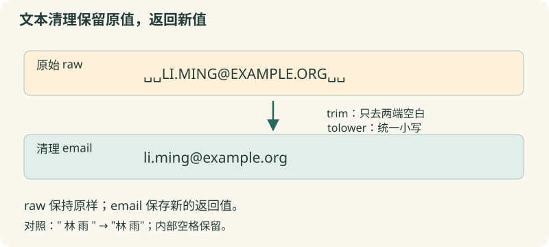

# 07 · 字符串处理

清理联系人信息，让大小写和空白遵守同一种格式。

约 35 分钟。前置知识：01–06：变量、条件、循环与列表。

## 要解决的问题

联系人记录写成“  LI.MING@EXAMPLE.ORG  ”，分组说明写成“alpha;beta;gamma”。我们清理邮件地址两端空白并转为小写，再把组别整理成可读的一行。原始文字是数据，清理应保持中间有意义的内容。

## 学习目标

- 用 string trim 清除两端空白
- 用 tolower / toupper 统一大小写
- 用 string length 和 match 检查文本
- 用 split 与 join 转换分隔形式
- 区分字符、列表元素以及结构化格式



## 先清理边界，不误删内部

string trim $raw 去掉两端的空白；不会删除姓名内部的空格。trim 的第二个可选参数是一组要剔除的字符。string tolower 与 toupper 转换大小写；它们返回新值，要用 set 保存结果，原变量不会自动改变。

## 长度和简单模式

string length 返回字符串长度，不是列表人数，也不是文件字节数。本节使用常见中文和英文字母，避免跨 Tcl 版本的补充 Unicode 字符差异。string match {*@example.org} $email 使用通配模式：* 表示任意长度，? 表示单个字符。它不是正规的邮件地址校验。

## split 是按字符集分隔

split $text ";" 以分号分割，得到列表；join $items " / " 将元素用指定分隔文字连接。split 的第二个参数是分隔字符集合，不是完整的分隔字符串：split $text ",;" 遇到逗号或分号都会切开。连续分隔符会产生空元素，需明确是否保留。

## 文本格式需要明确约定

如果姓名中本来就含逗号，简单 split 逗号会把姓名切坏；完整 CSV 还有引号、转义等规则，本节不假装实现 CSV 解析器。Tcl 列表应由 list 构造，不能用 split 的空格规则代替。清理规则、原始值和结果都应该可查看。

## 示例 1 · 规范邮箱文字

```tcl
set raw "  LI.MING@EXAMPLE.ORG  "
set email [string tolower [string trim $raw]]
puts "原始：<$raw>"
puts "清理：<$email>"
puts [string match {*@example.org} $email]
```
默认模拟参数（JSON 数组表示）：

```text
argv = []
argc = 0
```

没有额外预置文件。

预期输出：

```text
原始：<  LI.MING@EXAMPLE.ORG  >
清理：<li.ming@example.org>
1
```
<details><summary>本地准备与运行（Tcl 8.6+）</summary>

```sh
# 从本仓库根目录执行；文件读写发生在新建的临时练习目录。
workshop_repo="$PWD"
practice_dir="$(mktemp -d)"
cd "$practice_dir"
tclsh "$workshop_repo"/examples/07/01.tcl
# 生成文件留在 practice_dir；执行后回到仓库。
cd "$workshop_repo"
```


</details>
## 示例 2 · 分组说明变成可读列表

```tcl
set raw "alpha;beta;gamma"
set groups [split $raw ";"]
puts "组数：[llength $groups]"
puts [join $groups " / "]
puts [string toupper [lindex $groups 0]]
```
默认模拟参数（JSON 数组表示）：

```text
argv = []
argc = 0
```

没有额外预置文件。

预期输出：

```text
组数：3
alpha / beta / gamma
ALPHA
```
<details><summary>本地准备与运行（Tcl 8.6+）</summary>

```sh
# 从本仓库根目录执行；文件读写发生在新建的临时练习目录。
workshop_repo="$PWD"
practice_dir="$(mktemp -d)"
cd "$practice_dir"
tclsh "$workshop_repo"/examples/07/02.tcl
# 生成文件留在 practice_dir；执行后回到仓库。
cd "$workshop_repo"
```


</details>
## 示例 3 · 连续分隔符与空元素

```tcl
set raw {甲;;乙,丙}
set items [split $raw ",;"]
puts "分段数：[llength $items]"
puts [join $items " | "]
puts "第二段长度：[string length [lindex $items 1]]"
puts [string trim "  林 雨  "]
```
默认模拟参数（JSON 数组表示）：

```text
argv = []
argc = 0
```

没有额外预置文件。

预期输出：

```text
分段数：4
甲 |  | 乙 | 丙
第二段长度：0
林 雨
```
<details><summary>本地准备与运行（Tcl 8.6+）</summary>

```sh
# 从本仓库根目录执行；文件读写发生在新建的临时练习目录。
workshop_repo="$PWD"
practice_dir="$(mktemp -d)"
cd "$practice_dir"
tclsh "$workshop_repo"/examples/07/03.tcl
# 生成文件留在 practice_dir；执行后回到仓库。
cd "$workshop_repo"
```


</details>
## 修改一个条件

在例子一中把邮箱改成“ A@OTHER.ORG ”，观察清理值和匹配标记；再尝试只有空格的 raw。把例子三的分隔集合由 ",;" 改为 ";"，观察逗号是否还被切开。

## 常见错误

- **string trim $raw 执行后认为 raw 自动改变**：trim 返回新值，原变量不变；使用 set cleaned [string trim $raw]。
- **以为 split $text "::" 只会在两个冒号连在一起时切分**：分隔参数是字符集合，重复的冒号没有特殊意义。需要完整分隔字符串时选用明确的解析方法，不要误用 split。
- **先按空格 split 联系人姓名**：这会破坏“林 雨”这样的完整姓名。已有列表用 foreach 遍历元素，元素内部用字符串命令处理。

## 练习 1 · 清理一条邮箱

raw="  USER.ONE@EXAMPLE.ORG  "。去两端空白并转小写保存为 email；把字符串长度存为 size，用 string match 检查后缀保存为 matched。输出邮箱，再输出长度与匹配标记。

```tcl
set raw "  USER.ONE@EXAMPLE.ORG  "
set email $raw
set size 0
set matched 0
# 清理并检查
puts $email
puts "$size $matched"
```
默认模拟参数（JSON 数组表示）：

```text
argv = []
argc = 0
```

没有额外预置文件。

目标输出：

```text
user.one@example.org
20 1
```
<details><summary>逐层提示</summary>

内层 trim 的结果可以交给外层 tolower。

match 返回 1 或 0；这只是域名后缀检查。

</details>
<details><summary>参考答案</summary>

```tcl
set raw "  USER.ONE@EXAMPLE.ORG  "
set email [string tolower [string trim $raw]]
set size [string length $email]
set matched [string match {*@example.org} $email]
puts $email
puts "$size $matched"
```
<details><summary>本地准备与运行（Tcl 8.6+）</summary>

```sh
# 从本仓库根目录执行；文件读写发生在新建的临时练习目录。
workshop_repo="$PWD"
practice_dir="$(mktemp -d)"
cd "$practice_dir"
tclsh "$workshop_repo"/solutions/07/01.tcl
# 生成文件留在 practice_dir；执行后回到仓库。
cd "$workshop_repo"
```


</details>


</details>

## 练习 2 · 清理含空组的标签

raw="  red ; ; BLUE; green  "。以分号 split，再逐段 trim、tolower，删除清理后为空的段，生成 labels={red blue green}；display 用“ / ”连接。另对 rawEmpty=" ;  ; " 做相同处理，emptyLabels 应为空。输出 display 和空组数。

```tcl
set raw "  red ; ; BLUE; green  "
set rawEmpty " ;  ; "
set labels {}
set emptyLabels {}
# 切分后逐段清理，空段不要追加
set display [join $labels " / "]
puts $display
puts "空组：[llength $emptyLabels]"
```
默认模拟参数（JSON 数组表示）：

```text
argv = []
argc = 0
```

没有额外预置文件。

目标输出：

```text
red / blue / green
空组：0
```
<details><summary>逐层提示</summary>

每段先 trim，再判断是否为空。

删除空段后 lappend 完整标签；对全部为空的输入也应用同一规则。

</details>
<details><summary>参考答案</summary>

```tcl
set raw "  red ; ; BLUE; green  "
set rawEmpty " ;  ; "
set labels {}
foreach part [split $raw ";"] {
    set cleaned [string tolower [string trim $part]]
    if {$cleaned eq ""} {continue}
    lappend labels $cleaned
}
set emptyLabels {}
foreach part [split $rawEmpty ";"] {
    set cleaned [string tolower [string trim $part]]
    if {$cleaned eq ""} {continue}
    lappend emptyLabels $cleaned
}
set display [join $labels " / "]
puts $display
puts "空组：[llength $emptyLabels]"
```
<details><summary>本地准备与运行（Tcl 8.6+）</summary>

```sh
# 从本仓库根目录执行；文件读写发生在新建的临时练习目录。
workshop_repo="$PWD"
practice_dir="$(mktemp -d)"
cd "$practice_dir"
tclsh "$workshop_repo"/solutions/07/02.tcl
# 生成文件留在 practice_dir；执行后回到仓库。
cd "$workshop_repo"
```


</details>


</details>

## 练习 3 · 筛选指定组织的地址

contacts 包含“ A@EXAMPLE.ORG ”、“B@other.org”、“   ”、“c@example.org”。逐条 trim、tolower，只收集非空且匹配 *@example.org 的地址到 selected，保留顺序。输出两条地址和数量。这里的规则仅筛选后缀，不代表完整邮箱验证。

```tcl
set contacts [list " A@EXAMPLE.ORG " "B@other.org" "   " "c@example.org"]
 set selected {}
 # 清理后筛选
 puts [join $selected "\n"]
 puts "数量：[llength $selected]"
```
默认模拟参数（JSON 数组表示）：

```text
argv = []
argc = 0
```

没有额外预置文件。

目标输出：

```text
a@example.org
c@example.org
数量：2
```
<details><summary>逐层提示</summary>

先清理，否则尾部空格会使后缀匹配失败。

string match 的模式用花括号分组，星号表示任意前缀。

</details>
<details><summary>参考答案</summary>

```tcl
set contacts [list " A@EXAMPLE.ORG " "B@other.org" "   " "c@example.org"]
 set selected {}
 foreach raw $contacts {
     set email [string tolower [string trim $raw]]
     if {$email eq ""} {continue}
     if {[string match {*@example.org} $email]} {
         lappend selected $email
     }
 }
 puts [join $selected "\n"]
 puts "数量：[llength $selected]"
```
<details><summary>本地准备与运行（Tcl 8.6+）</summary>

```sh
# 从本仓库根目录执行；文件读写发生在新建的临时练习目录。
workshop_repo="$PWD"
practice_dir="$(mktemp -d)"
cd "$practice_dir"
tclsh "$workshop_repo"/solutions/07/03.tcl
# 生成文件留在 practice_dir；执行后回到仓库。
cd "$workshop_repo"
```


</details>


</details>

## 理解检查

string trim "  林 雨  " 返回什么？

1. 林雨
2. 林 雨
3. 原样返回所有空格

<details><summary>答案与解释</summary>

林 雨。trim 默认只删两端空白，不删除中间的姓名空格。

</details>
split {a,,b} "," 得到几个元素？

1. 2
2. 3
3. 4

<details><summary>答案与解释</summary>

3。连续分隔符之间有一个空元素，结果是 a、空字符串、b。

</details>

## 速查

- string trim $text：去两端空白
- string tolower / toupper $text：大小写转换
- string length $text：字符串长度
- string match {模式} $text：通配匹配，返回 1/0
- split $text {分隔字符集}：文字转列表
- join $items "分隔文字"：列表转文字

下一节：清理后记录常常还有姓名、设备号、温度等字段。下一节用字典和数组给每个字段取名字。
