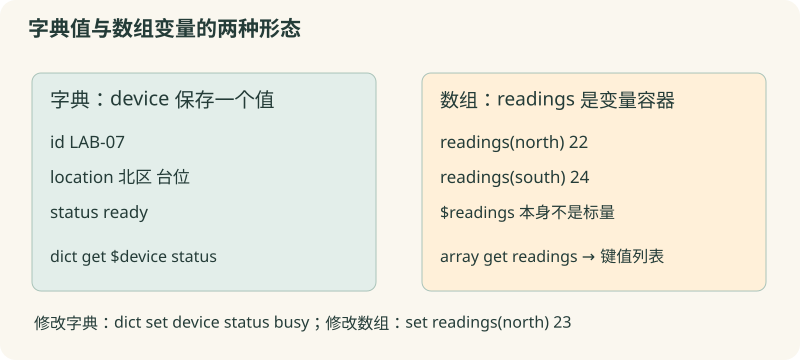

# 08 · 字典与数组

用字段名读取和更新设备记录，明确两种数据形态。

约 35 分钟。前置知识：01–07：变量、列表和文本清理。

## 要解决的问题

一台测量设备的记录包含 id=LAB-07、location=北区 台位、status=ready、runs=2。只用四项列表时，必须记住每个位置的含义。字典让我们按字段名读取，数组则把多个键值元素组织到同一个变量名下；两者形似，却不能混用命令。

## 学习目标

- 用 dict create/get/set/exists 管理记录
- 在访问前检查可选字段
- 区分字典值与 Tcl 数组变量
- 用 array 的基本访问和枚举方式
- 避免依赖字典或数组的输出顺序



## 字典是一个可传递的值

set device [dict create id LAB-07 location "北区 台位" status ready runs 2] 生成键值映射。dict get $device location 读取某字段，dict exists $device owner 检查是否存在。字典可以保存在普通变量、作为过程参数传递，或作为另一个字典的值。

## 读值与改变量的参数不同

dict get 接收字典值，因此用 $device；dict set 接收要修改的变量名，因此写 dict set device status busy。更新后 device 中保存新的字典值。如果把 $device 传给 dict set，它会把整个值当变量名，不是你要修改的记录。

## 数组是变量容器

array set readings {north 21 south 24} 建立数组变量；$readings(north) 读取元素，set readings(north) 22 修改元素。数组自身不是一个普通标量值，所以不能用 $readings 取得整个数组；用 array get readings 得到键值列表。dict create 的值与 array 变量是两种不同形态。

## 枚举前考虑输出顺序

array names 返回的顺序不保证；需要稳定输出时 foreach key [lsort [array names readings]]。array exists 检查变量是否为数组，info exists readings(west) 检查单个元素。字典也应按业务指定的字段或排序后的键展示，别依赖内存内部顺序。

## 示例 1 · 创建和更新设备记录

```tcl
set device [dict create id LAB-07 location "北区 台位" status ready runs 2]
puts "位置：[dict get $device location]"
dict set device status busy
dict set device runs [expr {[dict get $device runs] + 1}]
puts "状态：[dict get $device status]，次数：[dict get $device runs]"
```
默认模拟参数（JSON 数组表示）：

```text
argv = []
argc = 0
```

没有额外预置文件。

预期输出：

```text
位置：北区 台位
状态：busy，次数：3
```
<details><summary>本地准备与运行（Tcl 8.6+）</summary>

```sh
# 从本仓库根目录执行；文件读写发生在新建的临时练习目录。
workshop_repo="$PWD"
practice_dir="$(mktemp -d)"
cd "$practice_dir"
tclsh "$workshop_repo"/examples/08/01.tcl
# 生成文件留在 practice_dir；执行后回到仓库。
cd "$workshop_repo"
```


</details>
## 示例 2 · 可选字段缺失时提供说明

```tcl
set sample [dict create id S-12 temperature 23.5]
if {[dict exists $sample owner]} {
    puts "负责人：[dict get $sample owner]"
} else {
    puts "负责人：未登记"
}
dict set sample owner "顾 宁"
puts "负责人：[dict get $sample owner]"
```
默认模拟参数（JSON 数组表示）：

```text
argv = []
argc = 0
```

没有额外预置文件。

预期输出：

```text
负责人：未登记
负责人：顾 宁
```
<details><summary>本地准备与运行（Tcl 8.6+）</summary>

```sh
# 从本仓库根目录执行；文件读写发生在新建的临时练习目录。
workshop_repo="$PWD"
practice_dir="$(mktemp -d)"
cd "$practice_dir"
tclsh "$workshop_repo"/examples/08/02.tcl
# 生成文件留在 practice_dir；执行后回到仓库。
cd "$workshop_repo"
```


</details>
## 示例 3 · 数组按键排序展示

```tcl
array set readings {north 21 south 24}
set readings(north) 22
foreach key [lsort [array names readings]] {
    puts "$key：$readings($key)"
}
puts "西区存在：[info exists readings(west)]"
puts "它是数组：[array exists readings]"
```
默认模拟参数（JSON 数组表示）：

```text
argv = []
argc = 0
```

没有额外预置文件。

预期输出：

```text
north：22
south：24
西区存在：0
它是数组：1
```
<details><summary>本地准备与运行（Tcl 8.6+）</summary>

```sh
# 从本仓库根目录执行；文件读写发生在新建的临时练习目录。
workshop_repo="$PWD"
practice_dir="$(mktemp -d)"
cd "$practice_dir"
tclsh "$workshop_repo"/examples/08/03.tcl
# 生成文件留在 practice_dir；执行后回到仓库。
cd "$workshop_repo"
```


</details>
## 修改一个条件

给设备例子添加 owner "林 雨" 字段，再删去你自行加的字段并测试缺失分支。把数组例子的新键放在不同插入位置，确认按 lsort 输出仍保持顺序。思考传递整条记录时，字典值为何比数组变量容易使用。

## 常见错误

- **dict get device status，提示不是合法字典**：dict get 读取值，应写 dict get $device status；与 dict set device status busy 的变量名参数区别开。
- **puts $readings，报 variable is array**：数组容器不能作为普通标量读取。读单项 $readings(north)，或用 array get readings 导出键值列表。
- **可选字段不存在时直接 dict get**：先用 dict exists 判断；缺失、空字符串、0 是三种不同情况，不要混淆。

## 练习 1 · 更新一条实验记录

sample 包含 id=S-08、status=waiting、count=4。将 status 改成 done、count 加 1，保留 id。把 status 和 count 的读取结果组成“done / 5”输出。

```tcl
set sample [dict create id S-08 status waiting count 4]
# 更新两个字段，不覆盖整条记录
puts "[dict get $sample status] / [dict get $sample count]"
```
默认模拟参数（JSON 数组表示）：

```text
argv = []
argc = 0
```

没有额外预置文件。

目标输出：

```text
done / 5
```
<details><summary>逐层提示</summary>

dict set 的第一个参数是 sample，不是 $sample。

先 dict get count，计算增量，再 dict set。

</details>
<details><summary>参考答案</summary>

```tcl
set sample [dict create id S-08 status waiting count 4]
dict set sample status done
dict set sample count [expr {[dict get $sample count] + 1}]
puts "[dict get $sample status] / [dict get $sample count]"
```
<details><summary>本地准备与运行（Tcl 8.6+）</summary>

```sh
# 从本仓库根目录执行；文件读写发生在新建的临时练习目录。
workshop_repo="$PWD"
practice_dir="$(mktemp -d)"
cd "$practice_dir"
tclsh "$workshop_repo"/solutions/08/01.tcl
# 生成文件留在 practice_dir；执行后回到仓库。
cd "$workshop_repo"
```


</details>


</details>

## 练习 2 · 区分缺失字段与空字段

first={id A}，second={id B owner {}}，third={id C owner {周 月}}。按三种情况生成 notices 列表：“未登记”“已留空”“周 月”。缺字段用 dict exists 检查，空字段是存在但值为空。输出三个说明，各占一行。

```tcl
set first [dict create id A]
 set second [dict create id B owner ""]
 set third [dict create id C owner "周 月"]
 set notices {}
 # 遍历三条记录，区分字段不存在和字段值为空
 puts [join $notices "\n"]
```
默认模拟参数（JSON 数组表示）：

```text
argv = []
argc = 0
```

没有额外预置文件。

目标输出：

```text
未登记
已留空
周 月
```
<details><summary>逐层提示</summary>

必须先确认字段存在，才调用 dict get。

存在且值为空应进入第二种情况，而不是归入缺失。

</details>
<details><summary>参考答案</summary>

```tcl
set first [dict create id A]
 set second [dict create id B owner ""]
 set third [dict create id C owner "周 月"]
 set notices {}
 foreach record [list $first $second $third] {
     if {![dict exists $record owner]} {
         lappend notices "未登记"
     } elseif {[dict get $record owner] eq ""} {
         lappend notices "已留空"
     } else {
         lappend notices [dict get $record owner]
     }
 }
 puts [join $notices "\n"]
```
<details><summary>本地准备与运行（Tcl 8.6+）</summary>

```sh
# 从本仓库根目录执行；文件读写发生在新建的临时练习目录。
workshop_repo="$PWD"
practice_dir="$(mktemp -d)"
cd "$practice_dir"
tclsh "$workshop_repo"/solutions/08/02.tcl
# 生成文件留在 practice_dir；执行后回到仓库。
cd "$workshop_repo"
```


</details>


</details>

## 练习 3 · 整理数组并转成字典值

使用数组 temperatures 保存 roomA=22、roomB=25，并把 roomA 改成 23。按键排序展示；再使用 array get 的键值列表构造 snapshot 字典，并把 roomB 改成 26。数组 roomB 仍应是 25。输出数组两行和快照 roomB。

```tcl
array set temperatures {roomA 22 roomB 25}
# 更新数组并打印
set snapshot [dict create]
# 将数组转为字典快照并更新快照
puts "快照 roomB：[dict exists $snapshot roomB]"
```
默认模拟参数（JSON 数组表示）：

```text
argv = []
argc = 0
```

没有额外预置文件。

目标输出：

```text
roomA：23
roomB：25
快照 roomB：26
```
<details><summary>逐层提示</summary>

array get 返回键值配对列表，可作为字典值使用。

snapshot 是普通值的副本，dict set 不会自动改原数组。

</details>
<details><summary>参考答案</summary>

```tcl
array set temperatures {roomA 22 roomB 25}
set temperatures(roomA) 23
foreach key [lsort [array names temperatures]] {
    puts "$key：$temperatures($key)"
}
set snapshot [array get temperatures]
dict set snapshot roomB 26
puts "快照 roomB：[dict get $snapshot roomB]"
```
<details><summary>本地准备与运行（Tcl 8.6+）</summary>

```sh
# 从本仓库根目录执行；文件读写发生在新建的临时练习目录。
workshop_repo="$PWD"
practice_dir="$(mktemp -d)"
cd "$practice_dir"
tclsh "$workshop_repo"/solutions/08/03.tcl
# 生成文件留在 practice_dir；执行后回到仓库。
cd "$workshop_repo"
```


</details>


</details>

## 理解检查

哪条命令修改变量 device 里的字典？

1. dict set $device status busy
2. dict set device status busy
3. dict get device status busy

<details><summary>答案与解释</summary>

dict set device status busy。dict set 接收要修改的变量名字，dict get 则接收字典的值。

</details>
array 与 dict 最准确的区别是？

1. 它们是同一种值，所有命令可交换
2. dict 是值，array 是包含元素的变量容器
3. dict 不能包含空格

<details><summary>答案与解释</summary>

dict 是值，array 是包含元素的变量容器。字典可以作为普通数据值保存或传递；数组变量需要 array 命令或元素访问语法。

</details>

## 速查

- dict create key value ...：构造字典值
- dict get $record key：读取字段
- dict set record key value：修改字典变量
- dict exists $record key：字段是否存在
- array set a {key value ...}：建立数组变量
- $a(key) / set a(key) value：读取 / 修改元素
- array get a：导出键值列表；lsort [array names a]：稳定枚举

下一节：记录字段有时还藏在一行日志文字里。下一节使用简单正则把它们提取出来。
