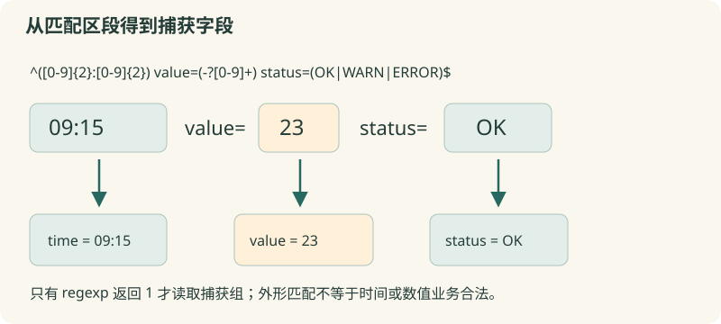

# 09 · 正则表达式入门

从清楚约定的日志格式中提取时间、数值和状态。

约 40 分钟。前置知识：01–08：字符串、条件、循环、列表与字典。

## 要解决的问题

教学日志一行写作“09:15 value=23 status=OK”。我们需要时间、整数数值和状态三个字段，遇到“broken row”要标记为无法解析。正则表达式是描述文本模式的规则；从易懂的字段开始，不需要背一整串符号。

## 学习目标

- 用 regexp 判断文本是否匹配
- 用小型捕获组提取字段
- 用花括号保护正则模式
- 区分完整匹配与部分匹配
- 判断何时 string match 或 split 已经足够



## 先判断，再提取

regexp {ERROR} $line 检查是否出现 ERROR，返回 1 或 0；它默认可匹配文本中的一段。需要整行符合格式时加 ^ 和 $。如果只判断后缀或固定文字，string match 与 string first 往往更清楚；简单的固定分隔字段也可用 split。

## 把模式拆成小块

[0-9] 表示一个十进制数字，+ 表示前面部分重复一次或更多次；([0-9]+) 在匹配数字时保存捕获组。时间的 ([0-9]{2}:[0-9]{2}) 表示两位数字、冒号、两位数字。本节模式只验证外形，不保证 29:99 是真实时刻。复杂格式应增加专门的有效性检查。

## 按位置接收捕获结果

regexp {^(... )$} $line whole time value status 的变量顺序依次接收整段匹配与每个括号组。本节完整模式为 ^([0-9]{2}:[0-9]{2}) value=(-?[0-9]+) status=(OK|WARN|ERROR)$。-? 表示负号可有可无，竖线表示三个候选状态之一。只有返回 1 时才使用捕获变量；不匹配时不要读取上一次的残留结果。

## 保护模式，控制复杂度

正则里的方括号是字符集合；如果模式放进双引号，Tcl 会先把 [0-9] 当命令替换，通常报错。用花括号把模式作为一个词传入 regexp。regexp -- $pattern $text 用 -- 结束选项，适合模式可能以 - 开头的情况。匹配成功只是第一步，是否允许负读数、是否是真实时间还要按业务规则检查。

## 示例 1 · 不用正则的对照：固定字段

```tcl
set line {09:15 23 OK}
set fields [split $line " "]
puts "时间：[lindex $fields 0]"
puts "值：[lindex $fields 1]"
puts "状态：[lindex $fields 2]"
puts [string match {ERROR:*} {ERROR: input missing}]
```
默认模拟参数（JSON 数组表示）：

```text
argv = []
argc = 0
```

没有额外预置文件。

预期输出：

```text
时间：09:15
值：23
状态：OK
1
```
<details><summary>本地准备与运行（Tcl 8.6+）</summary>

```sh
# 从本仓库根目录执行；文件读写发生在新建的临时练习目录。
workshop_repo="$PWD"
practice_dir="$(mktemp -d)"
cd "$practice_dir"
tclsh "$workshop_repo"/examples/09/01.tcl
# 生成文件留在 practice_dir；执行后回到仓库。
cd "$workshop_repo"
```


</details>
## 示例 2 · 三个小捕获组

```tcl
set line {09:15 value=23 status=OK}
set pattern {^([0-9]{2}:[0-9]{2}) value=(-?[0-9]+) status=(OK|WARN|ERROR)$}
if {[regexp -- $pattern $line whole time value status]} {
    puts "时间：$time"
    puts "值：$value"
    puts "状态：$status"
}
```
默认模拟参数（JSON 数组表示）：

```text
argv = []
argc = 0
```

没有额外预置文件。

预期输出：

```text
时间：09:15
值：23
状态：OK
```
<details><summary>本地准备与运行（Tcl 8.6+）</summary>

```sh
# 从本仓库根目录执行；文件读写发生在新建的临时练习目录。
workshop_repo="$PWD"
practice_dir="$(mktemp -d)"
cd "$practice_dir"
tclsh "$workshop_repo"/examples/09/02.tcl
# 生成文件留在 practice_dir；执行后回到仓库。
cd "$workshop_repo"
```


</details>
## 示例 3 · 对不符合约定的行明确处理

```tcl
set pattern {^([0-9]{2}:[0-9]{2}) value=(-?[0-9]+) status=(OK|WARN|ERROR)$}
foreach line [list {10:02 value=-3 status=WARN} {broken row} {10:03 value=7 status=UNKNOWN}] {
    if {[regexp -- $pattern $line whole time value status]} {
        puts "$time / $value / $status"
    } else {
        puts "无法解析：$line"
    }
}
```
默认模拟参数（JSON 数组表示）：

```text
argv = []
argc = 0
```

没有额外预置文件。

预期输出：

```text
10:02 / -3 / WARN
无法解析：broken row
无法解析：10:03 value=7 status=UNKNOWN
```
<details><summary>本地准备与运行（Tcl 8.6+）</summary>

```sh
# 从本仓库根目录执行；文件读写发生在新建的临时练习目录。
workshop_repo="$PWD"
practice_dir="$(mktemp -d)"
cd "$practice_dir"
tclsh "$workshop_repo"/examples/09/03.tcl
# 生成文件留在 practice_dir；执行后回到仓库。
cd "$workshop_repo"
```


</details>
## 修改一个条件

把第二个例子 value=23 改为 value=0、value=-7、value=2.5 和 value=abc，分别预测是否匹配。当前模式只允许整数，小数不应偷偷通过。再改成 29:99，确认模式匹配不等于时间合法。

## 常见错误

- **把模式写成 "[0-9]+"，出现 invalid command name**：Tcl 在正则之前先处理双引号里的方括号。改用 {[0-9]+} 保护正则语法。
- **没有 ^ 和 $，把 temp=12abc 也当成完整记录**：默认可匹配局部子串。完整字段或整行验证加锚点，再考虑额外的业务合法性检查。
- **regexp 返回 0 后仍使用 value**：它可能仍是上一行捕获的值。仅在匹配成功分支处理捕获结果，失败分支记录原行或错误。

## 练习 1 · 提取整数温度

line="temp=24"。用整行匹配模式 temp= 后接一位或多位数字，把整数文字捕获到 value，把 regexp 返回值存为 matched。输出“匹配：1，温度：24”。

```tcl
set line {temp=24}
set matched 0
set value ""
# 用花括号保护模式，保存捕获组
puts "匹配：$matched，温度：$value"
```
默认模拟参数（JSON 数组表示）：

```text
argv = []
argc = 0
```

没有额外预置文件。

目标输出：

```text
匹配：1，温度：24
```
<details><summary>逐层提示</summary>

整行匹配用 ^ 和 $，数字组用 ([0-9]+)。

whole 接收整段匹配，value 接收第一个括号组。

</details>
<details><summary>参考答案</summary>

```tcl
set line {temp=24}
set value ""
set matched [regexp {^temp=([0-9]+)$} $line whole value]
puts "匹配：$matched，温度：$value"
```
<details><summary>本地准备与运行（Tcl 8.6+）</summary>

```sh
# 从本仓库根目录执行；文件读写发生在新建的临时练习目录。
workshop_repo="$PWD"
practice_dir="$(mktemp -d)"
cd "$practice_dir"
tclsh "$workshop_repo"/solutions/09/01.tcl
# 生成文件留在 practice_dir；执行后回到仓库。
cd "$workshop_repo"
```


</details>


</details>

## 练习 2 · 验证三种输入，保留负数和零

samples 包含 temp=-8、temp=0、temp=bad。完整匹配允许可选负号，生成 values={-8 0}，把无法解析的原行保存到 rejected。输出值列表和拒绝列表。

```tcl
set samples [list {temp=-8} {temp=0} {temp=bad}]
set values {}
set rejected {}
# 每行成功才读取捕获值
puts "有效：[join $values {, }]"
puts "拒绝：[join $rejected {, }]"
```
默认模拟参数（JSON 数组表示）：

```text
argv = []
argc = 0
```

没有额外预置文件。

目标输出：

```text
有效：-8, 0
拒绝：temp=bad
```
<details><summary>逐层提示</summary>

把 -? 放在数字组内部，捕获值才能包括负号。

regexp 失败时进入 else，不把上一次 value 加入结果。

</details>
<details><summary>参考答案</summary>

```tcl
set samples [list {temp=-8} {temp=0} {temp=bad}]
set values {}
set rejected {}
foreach line $samples {
    if {[regexp {^temp=(-?[0-9]+)$} $line whole value]} {
        lappend values $value
    } else {
        lappend rejected $line
    }
}
puts "有效：[join $values {, }]"
puts "拒绝：[join $rejected {, }]"
```
<details><summary>本地准备与运行（Tcl 8.6+）</summary>

```sh
# 从本仓库根目录执行；文件读写发生在新建的临时练习目录。
workshop_repo="$PWD"
practice_dir="$(mktemp -d)"
cd "$practice_dir"
tclsh "$workshop_repo"/solutions/09/02.tcl
# 生成文件留在 practice_dir；执行后回到仓库。
cd "$workshop_repo"
```


</details>


</details>

## 练习 3 · 日志转记录并筛选警告

lines 包含 08:00 value=12 status=OK、08:01 value=-2 status=WARN、08:02 value=0 status=ERROR 和一条空行。解析成功后生成含 time/value/status 的字典存入 records；WARN 或 ERROR 的时间收集到 attention；解析失败次数保存在 rejectedCount。输出记录数、需要关注的时间、拒绝次数。

```tcl
set lines [list {08:00 value=12 status=OK} {08:01 value=-2 status=WARN} {08:02 value=0 status=ERROR} ""]
set pattern {^([0-9]{2}:[0-9]{2}) value=(-?[0-9]+) status=(OK|WARN|ERROR)$}
set records {}
set attention {}
set rejectedCount 0
# 解析、构造记录并按状态筛选
puts "记录：[llength $records]"
puts "关注：[join $attention {, }]"
puts "拒绝：$rejectedCount"
```
默认模拟参数（JSON 数组表示）：

```text
argv = []
argc = 0
```

没有额外预置文件。

目标输出：

```text
记录：3
关注：08:01, 08:02
拒绝：1
```
<details><summary>逐层提示</summary>

regexp 成功后用 dict create 构造一条记录。

WARN 和 ERROR 用 || 连接；空行是一次失败，不是值为 0 的记录。

</details>
<details><summary>参考答案</summary>

```tcl
set lines [list {08:00 value=12 status=OK} {08:01 value=-2 status=WARN} {08:02 value=0 status=ERROR} ""]
set pattern {^([0-9]{2}:[0-9]{2}) value=(-?[0-9]+) status=(OK|WARN|ERROR)$}
set records {}
set attention {}
set rejectedCount 0
foreach line $lines {
    if {![regexp -- $pattern $line whole time value status]} {
        incr rejectedCount
        continue
    }
    lappend records [dict create time $time value $value status $status]
    if {$status eq "WARN" || $status eq "ERROR"} {
        lappend attention $time
    }
}
puts "记录：[llength $records]"
puts "关注：[join $attention {, }]"
puts "拒绝：$rejectedCount"
```
<details><summary>本地准备与运行（Tcl 8.6+）</summary>

```sh
# 从本仓库根目录执行；文件读写发生在新建的临时练习目录。
workshop_repo="$PWD"
practice_dir="$(mktemp -d)"
cd "$practice_dir"
tclsh "$workshop_repo"/solutions/09/03.tcl
# 生成文件留在 practice_dir；执行后回到仓库。
cd "$workshop_repo"
```


</details>


</details>

## 理解检查

为什么把正则模式写在花括号里？

1. 让 Tcl 在传给 regexp 前不把方括号当命令执行
2. 这样模式只能匹配普通文字
3. 因为 regexp 不支持双引号

<details><summary>答案与解释</summary>

让 Tcl 在传给 regexp 前不把方括号当命令执行。花括号保护正则元字符；regexp 仍会按自己的规则解释模式。

</details>
regexp {temp=([0-9]+)} {temp=12abc} 为什么可能返回 1？

1. 它自动验证了整行
2. 没有锚点，局部匹配 temp=12 就足够
3. 捕获组禁止匹配尾部

<details><summary>答案与解释</summary>

没有锚点，局部匹配 temp=12 就足够。要整行符合格式，应使用 ^temp=([0-9]+)$。

</details>
固定的 ERROR: 前缀判断一定要正则吗？

1. 一定要
2. 不需要，string match {ERROR:*} 也能清楚表达
3. Tcl 不能判断前缀

<details><summary>答案与解释</summary>

不需要，string match {ERROR:*} 也能清楚表达。选最简单清楚的工具；正则适合需要模式结构与捕获时使用。

</details>

## 速查

- regexp {模式} $text：是否匹配，返回 1/0
- regexp -- $pattern $text whole group1 ...：接收整段与捕获组
- ^ / $：开头 / 结尾锚点
- [0-9]+：一个或更多数字；-?：可选负号
- (...)：捕获组；OK|WARN：候选模式
- 成功后再读取捕获结果；外形匹配后仍需业务校验

下一节：现在可以清理和解析一组数据。下一节把这些操作装进过程，让同一份逻辑接受不同输入并返回结果。
