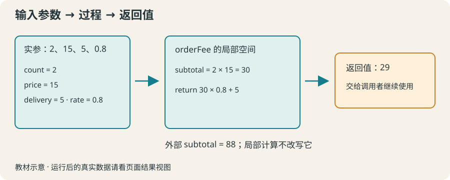

# 10 · 过程与参数：把费用计算装进工具

用 proc 封装重复计算，以参数接收不同订单，以 return 返回结果。

约 35 分钟。前置知识：变量与 expr、条件判断、列表

## 要解决的问题

活动物料、家庭采购和快递订单都需要计算费用。每次复制同一段乘法容易漏改一个数字。把计算写成一个过程，就像制作一个可重复使用的计算表：每次填入不同数据，得到新的结果。

## 学习目标

- 定义和调用带参数的过程
- 设置默认参数并解释何时使用默认值
- 区分返回值与打印输出
- 用不同输入验证过程
- 识别过程的局部变量



## 给重复工作起名字

proc 名称 {参数列表} {过程体} 定义一个过程。调用方式仍是 Tcl 命令：名称 参数。形参是过程接收的名字，实参是调用时传入的值；调用时 Tcl 会为形参建立局部变量。

## 返回可继续使用的数值

return 把值交给调用方。puts 把文本写到输出，两者用途不同。用 set total [fee 3 12] 接住返回值后，还可以继续计算或 format。不要让计算过程只打印答案。

## 给可选参数一个默认值

参数列表中的 {delivery 0} 表示 delivery 可省略，默认是 0。可选参数放在必选参数之后。省略参数与传入空字符串不同；空字符串仍是一个实际参数。

## 看清变量所在的位置

过程中的 subtotal 默认属于当前调用，外面的同名变量不会自动被读取或改写。第 13 节再讨论明确共享变量的方式。先让输入和输出都经过参数与返回值，通常更容易理解和测试。

## 示例 1 · 同一个过程计算两张订单

```tcl
proc fee {quantity price} {
    return [expr {$quantity * $price}]
}
puts [fee 3 12]
puts [fee 2 8]
```
默认模拟参数（JSON 数组表示）：

```text
argv = []
argc = 0
```

没有额外预置文件。

预期输出：

```text
36
16
```
<details><summary>本地准备与运行（Tcl 8.6+）</summary>

```sh
# 从本仓库根目录执行；文件读写发生在新建的临时练习目录。
workshop_repo="$PWD"
practice_dir="$(mktemp -d)"
cd "$practice_dir"
tclsh "$workshop_repo"/examples/10/01.tcl
# 生成文件留在 practice_dir；执行后回到仓库。
cd "$workshop_repo"
```


</details>
## 示例 2 · 可省略的运费

```tcl
proc deliveredFee {quantity price {delivery 0}} {
    return [expr {$quantity * $price + $delivery}]
}
puts [format "自提：%.2f 元" [deliveredFee 2 9.5]]
puts [format "配送：%.2f 元" [deliveredFee 2 9.5 4]]
```
默认模拟参数（JSON 数组表示）：

```text
argv = []
argc = 0
```

没有额外预置文件。

预期输出：

```text
自提：19.00 元
配送：23.00 元
```
<details><summary>本地准备与运行（Tcl 8.6+）</summary>

```sh
# 从本仓库根目录执行；文件读写发生在新建的临时练习目录。
workshop_repo="$PWD"
practice_dir="$(mktemp -d)"
cd "$practice_dir"
tclsh "$workshop_repo"/examples/10/02.tcl
# 生成文件留在 practice_dir；执行后回到仓库。
cd "$workshop_repo"
```


</details>
## 示例 3 · 过程内外的同名变量

```tcl
set subtotal 999
proc discountFee {price} {
    set subtotal [expr {$price * 0.9}]
    return $subtotal
}
set result [discountFee 20]
puts [format "返回值：%.2f" $result]
puts "外部 subtotal：$subtotal"
```
默认模拟参数（JSON 数组表示）：

```text
argv = []
argc = 0
```

没有额外预置文件。

预期输出：

```text
返回值：18.00
外部 subtotal：999
```
<details><summary>本地准备与运行（Tcl 8.6+）</summary>

```sh
# 从本仓库根目录执行；文件读写发生在新建的临时练习目录。
workshop_repo="$PWD"
practice_dir="$(mktemp -d)"
cd "$practice_dir"
tclsh "$workshop_repo"/examples/10/03.tcl
# 生成文件留在 practice_dir；执行后回到仓库。
cd "$workshop_repo"
```


</details>
## 修改一个条件

把例子 2 的默认 delivery 从 0 改成 6，再运行两次。观察只有省略运费的调用受默认值变化影响；显式传入 4 的调用保持原来的含义。

## 常见错误

- **在过程里 puts 结果，然后把 [fee ...] 当成数值使用。**：puts 通常返回空字符串。计算工具应 return 数值；在调用方决定打印格式。
- **以为过程能直接读取外面的 price，或修改同名变量。**：默认局部作用域隔离了它们。把 price 作为参数传入，把计算结果 return 出来。

## 练习 1 · 计算文具费用

定义 stationeryFee {count unitPrice}，返回总价。保留最后两行，输出 4 支 3 元的笔和 2 本 7 元的本子的费用。

```tcl
proc stationeryFee {count unitPrice} {
    # 返回数量乘以单价
}
puts [stationeryFee 4 3]
puts [stationeryFee 2 7]
```
默认模拟参数（JSON 数组表示）：

```text
argv = []
argc = 0
```

没有额外预置文件。

目标输出：

```text
12
14
```
<details><summary>逐层提示</summary>

用 expr {...} 完成乘法。

使用 return，而不是仅在过程中 puts。

</details>
<details><summary>参考答案</summary>

```tcl
proc stationeryFee {count unitPrice} {
    return [expr {$count * $unitPrice}]
}
puts [stationeryFee 4 3]
puts [stationeryFee 2 7]
```
<details><summary>本地准备与运行（Tcl 8.6+）</summary>

```sh
# 从本仓库根目录执行；文件读写发生在新建的临时练习目录。
workshop_repo="$PWD"
practice_dir="$(mktemp -d)"
cd "$practice_dir"
tclsh "$workshop_repo"/solutions/10/01.tcl
# 生成文件留在 practice_dir；执行后回到仓库。
cd "$workshop_repo"
```


</details>


</details>

## 练习 2 · 加入默认包装费

定义 packedFee，必选参数为 count 与 price，pack 默认 2。返回 count * price + pack。调用一次默认包装费，一次明确免包装费。

```tcl
proc packedFee {count price {pack 2}} {
    # 完成计算
}
puts [packedFee 3 4]
puts [packedFee 3 4 0]
```
默认模拟参数（JSON 数组表示）：

```text
argv = []
argc = 0
```

没有额外预置文件。

目标输出：

```text
14
12
```
<details><summary>逐层提示</summary>

{pack 2} 是参数列表里的一个二元素列表。

省略 pack 才用默认值；传入 0 应保留 0。

</details>
<details><summary>参考答案</summary>

```tcl
proc packedFee {count price {pack 2}} {
    return [expr {$count * $price + $pack}]
}
puts [packedFee 3 4]
puts [packedFee 3 4 0]
```
<details><summary>本地准备与运行（Tcl 8.6+）</summary>

```sh
# 从本仓库根目录执行；文件读写发生在新建的临时练习目录。
workshop_repo="$PWD"
practice_dir="$(mktemp -d)"
cd "$practice_dir"
tclsh "$workshop_repo"/solutions/10/02.tcl
# 生成文件留在 practice_dir；执行后回到仓库。
cd "$workshop_repo"
```


</details>


</details>

## 练习 3 · 复用带折扣的订单工具

定义 orderFee {count price {delivery 0} {rate 1.0}}。折扣只作用于商品金额，运费不打折。过程内可以使用 subtotal，但不得改变外部同名变量。

```tcl
set subtotal 88
proc orderFee {count price {delivery 0} {rate 1.0}} {
    # 商品金额乘折扣，最后加运费
}
puts [format "%.2f" [orderFee 2 15 5 0.8]]
puts "外部 subtotal：$subtotal"
```
默认模拟参数（JSON 数组表示）：

```text
argv = []
argc = 0
```

没有额外预置文件。

目标输出：

```text
29.00
外部 subtotal：88
```
<details><summary>逐层提示</summary>

先算商品 subtotal，再乘 rate。

局部 subtotal 不需要 global；return 最终金额。

</details>
<details><summary>参考答案</summary>

```tcl
set subtotal 88
proc orderFee {count price {delivery 0} {rate 1.0}} {
    set subtotal [expr {$count * $price}]
    return [expr {$subtotal * $rate + $delivery}]
}
puts [format "%.2f" [orderFee 2 15 5 0.8]]
puts "外部 subtotal：$subtotal"
```
<details><summary>本地准备与运行（Tcl 8.6+）</summary>

```sh
# 从本仓库根目录执行；文件读写发生在新建的临时练习目录。
workshop_repo="$PWD"
practice_dir="$(mktemp -d)"
cd "$practice_dir"
tclsh "$workshop_repo"/solutions/10/03.tcl
# 生成文件留在 practice_dir；执行后回到仓库。
cd "$workshop_repo"
```


</details>


</details>

## 理解检查

proc fee {n price} {return [expr {$n * $price}]} 中，return 的作用是？

1. 打印到屏幕
2. 把数值交给调用者
3. 创建全局变量

<details><summary>答案与解释</summary>

把数值交给调用者。返回值可以被方括号接住；打印是 puts 的职责。

</details>
参数列表 {n price {delivery 0}}，调用 fee 2 5 3 时 delivery 是？

1. 0
2. 3
3. 空字符串

<details><summary>答案与解释</summary>

3。显式实参 3 覆盖默认值；默认值只在省略该参数时使用。

</details>

## 速查

- 定义：proc name {arg1 arg2 {optional default}} {body}
- 调用：set result [name value1 value2]
- 返回：return $result
- 默认情况下，参数和过程中 set 的变量都是局部变量。

下一节：第 11 节把输入从手工写在代码中，改为从教学文件读取，再将摘要写入新文件。
