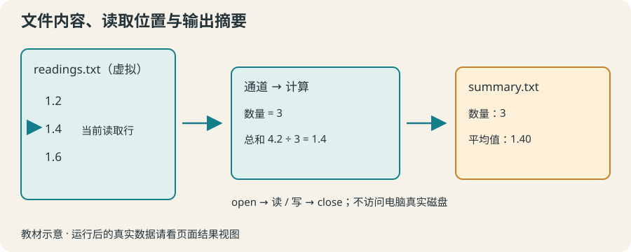

# 11 · 文件读写：为实验数据留下摘要

从教学文件读取数据，理解通道和读取位置，生成可下载的摘要。

约 40 分钟。前置知识：过程与参数、foreach 与列表、字符串处理

## 要解决的问题

实验记录在一份文本文件里。逐行手抄很容易漏掉数据，希望脚本读入所有记录，并保存“测量次数与平均值”的摘要。先学习读取位置，再把计算结果写回文件。

## 学习目标

- 用 open 和 close 管理文件通道
- 区分 read 与逐行 gets
- 向文件 puts 并读取验证
- 汇总输入中的测量值
- 区分浏览器虚拟文件与电脑磁盘



## 文件路径与通道不是同一个东西

open measurements.txt r 按路径打开文件，返回通道标识。后续 read、gets、puts 和 close 使用通道，而不是再次传文件路径。r 为读取，w 为写入并截断旧内容；需要保留旧内容时用 a 追加。

## 选择一次读取或逐行读取

read $ch 读取剩余文本，读取位置随之移动。gets $ch line 把一行赋给 line，并返回该行长度；到文件末尾返回 -1。用 >= 0 判断还读到了行，不能用行是否为空判断末尾，因为空白行也是合法一行。

## 写完后关闭，再验证文件内容

puts $out text 默认写入换行。close 将缓冲内容写完并释放通道。写文件前确认目标名称：w 会覆盖已有内容。当前练习只操作自己创建的教学文件；下一节补上读取失败时的清理。

## 浏览器里操作的是虚拟文件

页面会在浏览器内的 /work 目录放入本题附带文件，每次运行使用独立的教学文件系统。它不读取电脑真实路径。查看文件结果视图或下载运行产物才能保存到电脑。把相同 Tcl 脚本在电脑的 tclsh 中运行，则相对路径由真实工作目录决定。

## 示例 1 · 读取整份记录

```tcl
set ch [open readings.txt r]
set text [read $ch]
close $ch
puts [string trim $text]
```
默认模拟参数（JSON 数组表示）：

```text
argv = []
argc = 0
```

- 虚拟路径 `readings.txt` → [本地输入文件](../../data/lesson-11/example-1/readings.txt)

<details><summary>查看 readings.txt 的完整内容</summary>

```text
1.2
1.4
1.6
```


</details>

预期输出：

```text
1.2
1.4
1.6
```
<details><summary>本地准备与运行（Tcl 8.6+）</summary>

```sh
# 从本仓库根目录执行；文件读写发生在新建的临时练习目录。
workshop_repo="$PWD"
practice_dir="$(mktemp -d)"
cp "$workshop_repo"/data/lesson-11/example-1/readings.txt "$practice_dir"/readings.txt
cd "$practice_dir"
tclsh "$workshop_repo"/examples/11/01.tcl
# 生成文件留在 practice_dir；执行后回到仓库。
cd "$workshop_repo"
```


</details>
## 示例 2 · 空白行不等于文件末尾

```tcl
set ch [open notes.txt r]
set count 0
while {[gets $ch line] >= 0} {
    incr count
    puts "$count：[string length $line] 个字符"
}
close $ch
```
默认模拟参数（JSON 数组表示）：

```text
argv = []
argc = 0
```

- 虚拟路径 `notes.txt` → [本地输入文件](../../data/lesson-11/example-2/notes.txt)

<details><summary>查看 notes.txt 的完整内容</summary>

```text
开始

结束
```


</details>

预期输出：

```text
1：2 个字符
2：0 个字符
3：2 个字符
```
<details><summary>本地准备与运行（Tcl 8.6+）</summary>

```sh
# 从本仓库根目录执行；文件读写发生在新建的临时练习目录。
workshop_repo="$PWD"
practice_dir="$(mktemp -d)"
cp "$workshop_repo"/data/lesson-11/example-2/notes.txt "$practice_dir"/notes.txt
cd "$practice_dir"
tclsh "$workshop_repo"/examples/11/02.tcl
# 生成文件留在 practice_dir；执行后回到仓库。
cd "$workshop_repo"
```


</details>
## 示例 3 · 生成并验证摘要

```tcl
set ch [open readings.txt r]
set values [split [string trim [read $ch]] "
"]
close $ch
set total 0.0
foreach value $values { set total [expr {$total + $value}] }
set count [llength $values]
set out [open summary.txt w]
puts $out "数量：$count"
puts $out [format "平均值：%.2f" [expr {$total / $count}]]
close $out
set check [open summary.txt r]
puts [string trim [read $check]]
close $check
```
默认模拟参数（JSON 数组表示）：

```text
argv = []
argc = 0
```

- 虚拟路径 `readings.txt` → [本地输入文件](../../data/lesson-11/example-3/readings.txt)

<details><summary>查看 readings.txt 的完整内容</summary>

```text
1.2
1.4
1.6
```


</details>

预期输出：

```text
数量：3
平均值：1.40
```
<details><summary>本地准备与运行（Tcl 8.6+）</summary>

```sh
# 从本仓库根目录执行；文件读写发生在新建的临时练习目录。
workshop_repo="$PWD"
practice_dir="$(mktemp -d)"
cp "$workshop_repo"/data/lesson-11/example-3/readings.txt "$practice_dir"/readings.txt
cd "$practice_dir"
tclsh "$workshop_repo"/examples/11/03.tcl
# 生成文件留在 practice_dir；执行后回到仓库。
cd "$workshop_repo"
```


</details>
## 修改一个条件

在例子 2 的 notes.txt 中间多加两行空白（在代码中先用 w 写一个自己的测试文件也可以），观察输出中的零字符行仍被计数。再将 read 同一通道执行两次，观察第二次读到空字符串。

## 常见错误

- **把 gets 的返回值当成文本，或遇到空行就停止。**：gets $ch line 的返回值是长度，文本在 line；循环用返回值 >= 0，之后单独决定是否跳过空行。
- **open output.txt w 后忘记 close，或者希望原内容仍然保留。**：w 会截断原文件；结束时 close 通道。追加场景选择 a，但练习摘要每次重新生成，使用 w。

## 练习 1 · 复制一份清理后的备注

定义 cleanNote {inputPath outputPath}，读取输入文件、去除首尾空白，把清理后的文本和一个换行写到输出文件并返回文本。关闭所有通道。使用 note.txt 与 clean.txt 调用，输出返回值。

```tcl
proc cleanNote {inputPath outputPath} {
    # 读取、清理、写文件、返回文本
}
puts [cleanNote note.txt clean.txt]
```
默认模拟参数（JSON 数组表示）：

```text
argv = []
argc = 0
```

- 虚拟路径 `note.txt` → [本地输入文件](../../data/lesson-11/exercise-1/note.txt)

<details><summary>查看 note.txt 的完整内容</summary>

```text
  测量前请归零  
```


</details>

- 虚拟路径 `other-note.txt` → [本地输入文件](../../data/lesson-11/exercise-1/other-note.txt)

<details><summary>查看 other-note.txt 的完整内容</summary>

```text
 
 新实验记录 
 
```


</details>

- 虚拟路径 `empty-note.txt` → [本地输入文件](../../data/lesson-11/exercise-1/empty-note.txt)

<details><summary>查看 empty-note.txt 的完整内容</summary>

```text

```


</details>

目标输出：

```text
测量前请归零
```
<details><summary>逐层提示</summary>

string trim 可以清理 read 返回的文本。

用 puts $output $cleaned 写文件，在过程中 return，在调用方 puts 返回值。

</details>
<details><summary>参考答案</summary>

```tcl
proc cleanNote {inputPath outputPath} {
    set input [open $inputPath r]
    set cleaned [string trim [read $input]]
    close $input
    set output [open $outputPath w]
    puts $output $cleaned
    close $output
    return $cleaned
}
puts [cleanNote note.txt clean.txt]
```
<details><summary>本地准备与运行（Tcl 8.6+）</summary>

```sh
# 从本仓库根目录执行；文件读写发生在新建的临时练习目录。
workshop_repo="$PWD"
practice_dir="$(mktemp -d)"
cp "$workshop_repo"/data/lesson-11/exercise-1/note.txt "$practice_dir"/note.txt
cp "$workshop_repo"/data/lesson-11/exercise-1/other-note.txt "$practice_dir"/other-note.txt
cp "$workshop_repo"/data/lesson-11/exercise-1/empty-note.txt "$practice_dir"/empty-note.txt
cd "$practice_dir"
tclsh "$workshop_repo"/solutions/11/01.tcl
# 生成文件留在 practice_dir；执行后回到仓库。
cd "$workshop_repo"
```


</details>


</details>

## 练习 2 · 统计非空行

定义 countLines {path}，用 gets 逐行读取，返回去除首尾空白后非空的行数。输出 readings.txt 的数量。

```tcl
proc countLines {path} {
    # 跳过空白行，返回数量
}
puts [countLines readings.txt]
```
默认模拟参数（JSON 数组表示）：

```text
argv = []
argc = 0
```

- 虚拟路径 `readings.txt` → [本地输入文件](../../data/lesson-11/exercise-2/readings.txt)

<details><summary>查看 readings.txt 的完整内容</summary>

```text
1.2

 1.4 
1.6
```


</details>

- 虚拟路径 `empty.txt` → [本地输入文件](../../data/lesson-11/exercise-2/empty.txt)

<details><summary>查看 empty.txt 的完整内容</summary>

```text

```


</details>

- 虚拟路径 `mixed.txt` → [本地输入文件](../../data/lesson-11/exercise-2/mixed.txt)

<details><summary>查看 mixed.txt 的完整内容</summary>

```text
 
A

B
```


</details>

目标输出：

```text
3
```
<details><summary>逐层提示</summary>

gets 返回 -1 才表示结束。

用 string trim 判断空白行，再 incr 计数。

</details>
<details><summary>参考答案</summary>

```tcl
proc countLines {path} {
    set ch [open $path r]
    set count 0
    while {[gets $ch line] >= 0} {
        if {[string trim $line] ne ""} { incr count }
    }
    close $ch
    return $count
}
puts [countLines readings.txt]
```
<details><summary>本地准备与运行（Tcl 8.6+）</summary>

```sh
# 从本仓库根目录执行；文件读写发生在新建的临时练习目录。
workshop_repo="$PWD"
practice_dir="$(mktemp -d)"
cp "$workshop_repo"/data/lesson-11/exercise-2/readings.txt "$practice_dir"/readings.txt
cp "$workshop_repo"/data/lesson-11/exercise-2/empty.txt "$practice_dir"/empty.txt
cp "$workshop_repo"/data/lesson-11/exercise-2/mixed.txt "$practice_dir"/mixed.txt
cd "$practice_dir"
tclsh "$workshop_repo"/solutions/11/02.tcl
# 生成文件留在 practice_dir；执行后回到仓库。
cd "$workshop_repo"
```


</details>


</details>

## 练习 3 · 给数值文件写摘要

定义 writeSummary {inputPath outputPath}。跳过空白行，计算数量和平均值，写出两行摘要；无数据时写“平均值：无数据”。返回记录数量。此题输入保证是数值。

```tcl
proc writeSummary {inputPath outputPath} {
    # 从 inputPath 读取，写入 outputPath，返回数量
}
puts "已写入：[writeSummary measurements.txt report.txt] 条"
```
默认模拟参数（JSON 数组表示）：

```text
argv = []
argc = 0
```

- 虚拟路径 `measurements.txt` → [本地输入文件](../../data/lesson-11/exercise-3/measurements.txt)

<details><summary>查看 measurements.txt 的完整内容</summary>

```text
1

2
3
```


</details>

- 虚拟路径 `empty.txt` → [本地输入文件](../../data/lesson-11/exercise-3/empty.txt)

<details><summary>查看 empty.txt 的完整内容</summary>

```text

```


</details>

- 虚拟路径 `other.txt` → [本地输入文件](../../data/lesson-11/exercise-3/other.txt)

<details><summary>查看 other.txt 的完整内容</summary>

```text
4
6
```


</details>

目标输出：

```text
已写入：3 条
```
<details><summary>逐层提示</summary>

累加值用 0.0，避免整数除法；空文件不能直接除以数量。

输入和输出各自 open/close，用 if 区分零条和非零条。

</details>
<details><summary>参考答案</summary>

```tcl
proc writeSummary {inputPath outputPath} {
    set input [open $inputPath r]
    set count 0
    set total 0.0
    while {[gets $input line] >= 0} {
        set line [string trim $line]
        if {$line eq ""} { continue }
        incr count
        set total [expr {$total + $line}]
    }
    close $input
    set output [open $outputPath w]
    puts $output "数量：$count"
    if {$count == 0} {
        puts $output "平均值：无数据"
    } else {
        puts $output [format "平均值：%.2f" [expr {$total / $count}]]
    }
    close $output
    return $count
}
puts "已写入：[writeSummary measurements.txt report.txt] 条"
```
<details><summary>本地准备与运行（Tcl 8.6+）</summary>

```sh
# 从本仓库根目录执行；文件读写发生在新建的临时练习目录。
workshop_repo="$PWD"
practice_dir="$(mktemp -d)"
cp "$workshop_repo"/data/lesson-11/exercise-3/measurements.txt "$practice_dir"/measurements.txt
cp "$workshop_repo"/data/lesson-11/exercise-3/empty.txt "$practice_dir"/empty.txt
cp "$workshop_repo"/data/lesson-11/exercise-3/other.txt "$practice_dir"/other.txt
cd "$practice_dir"
tclsh "$workshop_repo"/solutions/11/03.tcl
# 生成文件留在 practice_dir；执行后回到仓库。
cd "$workshop_repo"
```


</details>


</details>

## 理解检查

gets $ch line 返回 0，说明什么？

1. 已经到文件末尾
2. 读到一个空行
3. 文件不存在

<details><summary>答案与解释</summary>

读到一个空行。空行长度为 0；文件末尾返回 -1。

</details>
浏览器代码 open report.txt w 写到哪里？

1. 作者电脑桌面
2. 本次运行的浏览器虚拟文件系统
3. GitHub 仓库

<details><summary>答案与解释</summary>

本次运行的浏览器虚拟文件系统。它是沙箱内的教学文件；下载或复制后才能在电脑保存。

</details>

## 速查

- 读取：set ch [open name.txt r]；set text [read $ch]
- 逐行：while {[gets $ch line] >= 0} {...}
- 写入：set out [open report.txt w]；puts $out $text
- 结束：close $ch；close $out
- 浏览器相对路径指向虚拟 /work；本地运行指向真实当前目录。

下一节：第 12 节处理文件缺失、非法数值和除零，并保证错误时也关闭已打开的文件。
