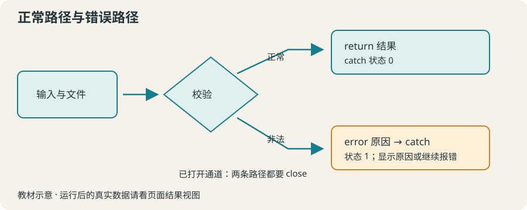

# 12 · 错误处理与调试：让失败说清原因

用 catch 区分正常返回与错误，用 error 说明非法输入，并保留失败信息。

约 40 分钟。前置知识：过程与参数、文件读写、条件判断

## 要解决的问题

一份自动摘要脚本遇到不存在的文件、写成“待测”的数值，或者零条记录。直接退出会让使用者不知道下一步怎么做；把所有错误都当成成功更危险。我们需要明确区分成功结果与失败原因。

## 学习目标

- 读取错误信息定位失败命令
- 用 catch 获得返回码和结果
- 为非法输入主动 error
- 避免整数除零与非法数值
- 在文件处理失败时关闭通道并继续传递错误



## 先读第一条错误，再找发生位置

错误信息通常包含原因和命令上下文。先看哪个命令失败，再查它使用的值。浏览器会在错误区显示解释器信息；用 puts 查看少量输入有助于调试，但不要把临时调试输出当成正式报告。

## catch 接住一次可预期的失败

catch {script} result options 返回整数状态：0 正常、1 错误；此外 2、3、4 分别与 return、break、continue 有关。result 在成功时是脚本返回值，在失败时是错误信息。options 记录 -errorinfo、-errorcode 等细节。常见边界处可以 catch，但不要无条件打印“成功”。

## 主动拒绝不合法的数据

error "数量必须是非负整数" 让调用方知道不能继续计算。string is integer -strict 和 string is double -strict 可用于数值格式检查。本课程的报告还需限制非有限值；专门的验证过程会在综合项目中处理。

## 关闭资源，再传递错误

打开文件后，catch 包住读取和校验；无论成功失败都先 close。失败时 return -options $options $result 把原错误交回调用方，外层决定显示提示还是终止。catch 前就失败的 open 不会产生已打开的通道。

## 示例 1 · 缺失文件给出可理解提示

```tcl
set status [catch {open missing.txt r} result options]
if {$status == 0} {
    close $result
    puts "文件已打开"
} else {
    puts "未读取：请确认 missing.txt 已放入输入文件"
    puts "错误状态：$status"
}
```
默认模拟参数（JSON 数组表示）：

```text
argv = []
argc = 0
```

没有额外预置文件。

预期输出：

```text
未读取：请确认 missing.txt 已放入输入文件
错误状态：1
```
<details><summary>本地准备与运行（Tcl 8.6+）</summary>

```sh
# 从本仓库根目录执行；文件读写发生在新建的临时练习目录。
workshop_repo="$PWD"
practice_dir="$(mktemp -d)"
cd "$practice_dir"
tclsh "$workshop_repo"/examples/12/01.tcl
# 生成文件留在 practice_dir；执行后回到仓库。
cd "$workshop_repo"
```


</details>
## 示例 2 · 区分除零错误与计算成功

```tcl
foreach divisor {2 0} {
    set status [catch {expr {8 / $divisor}} result]
    if {$status == 0} {
        puts "结果：$result"
    } else {
        puts "失败：$result"
    }
}
```
默认模拟参数（JSON 数组表示）：

```text
argv = []
argc = 0
```

没有额外预置文件。

预期输出：

```text
结果：4
失败：divide by zero
```
<details><summary>本地准备与运行（Tcl 8.6+）</summary>

```sh
# 从本仓库根目录执行；文件读写发生在新建的临时练习目录。
workshop_repo="$PWD"
practice_dir="$(mktemp -d)"
cd "$practice_dir"
tclsh "$workshop_repo"/examples/12/02.tcl
# 生成文件留在 practice_dir；执行后回到仓库。
cd "$workshop_repo"
```


</details>
## 示例 3 · 把输入检查封装在过程里

```tcl
proc parseCount {text} {
    if {![string is integer -strict $text] || $text < 0} {
        error "数量必须是非负整数"
    }
    return $text
}
foreach text {3 -1 abc} {
    if {[catch {parseCount $text} result]} {
        puts "$text：$result"
    } else {
        puts "$text：接收 $result"
    }
}
```
默认模拟参数（JSON 数组表示）：

```text
argv = []
argc = 0
```

没有额外预置文件。

预期输出：

```text
3：接收 3
-1：数量必须是非负整数
abc：数量必须是非负整数
```
<details><summary>本地准备与运行（Tcl 8.6+）</summary>

```sh
# 从本仓库根目录执行；文件读写发生在新建的临时练习目录。
workshop_repo="$PWD"
practice_dir="$(mktemp -d)"
cd "$practice_dir"
tclsh "$workshop_repo"/examples/12/03.tcl
# 生成文件留在 practice_dir；执行后回到仓库。
cd "$workshop_repo"
```


</details>
## 修改一个条件

将例子 3 的输入改成 {0 2.5 {} 8}，观察零被接受，小数和空串被拒绝。将练习 3 的坏数据移到第 1 行，错误提示的行号应该跟着改变。

## 常见错误

- **catch 后无论状态如何都输出“生成成功”。**：检查状态并分别处理。失败信息应保留给使用者；需要上层处理时重新传递原错误。
- **打开文件后在循环中 error，却没有 close。**：用 catch 包住文件处理，成功或失败都先 close，再返回结果或传递错误。

## 练习 1 · 拒绝非法报名人数

定义 requireCount {text}，接受非负整数并返回该值，其余输入 error "人数必须是非负整数"。按起始代码验证正常输入和非法输入。

```tcl
proc requireCount {text} {
    # 检查格式和范围
}
puts [requireCount 0]
if {[catch {requireCount -2} message]} { puts $message }
```
默认模拟参数（JSON 数组表示）：

```text
argv = []
argc = 0
```

没有额外预置文件。

目标输出：

```text
0
人数必须是非负整数
```
<details><summary>逐层提示</summary>

string is integer -strict 排除空字符串和文字。

格式正确后还需检查 text >= 0。

</details>
<details><summary>参考答案</summary>

```tcl
proc requireCount {text} {
    if {![string is integer -strict $text] || $text < 0} {
        error "人数必须是非负整数"
    }
    return $text
}
puts [requireCount 0]
if {[catch {requireCount -2} message]} { puts $message }
```
<details><summary>本地准备与运行（Tcl 8.6+）</summary>

```sh
# 从本仓库根目录执行；文件读写发生在新建的临时练习目录。
workshop_repo="$PWD"
practice_dir="$(mktemp -d)"
cd "$practice_dir"
tclsh "$workshop_repo"/solutions/12/01.tcl
# 生成文件留在 practice_dir；执行后回到仓库。
cd "$workshop_repo"
```


</details>


</details>

## 练习 2 · 避免零人数的平均费用

定义 perPerson {total people}，要求 total 为数值且 >= 0，people 为正整数。非法输入 error "费用或人数不合法"。计算使用 double，返回人均费用。

```tcl
proc perPerson {total people} {
    # 校验并返回浮点结果
}
puts [format "人均：%.2f" [perPerson 10 4]]
if {[catch {perPerson 10 0} message]} { puts $message }
```
默认模拟参数（JSON 数组表示）：

```text
argv = []
argc = 0
```

没有额外预置文件。

目标输出：

```text
人均：2.50
费用或人数不合法
```
<details><summary>逐层提示</summary>

先检查数值格式，再做范围比较。此题输入范围为普通有限十进制数。

double($total) 确保 10 / 4 不是整数除法。

</details>
<details><summary>参考答案</summary>

```tcl
proc perPerson {total people} {
    if {![string is double -strict $total] || ![string is integer -strict $people]} {
        error "费用或人数不合法"
    }
    if {$total < 0 || $people <= 0} { error "费用或人数不合法" }
    return [expr {double($total) / $people}]
}
puts [format "人均：%.2f" [perPerson 10 4]]
if {[catch {perPerson 10 0} message]} { puts $message }
```
<details><summary>本地准备与运行（Tcl 8.6+）</summary>

```sh
# 从本仓库根目录执行；文件读写发生在新建的临时练习目录。
workshop_repo="$PWD"
practice_dir="$(mktemp -d)"
cd "$practice_dir"
tclsh "$workshop_repo"/solutions/12/02.tcl
# 生成文件留在 practice_dir；执行后回到仓库。
cd "$workshop_repo"
```


</details>


</details>

## 练习 3 · 带行号的读取失败

定义 readCounts {path}。跳过空白行，要求每条非空行是非负整数；否则 error "第 N 行不是非负整数"（N 是实际文件行号）。返回列表。打开后用 catch 与 close 保证失败也释放通道。

```tcl
proc readCounts {path} {
    # 打开文件，校验，关闭通道；失败应继续报错
}
puts "接收：[readCounts good.txt]"
if {[catch {readCounts bad.txt} message]} { puts $message }
```
默认模拟参数（JSON 数组表示）：

```text
argv = []
argc = 0
```

- 虚拟路径 `good.txt` → [本地输入文件](../../data/lesson-12/exercise-3/good.txt)

<details><summary>查看 good.txt 的完整内容</summary>

```text
2
0
5
```


</details>

- 虚拟路径 `bad.txt` → [本地输入文件](../../data/lesson-12/exercise-3/bad.txt)

<details><summary>查看 bad.txt 的完整内容</summary>

```text
2

待测
```


</details>

- 虚拟路径 `other.txt` → [本地输入文件](../../data/lesson-12/exercise-3/other.txt)

<details><summary>查看 other.txt 的完整内容</summary>

```text
9
 1
```


</details>

- 虚拟路径 `empty.txt` → [本地输入文件](../../data/lesson-12/exercise-3/empty.txt)

<details><summary>查看 empty.txt 的完整内容</summary>

```text

```


</details>

目标输出：

```text
接收：2 0 5
第 3 行不是非负整数
```
<details><summary>逐层提示</summary>

catch 里累加 lineNo，空白行也算文件行号。

先 close，再在失败时 return -options $options $result。

</details>
<details><summary>参考答案</summary>

```tcl
proc readCounts {path} {
    set ch [open $path r]
    set status [catch {
        set values {}
        set lineNo 0
        while {[gets $ch line] >= 0} {
            incr lineNo
            set line [string trim $line]
            if {$line eq ""} { continue }
            if {![string is integer -strict $line] || $line < 0} {
                error "第 $lineNo 行不是非负整数"
            }
            lappend values $line
        }
        set values
    } result options]
    close $ch
    if {$status != 0} { return -options $options $result }
    return $result
}
puts "接收：[readCounts good.txt]"
if {[catch {readCounts bad.txt} message]} { puts $message }
```
<details><summary>本地准备与运行（Tcl 8.6+）</summary>

```sh
# 从本仓库根目录执行；文件读写发生在新建的临时练习目录。
workshop_repo="$PWD"
practice_dir="$(mktemp -d)"
cp "$workshop_repo"/data/lesson-12/exercise-3/good.txt "$practice_dir"/good.txt
cp "$workshop_repo"/data/lesson-12/exercise-3/bad.txt "$practice_dir"/bad.txt
cp "$workshop_repo"/data/lesson-12/exercise-3/other.txt "$practice_dir"/other.txt
cp "$workshop_repo"/data/lesson-12/exercise-3/empty.txt "$practice_dir"/empty.txt
cd "$practice_dir"
tclsh "$workshop_repo"/solutions/12/03.tcl
# 生成文件留在 practice_dir；执行后回到仓库。
cd "$workshop_repo"
```


</details>


</details>

## 理解检查

catch {expr {4 / 0}} result 返回什么？

1. 计算答案
2. 状态码 1
3. 总是 0

<details><summary>答案与解释</summary>

状态码 1。catch 的返回值是状态码；错误信息存放在 result。

</details>
读取失败后需要保留原错误，正确顺序是？

1. 打印成功再关闭
2. close，然后 return -options $options $result
3. 忽略错误继续统计

<details><summary>答案与解释</summary>

close，然后 return -options $options $result。关闭资源并传递错误，调用方才能可靠地区分失败与成功。

</details>

## 速查

- 接住结果：set status [catch {script} result options]
- 常见状态：0 正常，1 错误；不能把所有非零状态都当作同一含义。
- 主动失败：error "可理解的原因"
- 传递原状态：return -options $options $result
- 文件处理：open → catch 处理 → close → 成功返回或继续报错。

下一节：第 13 节把多个计算工具放进命名空间，明确区分局部状态与共享状态。
