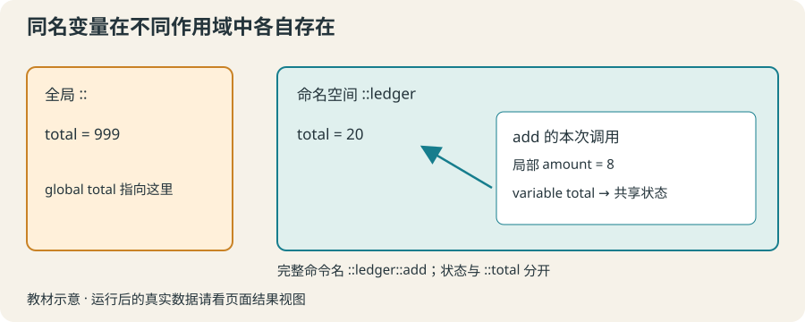

# 13 · 作用域与命名空间：给工具安排各自的位置

区分局部变量、全局变量和命名空间变量，减少同名工具之间的冲突。

约 40 分钟。前置知识：过程与局部变量、字典、错误处理

## 要解决的问题

活动费用和实验费用都需要一个叫 fee 的计算过程。如果放在同一个脚本顶层，后定义的 fee 会覆盖前一个。把它们放进不同命名空间，可以保留相同的短名字；共享计数器也要明确放在哪个空间里。

## 学习目标

- 解释过程中的默认局部作用域
- 用 global 明确访问全局变量
- 用 namespace eval 组织命令
- 用 variable 绑定命名空间状态
- 避免工具互相覆盖同名命令



## 默认局部变量最容易推理

调用过程时建立局部变量，过程返回后通常释放它们。外面的同名变量不自动参与计算。参数与返回值适合大多数独立计算；只有需要跨调用保存状态时才考虑共享变量。

## global 明确连接全局状态

过程体里 global visits 让 visits 这个局部名字绑定到全局的 ::visits。它不是把所有局部变量都变成全局。共享状态应少而明确，否则读者很难知道哪次调用修改了它。

## namespace 为命令和变量分组

namespace eval travel {...} 在 ::travel 空间建立命令和变量。用 ::travel::fee 完整名称调用，可与 ::food::fee 共存。命名空间不像对象，不会自动产生多份独立状态。

## variable 绑定当前命名空间的变量

命名空间里的过程使用 variable total 来访问 ::ledger::total。初始化在 namespace eval 中做一次；若在每次调用里 variable total 0，可能重新设为 0，破坏累积。本节不引入 upvar 或复杂的名字解析。

## 示例 1 · 局部变量与明确的全局计数

```tcl
set visits 0
proc visit {} {
    global visits
    incr visits
    set note "本次调用的局部备注"
    return $visits
}
puts [visit]
puts [visit]
puts "全局 visits：$visits"
```
默认模拟参数（JSON 数组表示）：

```text
argv = []
argc = 0
```

没有额外预置文件。

预期输出：

```text
1
2
全局 visits：2
```
<details><summary>本地准备与运行（Tcl 8.6+）</summary>

```sh
# 从本仓库根目录执行；文件读写发生在新建的临时练习目录。
workshop_repo="$PWD"
practice_dir="$(mktemp -d)"
cd "$practice_dir"
tclsh "$workshop_repo"/examples/13/01.tcl
# 生成文件留在 practice_dir；执行后回到仓库。
cd "$workshop_repo"
```


</details>
## 示例 2 · 两个同名费用工具共存

```tcl
namespace eval travel {
    proc fee {people} { return [expr {$people * 12}] }
}
namespace eval food {
    proc fee {people} { return [expr {$people * 18}] }
}
puts "交通：[::travel::fee 3]"
puts "餐食：[::food::fee 3]"
```
默认模拟参数（JSON 数组表示）：

```text
argv = []
argc = 0
```

没有额外预置文件。

预期输出：

```text
交通：36
餐食：54
```
<details><summary>本地准备与运行（Tcl 8.6+）</summary>

```sh
# 从本仓库根目录执行；文件读写发生在新建的临时练习目录。
workshop_repo="$PWD"
practice_dir="$(mktemp -d)"
cd "$practice_dir"
tclsh "$workshop_repo"/examples/13/02.tcl
# 生成文件留在 practice_dir；执行后回到仓库。
cd "$workshop_repo"
```


</details>
## 示例 3 · 命名空间状态跨调用保留

```tcl
set total 999
namespace eval ledger {
    variable total 0
    proc add {amount} {
        variable total
        set total [expr {$total + $amount}]
        return $total
    }
}
puts "累计：[::ledger::add 12]"
puts "累计：[::ledger::add 8]"
puts "外部 total：$total"
```
默认模拟参数（JSON 数组表示）：

```text
argv = []
argc = 0
```

没有额外预置文件。

预期输出：

```text
累计：12
累计：20
外部 total：999
```
<details><summary>本地准备与运行（Tcl 8.6+）</summary>

```sh
# 从本仓库根目录执行；文件读写发生在新建的临时练习目录。
workshop_repo="$PWD"
practice_dir="$(mktemp -d)"
cd "$practice_dir"
tclsh "$workshop_repo"/examples/13/03.tcl
# 生成文件留在 practice_dir；执行后回到仓库。
cd "$workshop_repo"
```


</details>
## 修改一个条件

给例子 2 再加 ::ticket::fee {people}，每人 30 元，观察三个 fee 互不覆盖。然后把例子 3 过程里的 variable total 去掉，读错误信息，解释为什么局部 total 尚未存在。

## 常见错误

- **在命名空间过程里 set total，以为会自动改共享状态。**：先声明 variable total，否则默认创建或读取局部 total。共享变量应在命名空间中初始化。
- **把 global total 放进 ::ledger 的过程，想访问 ::ledger::total。**：global 绑定的是顶层 ::total。访问当前命名空间状态用 variable total。

## 练习 1 · 明确的运行次数

顶层 runCount 从 0 开始。定义 recordRun，无参数，每调用一次把全局 runCount 加一并返回。最后输出两次调用结果。

```tcl
set runCount 0
proc recordRun {} {
    # 明确绑定全局计数
}
puts [recordRun]
puts [recordRun]
```
默认模拟参数（JSON 数组表示）：

```text
argv = []
argc = 0
```

没有额外预置文件。

目标输出：

```text
1
2
```
<details><summary>逐层提示</summary>

过程里声明 global runCount。

incr 的返回值就是更新后的整数，可直接 return。

</details>
<details><summary>参考答案</summary>

```tcl
set runCount 0
proc recordRun {} {
    global runCount
    return [incr runCount]
}
puts [recordRun]
puts [recordRun]
```
<details><summary>本地准备与运行（Tcl 8.6+）</summary>

```sh
# 从本仓库根目录执行；文件读写发生在新建的临时练习目录。
workshop_repo="$PWD"
practice_dir="$(mktemp -d)"
cd "$practice_dir"
tclsh "$workshop_repo"/solutions/13/01.tcl
# 生成文件留在 practice_dir；执行后回到仓库。
cd "$workshop_repo"
```


</details>


</details>

## 练习 2 · 各自独立的同名工具

在 ::bus 中定义 fee {n} 为 n * 8，在 ::snack 中定义 fee {n} 为 n * 5。保留调用，输出各自结果。

```tcl
namespace eval bus {
    # 定义 fee
}
namespace eval snack {
    # 定义 fee
}
puts [::bus::fee 4]
puts [::snack::fee 4]
```
默认模拟参数（JSON 数组表示）：

```text
argv = []
argc = 0
```

没有额外预置文件。

目标输出：

```text
32
20
```
<details><summary>逐层提示</summary>

namespace eval 里定义的 proc 属于该命名空间。

用完整名称 ::bus::fee 与 ::snack::fee 调用。

</details>
<details><summary>参考答案</summary>

```tcl
namespace eval bus {
    proc fee {n} { return [expr {$n * 8}] }
}
namespace eval snack {
    proc fee {n} { return [expr {$n * 5}] }
}
puts [::bus::fee 4]
puts [::snack::fee 4]
```
<details><summary>本地准备与运行（Tcl 8.6+）</summary>

```sh
# 从本仓库根目录执行；文件读写发生在新建的临时练习目录。
workshop_repo="$PWD"
practice_dir="$(mktemp -d)"
cd "$practice_dir"
tclsh "$workshop_repo"/solutions/13/02.tcl
# 生成文件留在 practice_dir；执行后回到仓库。
cd "$workshop_repo"
```


</details>


</details>

## 练习 3 · 可重置的累计账本

定义 ::budget::add {amount} 返回累加后的值，::budget::get 返回当前值，::budget::reset 清零并返回 0。状态变量 ::budget::total 初始化为 0；外部 total = 500 必须保持不变。

```tcl
set total 500
namespace eval budget {
    variable total 0
    # 定义 add、get 和 reset
}
puts [::budget::add 6]
puts [::budget::add 9]
puts "外部：$total"
puts "清零：[::budget::reset]"
```
默认模拟参数（JSON 数组表示）：

```text
argv = []
argc = 0
```

没有额外预置文件。

目标输出：

```text
6
15
外部：500
清零：0
```
<details><summary>逐层提示</summary>

初始化放在 namespace eval；过程只用 variable total 绑定。

get 不修改，reset 明确 set total 0，add 根据旧值计算。

</details>
<details><summary>参考答案</summary>

```tcl
set total 500
namespace eval budget {
    variable total 0
    proc add {amount} {
        variable total
        set total [expr {$total + $amount}]
        return $total
    }
    proc get {} {
        variable total
        return $total
    }
    proc reset {} {
        variable total
        set total 0
        return $total
    }
}
puts [::budget::add 6]
puts [::budget::add 9]
puts "外部：$total"
puts "清零：[::budget::reset]"
```
<details><summary>本地准备与运行（Tcl 8.6+）</summary>

```sh
# 从本仓库根目录执行；文件读写发生在新建的临时练习目录。
workshop_repo="$PWD"
practice_dir="$(mktemp -d)"
cd "$practice_dir"
tclsh "$workshop_repo"/solutions/13/03.tcl
# 生成文件留在 practice_dir；执行后回到仓库。
cd "$workshop_repo"
```


</details>


</details>

## 理解检查

在 ::ledger 的过程里 global total 绑定到哪里？

1. ::ledger::total
2. ::total
3. 每次新建的局部 total

<details><summary>答案与解释</summary>

::total。global 明确访问全局命名空间；命名空间变量使用 variable。

</details>
命名空间里的计数器最合适在哪里初始化？

1. 每次 add 时初始化为 0
2. namespace eval 中一次初始化
3. 每次 puts 之前初始化

<details><summary>答案与解释</summary>

namespace eval 中一次初始化。初始化与更新职责分开，才能保留跨调用累计状态。

</details>

## 速查

- 组织命令：namespace eval tools { proc fee {n} {...} }
- 完整调用名：::tools::fee 3
- 全局变量绑定：global visits
- 命名空间变量绑定：variable total
- 优先参数与返回值；需要持久状态时才明确共享。

下一节：第 14 节把不同工具移到独立 .tcl 文件，并用入口参数与配置选择报告内容。
