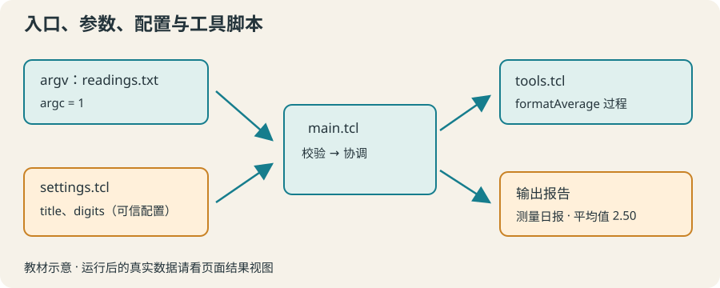

# 14 · 脚本组织与参数：用同一套工具生成不同报告

通过 source 加载工具和可信配置，通过 argc 与 argv 选择报告输入。

约 45 分钟。前置知识：过程与命名空间、文件读写、错误处理、字典

## 要解决的问题

每天写一份报告，只是标题、输入文件和小数位数不同。不必为每一天复制整套算法。把工具写在一份脚本里，配置写在另一份文件里，入口脚本读取参数决定这次处理谁。

## 学习目标

- 用 source 加载另一份 Tcl 脚本
- 读取并校验 argc 与 argv
- 用列表而非空格拼接保存参数
- 从可信 Tcl 配置中取得字典
- 说明入口、配置和工具文件的依赖



## source 真正执行另一份脚本

source helpers.tcl 在当前解释器、当前调用上下文中执行文件。文件可以定义过程，也可以返回一个配置字典。它不是“读取纯文本”，因此只 source 自己写的或已审查的可信脚本，不能把未知数据当配置代码执行。

## argc 是数量，argv 是参数列表

本地可以运行 tclsh main.tcl morning readings.txt。argv 是 {morning readings.txt} 这样的 Tcl 列表，argc 是它的长度。文件名含空格时，由命令行正确引用；在 Tcl 中用 lindex 或 lassign 取参数，不用 split 按空格重拆。argv0 则通常是入口脚本名。

## 页面提供的是明确的教学参数

在线例子会把题目声明的 argv 列表和 argc 注入本次解释器；下面例子 2 的参数是 morning 与 attendance.txt。它不读取电脑终端的参数。可以在编辑器代码顶部用 set argv [list ...] 和 set argc [llength $argv] 修改实验参数，并保留两者一致。

## 入口只协调各部分

入口先检查参数，再 source 工具与配置，读取输入，调用过程并输出。配置字典保存 title、digits 等值；算法只接收需要的字段。相对 source 路径由当前工作目录决定，本课程在线运行统一从虚拟 /work 启动；本地也请先进入示例目录。

## 示例 1 · 加载可复用的标题工具

```tcl
source helpers.tcl
puts [reportHeading 周二]
puts [reportHeading 周五]
```
默认模拟参数（JSON 数组表示）：

```text
argv = []
argc = 0
```

- 虚拟路径 `helpers.tcl` → [本地输入文件](../../data/lesson-14/example-1/helpers.tcl)

<details><summary>查看 helpers.tcl 的完整内容</summary>

```tcl
proc reportHeading {name} { return "报告：$name" }
```


</details>

预期输出：

```text
报告：周二
报告：周五
```
<details><summary>本地准备与运行（Tcl 8.6+）</summary>

```sh
# 从本仓库根目录执行；文件读写发生在新建的临时练习目录。
workshop_repo="$PWD"
practice_dir="$(mktemp -d)"
cp "$workshop_repo"/data/lesson-14/example-1/helpers.tcl "$practice_dir"/helpers.tcl
cd "$practice_dir"
tclsh "$workshop_repo"/examples/14/01.tcl
# 生成文件留在 practice_dir；执行后回到仓库。
cd "$workshop_repo"
```


</details>
## 示例 2 · 读取本次运行参数

```tcl
if {$argc != 2} { error "用法：main.tcl <报告名称> <输入文件>" }
lassign $argv reportName inputPath
puts "报告名称：$reportName"
puts "输入文件：$inputPath"
```
默认模拟参数（JSON 数组表示）：

```text
argv = ["morning", "attendance.txt"]
argc = 2
```

没有额外预置文件。

预期输出：

```text
报告名称：morning
输入文件：attendance.txt
```
<details><summary>本地准备与运行（Tcl 8.6+）</summary>

```sh
# 从本仓库根目录执行；文件读写发生在新建的临时练习目录。
workshop_repo="$PWD"
practice_dir="$(mktemp -d)"
cd "$practice_dir"
tclsh "$workshop_repo"/examples/14/02.tcl morning attendance.txt
# 生成文件留在 practice_dir；执行后回到仓库。
cd "$workshop_repo"
```


</details>
## 示例 3 · 配置控制显示精度

```tcl
set config [source settings.tcl]
source tools.tcl
puts [dict get $config title]
puts [formatAverage {1.2 1.4 1.6} [dict get $config digits]]
```
默认模拟参数（JSON 数组表示）：

```text
argv = []
argc = 0
```

- 虚拟路径 `settings.tcl` → [本地输入文件](../../data/lesson-14/example-3/settings.tcl)

<details><summary>查看 settings.tcl 的完整内容</summary>

```tcl
dict create title {周末实验} digits 2
```


</details>

- 虚拟路径 `tools.tcl` → [本地输入文件](../../data/lesson-14/example-3/tools.tcl)

<details><summary>查看 tools.tcl 的完整内容</summary>

```tcl
proc formatAverage {values digits} {
    if {[llength $values] == 0} { return {无数据} }
    set total 0.0
    foreach value $values { set total [expr {$total + $value}] }
    return [format "%.*f" $digits [expr {$total / [llength $values]}]]
}
```


</details>

预期输出：

```text
周末实验
1.40
```
<details><summary>本地准备与运行（Tcl 8.6+）</summary>

```sh
# 从本仓库根目录执行；文件读写发生在新建的临时练习目录。
workshop_repo="$PWD"
practice_dir="$(mktemp -d)"
cp "$workshop_repo"/data/lesson-14/example-3/settings.tcl "$practice_dir"/settings.tcl
cp "$workshop_repo"/data/lesson-14/example-3/tools.tcl "$practice_dir"/tools.tcl
cd "$practice_dir"
tclsh "$workshop_repo"/examples/14/03.tcl
# 生成文件留在 practice_dir；执行后回到仓库。
cd "$workshop_repo"
```


</details>
## 修改一个条件

在例子 2 顶部加 set argv [list {晚间实验} {my readings.txt}] 和 set argc [llength $argv]，观察空格仍属于同一个参数。将例子 3 的 digits 改成 1，确认变化发生在显示精度而非原始平均值。

## 常见错误

- **对 argv 做 split，把“lab results.txt”拆成两个参数。**：argv 本来就是 Tcl 列表。用 llength、lindex 或 lassign；在自己构造参数时用 list。
- **把用户提供的任意文本文件直接 source。**：source 会执行 Tcl 命令。普通报告用 open/read 读取；配置脚本必须可信，数据不是代码。

## 练习 1 · 入口加载工具文件

题目附带 headings.tcl，其中定义 makeHeading {topic}。不要在入口重写它。用 source 加载，然后输出“摘要 / 实验 A”。

```tcl
# 加载 headings.tcl
puts [makeHeading {实验 A}]
```
默认模拟参数（JSON 数组表示）：

```text
argv = []
argc = 0
```

- 虚拟路径 `headings.tcl` → [本地输入文件](../../data/lesson-14/exercise-1/headings.tcl)

<details><summary>查看 headings.tcl 的完整内容</summary>

```tcl
proc makeHeading {topic} { return "摘要 / $topic" }
```


</details>

目标输出：

```text
摘要 / 实验 A
```
<details><summary>逐层提示</summary>

source 的参数是相对文件路径。

函数调用中 {实验 A} 是一个带空格的参数。

</details>
<details><summary>参考答案</summary>

```tcl
source headings.tcl
puts [makeHeading {实验 A}]
```
<details><summary>本地准备与运行（Tcl 8.6+）</summary>

```sh
# 从本仓库根目录执行；文件读写发生在新建的临时练习目录。
workshop_repo="$PWD"
practice_dir="$(mktemp -d)"
cp "$workshop_repo"/data/lesson-14/exercise-1/headings.tcl "$practice_dir"/headings.tcl
cd "$practice_dir"
tclsh "$workshop_repo"/solutions/14/01.tcl
# 生成文件留在 practice_dir；执行后回到仓库。
cd "$workshop_repo"
```


</details>


</details>

## 练习 2 · 可靠地解析两个参数

定义 reportArgs {argsList}：要求恰好两个元素，否则 error "需要标题和输入文件两个参数"；返回含 title 与 input 字段的字典。通过 argv 调用并输出字段，文件名包含空格。

```tcl
proc reportArgs {argsList} {
    # 校验列表长度，再建立字典
}
set request [reportArgs $argv]
puts [dict get $request title]
puts [dict get $request input]
```
默认模拟参数（JSON 数组表示）：

```text
argv = ["下午实验", "lab results.txt"]
argc = 2
```

没有额外预置文件。

目标输出：

```text
下午实验
lab results.txt
```
<details><summary>逐层提示</summary>

argsList 已经是列表，不要 split。

lassign 保留每个元素内部的空格，dict create 建立字段。

</details>
<details><summary>参考答案</summary>

```tcl
proc reportArgs {argsList} {
    if {[llength $argsList] != 2} { error "需要标题和输入文件两个参数" }
    lassign $argsList title inputPath
    return [dict create title $title input $inputPath]
}
set request [reportArgs $argv]
puts [dict get $request title]
puts [dict get $request input]
```
<details><summary>本地准备与运行（Tcl 8.6+）</summary>

```sh
# 从本仓库根目录执行；文件读写发生在新建的临时练习目录。
workshop_repo="$PWD"
practice_dir="$(mktemp -d)"
cd "$practice_dir"
tclsh "$workshop_repo"/solutions/14/02.tcl '下午实验' 'lab results.txt'
# 生成文件留在 practice_dir；执行后回到仓库。
cd "$workshop_repo"
```


</details>


</details>

## 练习 3 · 用配置和参数生成报告

定义 generateReport {argsList}，要求一个输入文件参数，否则报错；加载 settings.tcl 与 tools.tcl，读取数值文件（本题保证非空合法数值），调用 formatAverage，返回两行文本：配置 title 和“平均值：N”。

```tcl
proc generateReport {argsList} {
    # 校验参数，source 配置与工具，读取文件并格式化
}
puts [generateReport $argv]
```
默认模拟参数（JSON 数组表示）：

```text
argv = ["readings.txt"]
argc = 1
```

- 虚拟路径 `settings.tcl` → [本地输入文件](../../data/lesson-14/exercise-3/settings.tcl)

<details><summary>查看 settings.tcl 的完整内容</summary>

```tcl
dict create title {测量日报} digits 2
```


</details>

- 虚拟路径 `tools.tcl` → [本地输入文件](../../data/lesson-14/exercise-3/tools.tcl)

<details><summary>查看 tools.tcl 的完整内容</summary>

```tcl
proc formatAverage {values digits} {
    set total 0.0
    foreach value $values { set total [expr {$total + $value}] }
    return [format "%.*f" $digits [expr {$total / [llength $values]}]]
}
```


</details>

- 虚拟路径 `readings.txt` → [本地输入文件](../../data/lesson-14/exercise-3/readings.txt)

<details><summary>查看 readings.txt 的完整内容</summary>

```text
2
3
```


</details>

- 虚拟路径 `other.txt` → [本地输入文件](../../data/lesson-14/exercise-3/other.txt)

<details><summary>查看 other.txt 的完整内容</summary>

```text
4
6
```


</details>

目标输出：

```text
测量日报
平均值：2.50
```
<details><summary>逐层提示</summary>

source settings.tcl 的返回值就是字典。

read 读入后关闭通道，split 成每行一个数值的列表。

</details>
<details><summary>参考答案</summary>

```tcl
proc generateReport {argsList} {
    if {[llength $argsList] != 1} { error "需要一个输入文件参数" }
    set config [source settings.tcl]
    source tools.tcl
    set ch [open [lindex $argsList 0] r]
    set values [split [string trim [read $ch]] "
"]
    close $ch
    set average [formatAverage $values [dict get $config digits]]
    return "[dict get $config title]
平均值：$average"
}
puts [generateReport $argv]
```
<details><summary>本地准备与运行（Tcl 8.6+）</summary>

```sh
# 从本仓库根目录执行；文件读写发生在新建的临时练习目录。
workshop_repo="$PWD"
practice_dir="$(mktemp -d)"
cp "$workshop_repo"/data/lesson-14/exercise-3/settings.tcl "$practice_dir"/settings.tcl
cp "$workshop_repo"/data/lesson-14/exercise-3/tools.tcl "$practice_dir"/tools.tcl
cp "$workshop_repo"/data/lesson-14/exercise-3/readings.txt "$practice_dir"/readings.txt
cp "$workshop_repo"/data/lesson-14/exercise-3/other.txt "$practice_dir"/other.txt
cd "$practice_dir"
tclsh "$workshop_repo"/solutions/14/03.tcl readings.txt
# 生成文件留在 practice_dir；执行后回到仓库。
cd "$workshop_repo"
```


</details>


</details>

## 理解检查

source settings.tcl 与 read $ch 最关键的区别是？

1. source 执行 Tcl 代码，read 返回文本
2. 两者总是等价
3. read 会定义过程

<details><summary>答案与解释</summary>

source 执行 Tcl 代码，read 返回文本。配置脚本是代码，数据文件是文本；这也影响信任边界。

</details>
argv 含一个文件名“lab results.txt”，应该如何取出它？

1. split $argv
2. lindex $argv 0
3. 按空格截取

<details><summary>答案与解释</summary>

lindex $argv 0。argv 是列表，lindex 保留元素内的空格。

</details>

## 速查

- 加载：source helpers.tcl
- 参数数量：$argc；参数列表：$argv；入口名：$argv0
- 拆参数：lassign $argv title inputPath
- 构造参数：set argv [list {带空格的标题} {input data.txt}]
- 可信配置：set config [source settings.tcl]；dict get $config digits

下一节：第 15 节用 TclOO 建立多台拥有独立状态的测量仪器，并比较对象与过程各自适合的场景。
