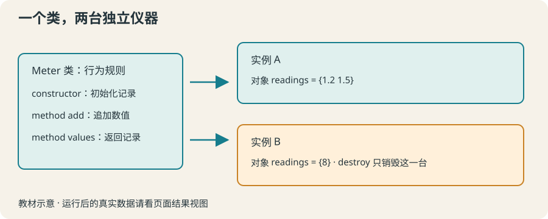

# 15 · TclOO 入门：两台仪器，各自记住测量值

用类定义行为，用对象保存各自的状态，掌握创建、调用方法和销毁。

约 45 分钟。前置知识：过程与参数、作用域与 namespace variable、列表与统计

## 要解决的问题

两台测量仪器分别记录不同实验的数据。用一个共享列表会把它们混在一起。对象把“这一台的测量列表”与“这台能做的操作”放在一起，让两台仪器使用同样的方法，却保有各自的记录。

## 学习目标

- 使用 oo::class create 定义简单类
- 通过 constructor 设置初始状态
- 用 method 读取或更新对象变量
- 创建并比较两个独立实例
- 使用 destroy 释放实例并判断何时过程已足够



## 类是规则，对象是具体的一台

oo::class create Meter 定义类；Meter new 创建实例并返回对象命令名。对象命令名由解释器生成，保存到变量 m；调用 $m add 1.2 就是向这一台实例发出请求。TclOO 随 Tcl 8.6 及以上提供。

## constructor 设置每个实例的初始状态

类体中的 variable readings 声明对象变量。constructor {} {set readings {}} 初始化每个新实例的记录。它不是命名空间里所有实例共用的一个列表；两个实例各有自己的变量。

## method 是对象可调用的操作

method add {value} {lappend readings $value} 定义方法。类声明的对象变量会在方法中可访问，形参如 value 仍是本次调用的局部变量。平均值需要先判断空列表；实际测量工具还应验证输入并定义单位。

## destroy 与更简单的方案

用 $m destroy 销毁该实例；它对应的命令随即消失，继续调用会报错。只有一次计算、没有持续状态时，过程往往更清楚。这里用对象是因为多台仪器独立保存多次调用之间的状态，不意味着所有脚本都必须面向对象。

## 示例 1 · 一台仪器记录两次数值

```tcl
oo::class create Meter {
    variable readings
    constructor {} { set readings {} }
    method add {value} { lappend readings $value }
    method values {} { return $readings }
}
set m [Meter new]
$m add 1.2
$m add 1.5
puts "记录：[$m values]"
$m destroy
```
默认模拟参数（JSON 数组表示）：

```text
argv = []
argc = 0
```

没有额外预置文件。

预期输出：

```text
记录：1.2 1.5
```
<details><summary>本地准备与运行（Tcl 8.6+）</summary>

```sh
# 从本仓库根目录执行；文件读写发生在新建的临时练习目录。
workshop_repo="$PWD"
practice_dir="$(mktemp -d)"
cd "$practice_dir"
tclsh "$workshop_repo"/examples/15/01.tcl
# 生成文件留在 practice_dir；执行后回到仓库。
cd "$workshop_repo"
```


</details>
## 示例 2 · 两个对象互不混用记录

```tcl
oo::class create CounterMeter {
    variable readings
    constructor {} { set readings {} }
    method add {value} { lappend readings $value }
    method count {} { return [llength $readings] }
}
set first [CounterMeter new]
set second [CounterMeter new]
$first add 10
$first add 20
$second add 8
puts "第一台：[$first count] 条"
puts "第二台：[$second count] 条"
$first destroy
$second destroy
```
默认模拟参数（JSON 数组表示）：

```text
argv = []
argc = 0
```

没有额外预置文件。

预期输出：

```text
第一台：2 条
第二台：1 条
```
<details><summary>本地准备与运行（Tcl 8.6+）</summary>

```sh
# 从本仓库根目录执行；文件读写发生在新建的临时练习目录。
workshop_repo="$PWD"
practice_dir="$(mktemp -d)"
cd "$practice_dir"
tclsh "$workshop_repo"/examples/15/02.tcl
# 生成文件留在 practice_dir；执行后回到仓库。
cd "$workshop_repo"
```


</details>
## 示例 3 · 空数据状态与销毁后的命令

```tcl
oo::class create AverageMeter {
    variable values
    constructor {} { set values {} }
    method add {x} { lappend values $x }
    method average {} {
        if {[llength $values] == 0} { return {无数据} }
        set total 0.0
        foreach x $values { set total [expr {$total + $x}] }
        return [format "%.2f" [expr {$total / [llength $values]}]]
    }
}
set m [AverageMeter new]
puts [$m average]
$m add 2
$m add 4
puts [$m average]
$m destroy
puts "销毁后存在：[expr {[llength [info commands $m]] > 0}]"
```
默认模拟参数（JSON 数组表示）：

```text
argv = []
argc = 0
```

没有额外预置文件。

预期输出：

```text
无数据
3.00
销毁后存在：0
```
<details><summary>本地准备与运行（Tcl 8.6+）</summary>

```sh
# 从本仓库根目录执行；文件读写发生在新建的临时练习目录。
workshop_repo="$PWD"
practice_dir="$(mktemp -d)"
cd "$practice_dir"
tclsh "$workshop_repo"/examples/15/03.tcl
# 生成文件留在 practice_dir；执行后回到仓库。
cd "$workshop_repo"
```


</details>
## 修改一个条件

在例子 2 中只向 first 追加第三条记录，观察 second 数量不变。尝试对销毁后的对象调用 count，在错误区查看失效命令提示，之后再创建新实例。

## 常见错误

- **忘记类体 variable readings，以为方法里的 set 会自动成为持久状态。**：明确声明对象变量，并在 constructor 初始化；这样方法之间才访问同一台仪器的记录。
- **销毁对象后继续用保存的名称调用方法，或认为两个实例共享一个列表。**：destroy 移除了对象命令；创建新的实例才能重新使用。每个实例独立初始化对象状态。

## 练习 1 · 带名字的仪器

定义 NamedMeter，constructor {label} 存储名字，method label {} 返回名字。创建“温度计 A”并输出，然后销毁。

```tcl
oo::class create NamedMeter {
    # 声明对象变量，定义构造器与 label 方法
}
set meter [NamedMeter new {温度计 A}]
puts [$meter label]
$meter destroy
```
默认模拟参数（JSON 数组表示）：

```text
argv = []
argc = 0
```

没有额外预置文件。

目标输出：

```text
温度计 A
```
<details><summary>逐层提示</summary>

variable name 在类体声明对象变量。

构造参数 label 赋给 name，方法 return $name。

</details>
<details><summary>参考答案</summary>

```tcl
oo::class create NamedMeter {
    variable name
    constructor {label} { set name $label }
    method label {} { return $name }
}
set meter [NamedMeter new {温度计 A}]
puts [$meter label]
$meter destroy
```
<details><summary>本地准备与运行（Tcl 8.6+）</summary>

```sh
# 从本仓库根目录执行；文件读写发生在新建的临时练习目录。
workshop_repo="$PWD"
practice_dir="$(mktemp -d)"
cd "$practice_dir"
tclsh "$workshop_repo"/solutions/15/01.tcl
# 生成文件留在 practice_dir；执行后回到仓库。
cd "$workshop_repo"
```


</details>


</details>

## 练习 2 · 独立的测量列表

定义 SampleMeter，初始记录为空；add {value} 追加数值并返回数量，values {} 返回记录。创建对象、加入两值、输出列表、销毁。

```tcl
oo::class create SampleMeter {
    # readings 是对象状态
}
set meter [SampleMeter new]
$meter add 5
$meter add 7
puts [$meter values]
$meter destroy
```
默认模拟参数（JSON 数组表示）：

```text
argv = []
argc = 0
```

没有额外预置文件。

目标输出：

```text
5 7
```
<details><summary>逐层提示</summary>

初始化空列表后，用 lappend 保存每次传入的值。

返回列表与计数是两个不同方法的职责。

</details>
<details><summary>参考答案</summary>

```tcl
oo::class create SampleMeter {
    variable readings
    constructor {} { set readings {} }
    method add {value} {
        lappend readings $value
        return [llength $readings]
    }
    method values {} { return $readings }
}
set meter [SampleMeter new]
$meter add 5
$meter add 7
puts [$meter values]
$meter destroy
```
<details><summary>本地准备与运行（Tcl 8.6+）</summary>

```sh
# 从本仓库根目录执行；文件读写发生在新建的临时练习目录。
workshop_repo="$PWD"
practice_dir="$(mktemp -d)"
cd "$practice_dir"
tclsh "$workshop_repo"/solutions/15/02.tcl
# 生成文件留在 practice_dir；执行后回到仓库。
cd "$workshop_repo"
```


</details>


</details>

## 练习 3 · 带清零与平均值的仪器

定义 StatsMeter，add {value} 记录值，average {} 返回两位小数文本（空数据返回“无数据”），reset {} 清空记录。输入保证有限数值。用两次读取验证清零。

```tcl
oo::class create StatsMeter {
    # 完成 constructor、add、average、reset
}
set meter [StatsMeter new]
$meter add 2
$meter add 6
puts [$meter average]
$meter reset
puts [$meter average]
$meter destroy
```
默认模拟参数（JSON 数组表示）：

```text
argv = []
argc = 0
```

没有额外预置文件。

目标输出：

```text
4.00
无数据
```
<details><summary>逐层提示</summary>

average 先处理空列表；sum 从 0.0 开始。

reset 必须清空当前对象的 readings，而不是创建普通局部变量。

</details>
<details><summary>参考答案</summary>

```tcl
oo::class create StatsMeter {
    variable readings
    constructor {} { set readings {} }
    method add {value} { lappend readings $value }
    method average {} {
        if {[llength $readings] == 0} { return {无数据} }
        set sum 0.0
        foreach value $readings { set sum [expr {$sum + $value}] }
        return [format "%.2f" [expr {$sum / [llength $readings]}]]
    }
    method reset {} { set readings {} }
}
set meter [StatsMeter new]
$meter add 2
$meter add 6
puts [$meter average]
$meter reset
puts [$meter average]
$meter destroy
```
<details><summary>本地准备与运行（Tcl 8.6+）</summary>

```sh
# 从本仓库根目录执行；文件读写发生在新建的临时练习目录。
workshop_repo="$PWD"
practice_dir="$(mktemp -d)"
cd "$practice_dir"
tclsh "$workshop_repo"/solutions/15/03.tcl
# 生成文件留在 practice_dir；执行后回到仓库。
cd "$workshop_repo"
```


</details>


</details>

## 理解检查

同一个类创建的两个对象，readings 应该是什么关系？

1. 总是共用同一份列表
2. 各自独立
3. 只能一个对象拥有

<details><summary>答案与解释</summary>

各自独立。实例保存独立对象变量，类提供可复用的行为定义。

</details>
一次性计算 total = quantity * price，通常选什么更清楚？

1. 必须使用类
2. 简单过程通常足够
3. 必须保存全局对象

<details><summary>答案与解释</summary>

简单过程通常足够。无持续状态的计算不需要对象；对象适合多份独立、跨调用状态。

</details>

## 速查

- 类：oo::class create Meter { variable readings; constructor {} {...}; method add {x} {...} }
- 实例：set m [Meter new]
- 调用：$m add 1.2；set result [$m average]
- 销毁：$m destroy
- TclOO 要求 Tcl 8.6+；不需要外部面向对象扩展。

下一节：第 16 节进入 VLSI 场景：首先区分 Tcl 命令与 EDA 工具命令，并用透明的教学模型做对象筛选。
