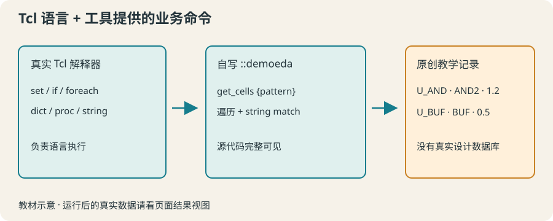

# 16 · Tcl 与 EDA 工具：先分清谁提供了命令

以自己编写的设计记录模型练习筛选，区分语言命令与工具扩展命令。

约 40 分钟。前置知识：列表与字典、过程与 namespace、字符串匹配

## 要解决的问题

在设计自动化教程中常看到 get_cells、report_timing 一类命令。在普通 tclsh 或本网站运行它们却提示“invalid command name”。这不是 Tcl 学错了，而是这些命令由具体工具提供。我们先用透明、很小的自写模型练习筛选思路。

## 学习目标

- 区分 Tcl 核心命令与宿主工具命令
- 解释工具为什么能提供额外的 Tcl 命令
- 用自写模型按名称与字段筛选记录
- 说明教学列表与真实工具对象集合的差别
- 确认浏览器没有连接商业 EDA 软件



## Tcl 是语言，EDA 工具提供业务命令

set、if、foreach、dict、proc 是 Tcl 命令。宿主软件可以注册额外命令，把设计数据库中的对象交给 Tcl 操作。许多工具采用 Tcl 来组合查询、条件和报告；同名工具命令的参数及返回类型仍须查对应工具文档。

## 普通解释器不自带设计数据库

本网站只运行真实 Tcl，不启动综合、布局布线或时序工具，也不接入私人服务器。get_cells 不是 Tcl 核心命令。我们将自己定义 ::demoeda::get_cells，每一行实现都可见，它查询的是原创教学字典列表。

## 教学记录就是字段和值

本节记录包含 name、kind、area。area 是随意设置的教学面积单位，没有工艺含义。用 dict get 访问字段，string match 用 glob 模式匹配名称；* 表示任意长度字符。把筛选条件放在过程参数中，方便使用新数据验证。

## 不能把教学模型的行为套到真实工具

这里返回标准 Tcl 列表，因此可以 foreach 与 llength。真实工具可能返回专有 collection、对象句柄或其他类型，常有专门的遍历命令。工具名、属性单位、查询语法和空结果语义都需要在使用该工具前确认。

## 示例 1 · 普通 Tcl 中哪些命令存在

```tcl
puts "Tcl 的 dict：[expr {[llength [info commands dict]] > 0}]"
puts "工具的 get_cells：[expr {[llength [info commands get_cells]] > 0}]"
if {[catch {get_cells *} message]} {
    puts "当前没有 EDA 工具命令；先加载教学模型"
}
```
默认模拟参数（JSON 数组表示）：

```text
argv = []
argc = 0
```

没有额外预置文件。

预期输出：

```text
Tcl 的 dict：1
工具的 get_cells：0
当前没有 EDA 工具命令；先加载教学模型
```
<details><summary>本地准备与运行（Tcl 8.6+）</summary>

```sh
# 从本仓库根目录执行；文件读写发生在新建的临时练习目录。
workshop_repo="$PWD"
practice_dir="$(mktemp -d)"
cd "$practice_dir"
tclsh "$workshop_repo"/examples/16/01.tcl
# 生成文件留在 practice_dir；执行后回到仓库。
cd "$workshop_repo"
```


</details>
## 示例 2 · 用字典记录演示筛选

```tcl
set cells [list     [dict create name U_AND kind AND2 area 1.2]     [dict create name U_BUF kind BUF area 0.5]     [dict create name CLK_BUF kind BUF area 0.8]]
foreach cell $cells {
    if {[dict get $cell kind] eq "BUF"} {
        puts "[dict get $cell name]：[dict get $cell area]"
    }
}
```
默认模拟参数（JSON 数组表示）：

```text
argv = []
argc = 0
```

没有额外预置文件。

预期输出：

```text
U_BUF：0.5
CLK_BUF：0.8
```
<details><summary>本地准备与运行（Tcl 8.6+）</summary>

```sh
# 从本仓库根目录执行；文件读写发生在新建的临时练习目录。
workshop_repo="$PWD"
practice_dir="$(mktemp -d)"
cd "$practice_dir"
tclsh "$workshop_repo"/examples/16/02.tcl
# 生成文件留在 practice_dir；执行后回到仓库。
cd "$workshop_repo"
```


</details>
## 示例 3 · 可见实现的教学工具命令

```tcl
namespace eval demoeda {
    variable cells [list         [dict create name U_AND kind AND2]         [dict create name U_BUF kind BUF]         [dict create name CLK_BUF kind BUF]]
    proc get_cells {pattern} {
        variable cells
        set selected {}
        foreach cell $cells {
            if {[string match $pattern [dict get $cell name]]} {
                lappend selected [dict get $cell name]
            }
        }
        return $selected
    }
}
puts "教学查询：[::demoeda::get_cells U_*]"
puts "无匹配数量：[llength [::demoeda::get_cells X_*]]"
```
默认模拟参数（JSON 数组表示）：

```text
argv = []
argc = 0
```

没有额外预置文件。

预期输出：

```text
教学查询：U_AND U_BUF
无匹配数量：0
```
<details><summary>本地准备与运行（Tcl 8.6+）</summary>

```sh
# 从本仓库根目录执行；文件读写发生在新建的临时练习目录。
workshop_repo="$PWD"
practice_dir="$(mktemp -d)"
cd "$practice_dir"
tclsh "$workshop_repo"/examples/16/03.tcl
# 生成文件留在 practice_dir；执行后回到仓库。
cd "$workshop_repo"
```


</details>
## 修改一个条件

把例子 3 的模式 U_* 改成 *BUF，然后新增一条完全不同名称的记录。判断结果应该如何改变，再运行核对。所有记录仍是教学数据，不代表真实网表。

## 常见错误

- **在普通 tclsh 或浏览器里直接运行 get_cells，认为所有 EDA 命令都是 Tcl 核心。**：确认宿主环境与命令来源。本课的 ::demoeda::get_cells 是自己编写的教学过程；真实工具需要它的可用环境。
- **把真实工具返回的 collection 当普通列表，直接使用 llength。**：查询该工具的对象与集合文档。这里只用自己创建的标准 Tcl 列表，不能推断所有工具也如此。

## 练习 1 · 按名称筛选教学列表

定义 matchNames {names pattern}，按 string match 保留匹配名称，维持原顺序。输出以 U_ 开头的名称。

```tcl
proc matchNames {names pattern} {
    # 返回匹配名称列表
}
puts [matchNames {U_AND CLK_BUF U_BUF} U_*]
```
默认模拟参数（JSON 数组表示）：

```text
argv = []
argc = 0
```

没有额外预置文件。

目标输出：

```text
U_AND U_BUF
```
<details><summary>逐层提示</summary>

string match 的顺序是 pattern、string。

构建空 result，foreach 时只追加匹配项。

</details>
<details><summary>参考答案</summary>

```tcl
proc matchNames {names pattern} {
    set result {}
    foreach name $names {
        if {[string match $pattern $name]} { lappend result $name }
    }
    return $result
}
puts [matchNames {U_AND CLK_BUF U_BUF} U_*]
```
<details><summary>本地准备与运行（Tcl 8.6+）</summary>

```sh
# 从本仓库根目录执行；文件读写发生在新建的临时练习目录。
workshop_repo="$PWD"
practice_dir="$(mktemp -d)"
cd "$practice_dir"
tclsh "$workshop_repo"/solutions/16/01.tcl
# 生成文件留在 practice_dir；执行后回到仓库。
cd "$workshop_repo"
```


</details>


</details>

## 练习 2 · 按单元类型筛选

定义 namesOfKind {records kind}。records 是含 name、kind、area 的字典列表。返回 kind 字段精确等于参数的单元名称；不要用名称推测类型。

```tcl
proc namesOfKind {records kind} {
    # 检查字段，不要猜名字
}
set cells [list     [dict create name U1 kind BUF area 0.5]     [dict create name U2 kind AND2 area 1.2]     [dict create name U3 kind BUF area 0.8]]
puts [namesOfKind $cells BUF]
```
默认模拟参数（JSON 数组表示）：

```text
argv = []
argc = 0
```

没有额外预置文件。

目标输出：

```text
U1 U3
```
<details><summary>逐层提示</summary>

dict get $cell kind 读取类型；eq 做字符串精确比较。

选择记录后，追加该记录的 name 字段。

</details>
<details><summary>参考答案</summary>

```tcl
proc namesOfKind {records kind} {
    set result {}
    foreach cell $records {
        if {[dict get $cell kind] eq $kind} {
            lappend result [dict get $cell name]
        }
    }
    return $result
}
set cells [list     [dict create name U1 kind BUF area 0.5]     [dict create name U2 kind AND2 area 1.2]     [dict create name U3 kind BUF area 0.8]]
puts [namesOfKind $cells BUF]
```
<details><summary>本地准备与运行（Tcl 8.6+）</summary>

```sh
# 从本仓库根目录执行；文件读写发生在新建的临时练习目录。
workshop_repo="$PWD"
practice_dir="$(mktemp -d)"
cd "$practice_dir"
tclsh "$workshop_repo"/solutions/16/02.tcl
# 生成文件留在 practice_dir；执行后回到仓库。
cd "$workshop_repo"
```


</details>


</details>

## 练习 3 · 组合名称与面积条件

定义 selectCells {records pattern maxArea}，返回名称匹配 pattern 且 area <= maxArea 的原字典记录列表。数据格式保证完整且面积为非负有限数。输出筛选数量与名称。

```tcl
proc selectCells {records pattern maxArea} {
    # 两个条件必须同时成立
}
set cells [list     [dict create name U_A kind AND2 area 1.2]     [dict create name U_B kind BUF area 0.5]     [dict create name CLK_B kind BUF area 0.4]]
set selected [selectCells $cells U_* 1.0]
puts "教学筛选：[llength $selected] 个"
foreach cell $selected { puts [dict get $cell name] }
```
默认模拟参数（JSON 数组表示）：

```text
argv = []
argc = 0
```

没有额外预置文件。

目标输出：

```text
教学筛选：1 个
U_B
```
<details><summary>逐层提示</summary>

字符串匹配与数值比较用 && 连接。

lappend 原 cell，而不是仅追加 name，才能保留后续需要的字段。

</details>
<details><summary>参考答案</summary>

```tcl
proc selectCells {records pattern maxArea} {
    set result {}
    foreach cell $records {
        if {[string match $pattern [dict get $cell name]] && [dict get $cell area] <= $maxArea} {
            lappend result $cell
        }
    }
    return $result
}
set cells [list     [dict create name U_A kind AND2 area 1.2]     [dict create name U_B kind BUF area 0.5]     [dict create name CLK_B kind BUF area 0.4]]
set selected [selectCells $cells U_* 1.0]
puts "教学筛选：[llength $selected] 个"
foreach cell $selected { puts [dict get $cell name] }
```
<details><summary>本地准备与运行（Tcl 8.6+）</summary>

```sh
# 从本仓库根目录执行；文件读写发生在新建的临时练习目录。
workshop_repo="$PWD"
practice_dir="$(mktemp -d)"
cd "$practice_dir"
tclsh "$workshop_repo"/solutions/16/03.tcl
# 生成文件留在 practice_dir；执行后回到仓库。
cd "$workshop_repo"
```


</details>


</details>

## 理解检查

get_cells 的来源通常是什么？

1. Tcl 语言规范必带命令
2. 具体 EDA 工具提供的扩展命令
3. 任意网页都自动提供

<details><summary>答案与解释</summary>

具体 EDA 工具提供的扩展命令。工具将自己的设计数据库能力注册到 Tcl；普通解释器不自带。

</details>
本课程 demoeda 返回普通 Tcl 列表，可以推断真实工具也如此吗？

1. 可以
2. 不能，需查工具文档
3. 只要名字相同就可以

<details><summary>答案与解释</summary>

不能，需查工具文档。工具可能使用专有集合与遍历接口，本模型只演示筛选思路。

</details>

## 速查

- 语言命令：set、if、foreach、dict、proc
- 教学命令：::demoeda::get_cells（源代码在本节例子）
- glob 匹配：string match U_* $name
- 字段读取：dict get $cell kind
- 本网站不连接商业 EDA；教学面积单位没有工艺意义。

下一节：第 17 节用简化教学时序数据理解周期、路径延迟与 slack，并筛选需要关注的路径。
