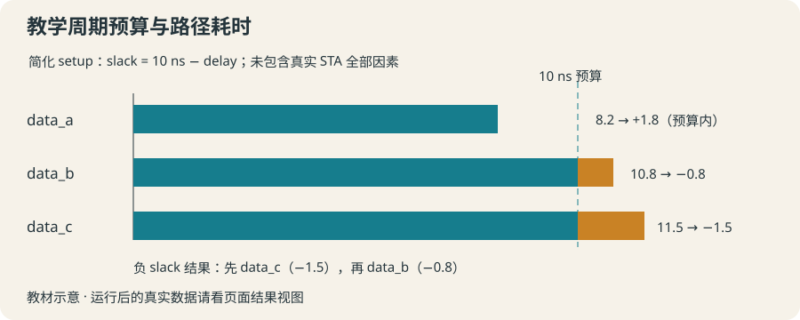

# 17 · 约束与报告：用教学路径看懂 slack

以周期减延迟的简化模型计算 slack，解析教学报告并排序关注路径。

约 45 分钟。前置知识：正则与捕获组、字典与列表、数值计算与过程、Tcl 与 EDA 工具

## 要解决的问题

一份教学设计报告列出三条路径。假设它们都必须在 10 ns 内完成，哪些来得及，哪些需要关注？先把周期看成公交发车间隔、延迟看成完成任务耗时，再用明确的数据模型计算剩余时间。

## 学习目标

- 解释教学时钟周期与路径延迟的单位
- 计算简化模型中的 slack
- 解析明确格式的教学报告
- 筛选负 slack 并按数值排序
- 列出真实 STA 与简化模型的重要差异



## 周期、延迟与单位

本节所有数值单位都是 ns。教学模型假设单周期、同一时钟的简化 setup 检查：slack = period - delay。8.2 ns 的耗时在 10 ns 预算内，剩余 1.8 ns；10.8 ns 则超出 0.8 ns。负值标为需要关注，零表示模型中恰好达到边界。

## 这不是完整的 STA 方程

真实 setup slack 一般是 required arrival time 减 actual arrival time，还涉及时钟边沿、时钟树延迟与 skew、setup time、uncertainty、传播延迟、I/O 和多周期等约束。hold 检查另有要求。本课没有这些因素，不生成可用于签核的时序结论。

## 先约定报告格式再解析

教学行格式为 PATH 名称 DELAY 数值，例如 PATH data_a DELAY 8.2。先 regexp 抓取两个字段，再验证数值范围。路径名在本课不含空白；生产报告格式会更复杂，不应把这个模式直接套上所有工具输出。

## 排序应使用数值，不是字典序

将 [list slack path] 作为排序行，用 lsort -real -index 0；更负的 slack 排在前面。需要关注的条件是 slack < 0，显示时 format 保留两位小数；选择与排序使用未四舍五入的数值。

## 示例 1 · 一个周期，两种路径延迟

```tcl
set period 10.0
foreach delay {8.2 10.8} {
    set slack [expr {$period - $delay}]
    puts [format "延迟 %.2f ns → slack %.2f ns" $delay $slack]
}
```
默认模拟参数（JSON 数组表示）：

```text
argv = []
argc = 0
```

没有额外预置文件。

预期输出：

```text
延迟 8.20 ns → slack 1.80 ns
延迟 10.80 ns → slack -0.80 ns
```
<details><summary>本地准备与运行（Tcl 8.6+）</summary>

```sh
# 从本仓库根目录执行；文件读写发生在新建的临时练习目录。
workshop_repo="$PWD"
practice_dir="$(mktemp -d)"
cd "$practice_dir"
tclsh "$workshop_repo"/examples/17/01.tcl
# 生成文件留在 practice_dir；执行后回到仓库。
cd "$workshop_repo"
```


</details>
## 示例 2 · 从一行教学报告提取字段

```tcl
set line "PATH data_a DELAY 10.8"
if {![regexp {^PATH\s+(\S+)\s+DELAY\s+([0-9]+(?:\.[0-9]+)?)$} $line -> path delay]} {
    error "不是约定的教学报告格式"
}
set record [dict create path $path delay $delay slack [expr {10.0 - $delay}]]
puts "路径：[dict get $record path]"
puts [format "slack：%.2f ns" [dict get $record slack]]
```
默认模拟参数（JSON 数组表示）：

```text
argv = []
argc = 0
```

没有额外预置文件。

预期输出：

```text
路径：data_a
slack：-0.80 ns
```
<details><summary>本地准备与运行（Tcl 8.6+）</summary>

```sh
# 从本仓库根目录执行；文件读写发生在新建的临时练习目录。
workshop_repo="$PWD"
practice_dir="$(mktemp -d)"
cd "$practice_dir"
tclsh "$workshop_repo"/examples/17/02.tcl
# 生成文件留在 practice_dir；执行后回到仓库。
cd "$workshop_repo"
```


</details>
## 示例 3 · 负 slack 从最需要关注的开始

```tcl
set period 10.0
set pairs {}
foreach {path delay} {data_a 8.2 data_b 10.8 data_c 11.5} {
    set slack [expr {$period - $delay}]
    if {$slack < 0} { lappend pairs [list $slack $path] }
}
foreach pair [lsort -real -index 0 $pairs] {
    lassign $pair slack path
    puts [format "%s | %.2f ns" $path $slack]
}
```
默认模拟参数（JSON 数组表示）：

```text
argv = []
argc = 0
```

没有额外预置文件。

预期输出：

```text
data_c | -1.50 ns
data_b | -0.80 ns
```
<details><summary>本地准备与运行（Tcl 8.6+）</summary>

```sh
# 从本仓库根目录执行；文件读写发生在新建的临时练习目录。
workshop_repo="$PWD"
practice_dir="$(mktemp -d)"
cd "$practice_dir"
tclsh "$workshop_repo"/examples/17/03.tcl
# 生成文件留在 practice_dir；执行后回到仓库。
cd "$workshop_repo"
```


</details>
## 修改一个条件

把例子 3 的 period 从 10.0 改成 11.0，观察 data_b 转为非负，data_c 仍需关注。再改成 11.5，观察零 slack 的路径没有被选入负值列表。说明这只改变教学预算，不是优化电路。

## 常见错误

- **把 slack 计算写成 delay - period，或者把零 slack 也算成负值。**：本教学 setup 模型为 period - delay；严格负值使用 < 0。真实约束检查还需完整工具模型。
- **用默认 lsort 排序 slack，或先四舍五入再判断。**：使用 -real 做数值排序，先根据原数值筛选；format 只用于最后显示。

## 练习 1 · 可重复使用的 slack 计算

定义 teachingSlack {period delay}，返回 period - delay。输入为有限数值，周期为正，延迟非负。输出 10 ns 周期和 9.5 ns 延迟的结果。

```tcl
proc teachingSlack {period delay} {
    # 简化模型；返回数值
}
puts [format "教学 slack：%.2f ns" [teachingSlack 10 9.5]]
```
默认模拟参数（JSON 数组表示）：

```text
argv = []
argc = 0
```

没有额外预置文件。

目标输出：

```text
教学 slack：0.50 ns
```
<details><summary>逐层提示</summary>

两个输入必须都参与计算。

返回原始数值，显示格式由调用方决定。

</details>
<details><summary>参考答案</summary>

```tcl
proc teachingSlack {period delay} {
    return [expr {double($period) - $delay}]
}
puts [format "教学 slack：%.2f ns" [teachingSlack 10 9.5]]
```
<details><summary>本地准备与运行（Tcl 8.6+）</summary>

```sh
# 从本仓库根目录执行；文件读写发生在新建的临时练习目录。
workshop_repo="$PWD"
practice_dir="$(mktemp -d)"
cd "$practice_dir"
tclsh "$workshop_repo"/solutions/17/01.tcl
# 生成文件留在 practice_dir；执行后回到仓库。
cd "$workshop_repo"
```


</details>


</details>

## 练习 2 · 解析一行，拒绝坏格式

定义 parseTeachingPath {line period}，格式为 PATH 名称 DELAY 非负十进制数（整数或带小数，路径名无空白）。返回 path、delay、slack 字典；坏格式 error "教学路径格式错误"。周期保证有效。

```tcl
proc parseTeachingPath {line period} {
    # regexp 提取字段并返回字典
}
set record [parseTeachingPath {PATH p7 DELAY 10.2} 10]
puts "[dict get $record path]：[format %.2f [dict get $record slack]]"
```
默认模拟参数（JSON 数组表示）：

```text
argv = []
argc = 0
```

没有额外预置文件。

目标输出：

```text
p7：-0.20
```
<details><summary>逐层提示</summary>

^ 与 $ 要求整行符合格式，捕获组分别接 path 和 delay。

expr 用捕获出的 delay 与参数 period 计算，dict create 保存字段。

</details>
<details><summary>参考答案</summary>

```tcl
proc parseTeachingPath {line period} {
    if {![regexp {^PATH\s+(\S+)\s+DELAY\s+([0-9]+(?:\.[0-9]+)?)$} $line -> path delay]} {
        error "教学路径格式错误"
    }
    return [dict create path $path delay $delay slack [expr {double($period) - $delay}]]
}
set record [parseTeachingPath {PATH p7 DELAY 10.2} 10]
puts "[dict get $record path]：[format %.2f [dict get $record slack]]"
```
<details><summary>本地准备与运行（Tcl 8.6+）</summary>

```sh
# 从本仓库根目录执行；文件读写发生在新建的临时练习目录。
workshop_repo="$PWD"
practice_dir="$(mktemp -d)"
cd "$practice_dir"
tclsh "$workshop_repo"/solutions/17/02.tcl
# 生成文件留在 practice_dir；执行后回到仓库。
cd "$workshop_repo"
```


</details>


</details>

## 练习 3 · 筛选并按严重程度排序

定义 attentionPaths {records}。输入字典列表含 path 与 slack。返回 [list slack path] 行的列表，仅保留 slack < 0，按 slack 数值升序排列；输出结果。

```tcl
proc attentionPaths {records} {
    # 构造排序行，只选择严格负值
}
set paths [list     [dict create path a slack -0.2]     [dict create path b slack 0.0]     [dict create path c slack -1.1]]
foreach row [attentionPaths $paths] {
    lassign $row slack path
    puts [format "%s：%.2f ns" $path $slack]
}
```
默认模拟参数（JSON 数组表示）：

```text
argv = []
argc = 0
```

没有额外预置文件。

目标输出：

```text
c：-1.10 ns
a：-0.20 ns
```
<details><summary>逐层提示</summary>

先筛选，lappend [list $slack $path]。

lsort -real -index 0 按每一行的第 0 个元素做数值排序。

</details>
<details><summary>参考答案</summary>

```tcl
proc attentionPaths {records} {
    set selected {}
    foreach record $records {
        set slack [dict get $record slack]
        if {$slack < 0} {
            lappend selected [list $slack [dict get $record path]]
        }
    }
    return [lsort -real -index 0 $selected]
}
set paths [list     [dict create path a slack -0.2]     [dict create path b slack 0.0]     [dict create path c slack -1.1]]
foreach row [attentionPaths $paths] {
    lassign $row slack path
    puts [format "%s：%.2f ns" $path $slack]
}
```
<details><summary>本地准备与运行（Tcl 8.6+）</summary>

```sh
# 从本仓库根目录执行；文件读写发生在新建的临时练习目录。
workshop_repo="$PWD"
practice_dir="$(mktemp -d)"
cd "$practice_dir"
tclsh "$workshop_repo"/solutions/17/03.tcl
# 生成文件留在 practice_dir；执行后回到仓库。
cd "$workshop_repo"
```


</details>


</details>

## 理解检查

本节简化模型中，period = 8，delay = 9，slack 是？

1. +1 ns
2. -1 ns
3. 0 ns

<details><summary>答案与解释</summary>

-1 ns。预算减耗时为 8 - 9 = -1，教学模型中超出预算。

</details>
真实 STA 能否直接用本节 period - delay 作为完整结论？

1. 可以，永远正确
2. 不能，还需时钟与器件等约束因素
3. 只看路径名称即可

<details><summary>答案与解释</summary>

不能，还需时钟与器件等约束因素。简化模型忽略 setup、时钟树、uncertainty 等因素，也不覆盖 hold。

</details>

## 速查

- 教学 setup 模型：slack = period - delay（单位一致）
- 关注条件：$slack < 0；零值不属于负值。
- 解析：regexp {^PATH ... DELAY ...$} $line -> path delay
- 数值排序：lsort -real -index 0 $rows
- 显示：format "%.2f ns" $slack；真实 STA 需工具完整约束模型。

下一节：第 18 节把多份教学报告读取、解析、统计和错误处理合为一份可追溯摘要。
