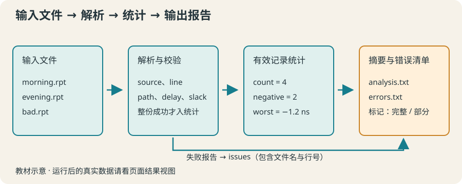

# 18 · 自动生成分析摘要：把整条处理链连起来

读取多份教学报告，保留来源与错误，汇总路径数量、负 slack 与最差值。

约 55 分钟。前置知识：文件读写与错误处理、source 与参数、列表、字典与过程、教学约束与路径筛选

## 要解决的问题

每天收到多份教学路径报告，手动相加会漏文件，遇到坏行还可能把半份报告当成完整数据。我们需要可追溯流程：读入每份文件、解析成字典、累计统计、保存摘要，并明确列出没有成功处理的输入。

## 学习目标

- 将读取、解析和统计拆分为可测试过程
- 为每条记录保存文件与行号来源
- 明确处理一份报告失败的策略
- 生成摘要文件和单独的错误记录
- 覆盖空报告、错误报告和不同输入



## 定义输入与处理策略

仍使用上一节 PATH 名称 DELAY 非负十进制数格式。空行和以 # 开头的注释跳过；周期须为正，周期与延迟限定在本教学的 1000 ns 范围内。某文件任何一行失败，就整份文件不计入统计，避免半份结果冒充完整数据；其他成功文件仍可汇总。

## 读取层返回记录或抛错

附件 report-tools.tcl 定义 parseReport。每条记录含 source、line、path、delay、slack。catch 包住读取，close 后传递原错误；坏行携带文件名与行号。数值通过已约定的十进制格式检查再转换。没有路径的报告返回空列表，仍是成功读取。

## 协调层分别收集数据与问题

collectReports 接受文件列表和周期。成功记录进入 records，失败信息进入 issues，同时记下 loaded 成功文件数。单文件失败与空文件不同：不能把失败静默改成空列表。下方代码会 source 自带的工具；下载或查看课程源码可审查工具全文。

## 统计层不依赖文件

summarizeRecords 只接受记录列表，返回 count、negative、worst。空记录用空字符串表示“没有最差值”，显示为“无数据”，绝不把它说成零 slack。负 slack 用 < 0；最差值在所有有效记录中取最小值。

## 输出时说明结论的范围

摘要写成功文件数、路径数、负 slack 数、最差 slack；错误清单另存。若有失败输入，标题必须说明为部分结果。来源文件名和行号使异常可以追回原处。这里仍是教学单周期模型，不能作为真实设计签核报告。

## 示例 1 · 两份报告合成一组记录

```tcl
source report-tools.tcl
set result [collectReports {morning.rpt evening.rpt} 10]
puts "成功文件：[dict get $result loaded]"
foreach record [dict get $result records] {
    puts [format "%s:%d %s slack=%.2f ns" [dict get $record source] [dict get $record line] [dict get $record path] [dict get $record slack]]
}
```
默认模拟参数（JSON 数组表示）：

```text
argv = []
argc = 0
```

- 虚拟路径 `report-tools.tcl` → [本地输入文件](../../data/lesson-18/example-1/report-tools.tcl)

<details><summary>查看 report-tools.tcl 的完整内容</summary>

```tcl
proc parseReport {path period} {
    if {![regexp {^[0-9]+(?:\.[0-9]+)?$} $period]} {
        error "周期必须是正十进制数"
    }
    scan $period %f period
    if {$period <= 0 || $period > 1000} { error "周期须满足 0 < period <= 1000 ns" }
    set ch [open $path r]
    set status [catch {
        set records {}
        set lineNo 0
        while {[gets $ch line] >= 0} {
            incr lineNo
            set line [string trim $line]
            if {$line eq "" || [string match #* $line]} { continue }
            if {![regexp {^PATH\s+(\S+)\s+DELAY\s+([0-9]+(?:\.[0-9]+)?)$} $line -> name delay]} {
                error "$path:$lineNo：教学路径格式错误"
            }
            scan $delay %f delay
            if {$delay > 1000} { error "$path:$lineNo：延迟超出教学范围" }
            lappend records [dict create source $path line $lineNo path $name delay $delay slack [expr {$period - $delay}]]
        }
        set records
    } result options]
    close $ch
    if {$status != 0} { return -options $options $result }
    return $result
}
proc collectReports {paths period} {
    set records {}
    set issues {}
    set loaded 0
    foreach path $paths {
        if {[catch {parseReport $path $period} one]} {
            lappend issues [dict create source $path message $one]
        } else {
            incr loaded
            foreach record $one { lappend records $record }
        }
    }
    return [dict create records $records issues $issues loaded $loaded]
}
proc summarizeRecords {records} {
    set count [llength $records]
    set negative 0
    set worst {}
    foreach record $records {
        set slack [dict get $record slack]
        if {$slack < 0} { incr negative }
        if {$worst eq "" || $slack < $worst} { set worst $slack }
    }
    return [dict create count $count negative $negative worst $worst]
}
```


</details>

- 虚拟路径 `morning.rpt` → [本地输入文件](../../data/lesson-18/example-1/morning.rpt)

<details><summary>查看 morning.rpt 的完整内容</summary>

```text
# 原创教学路径；单位 ns
PATH a DELAY 8.0
PATH b DELAY 10.5
```


</details>

- 虚拟路径 `evening.rpt` → [本地输入文件](../../data/lesson-18/example-1/evening.rpt)

<details><summary>查看 evening.rpt 的完整内容</summary>

```text
PATH c DELAY 9.0
PATH d DELAY 11.2
```


</details>

预期输出：

```text
成功文件：2
morning.rpt:2 a slack=2.00 ns
morning.rpt:3 b slack=-0.50 ns
evening.rpt:1 c slack=1.00 ns
evening.rpt:2 d slack=-1.20 ns
```
<details><summary>本地准备与运行（Tcl 8.6+）</summary>

```sh
# 从本仓库根目录执行；文件读写发生在新建的临时练习目录。
workshop_repo="$PWD"
practice_dir="$(mktemp -d)"
cp "$workshop_repo"/data/lesson-18/example-1/report-tools.tcl "$practice_dir"/report-tools.tcl
cp "$workshop_repo"/data/lesson-18/example-1/morning.rpt "$practice_dir"/morning.rpt
cp "$workshop_repo"/data/lesson-18/example-1/evening.rpt "$practice_dir"/evening.rpt
cd "$practice_dir"
tclsh "$workshop_repo"/examples/18/01.tcl
# 生成文件留在 practice_dir；执行后回到仓库。
cd "$workshop_repo"
```


</details>
## 示例 2 · 坏报告不混入有效统计

```tcl
source report-tools.tcl
set result [collectReports {morning.rpt bad.rpt} 10]
set summary [summarizeRecords [dict get $result records]]
puts "部分结果：成功 [dict get $result loaded] 份，失败 [llength [dict get $result issues]] 份"
puts "有效路径：[dict get $summary count]"
foreach issue [dict get $result issues] { puts [dict get $issue message] }
```
默认模拟参数（JSON 数组表示）：

```text
argv = []
argc = 0
```

- 虚拟路径 `report-tools.tcl` → [本地输入文件](../../data/lesson-18/example-2/report-tools.tcl)

<details><summary>查看 report-tools.tcl 的完整内容</summary>

```tcl
proc parseReport {path period} {
    if {![regexp {^[0-9]+(?:\.[0-9]+)?$} $period]} {
        error "周期必须是正十进制数"
    }
    scan $period %f period
    if {$period <= 0 || $period > 1000} { error "周期须满足 0 < period <= 1000 ns" }
    set ch [open $path r]
    set status [catch {
        set records {}
        set lineNo 0
        while {[gets $ch line] >= 0} {
            incr lineNo
            set line [string trim $line]
            if {$line eq "" || [string match #* $line]} { continue }
            if {![regexp {^PATH\s+(\S+)\s+DELAY\s+([0-9]+(?:\.[0-9]+)?)$} $line -> name delay]} {
                error "$path:$lineNo：教学路径格式错误"
            }
            scan $delay %f delay
            if {$delay > 1000} { error "$path:$lineNo：延迟超出教学范围" }
            lappend records [dict create source $path line $lineNo path $name delay $delay slack [expr {$period - $delay}]]
        }
        set records
    } result options]
    close $ch
    if {$status != 0} { return -options $options $result }
    return $result
}
proc collectReports {paths period} {
    set records {}
    set issues {}
    set loaded 0
    foreach path $paths {
        if {[catch {parseReport $path $period} one]} {
            lappend issues [dict create source $path message $one]
        } else {
            incr loaded
            foreach record $one { lappend records $record }
        }
    }
    return [dict create records $records issues $issues loaded $loaded]
}
proc summarizeRecords {records} {
    set count [llength $records]
    set negative 0
    set worst {}
    foreach record $records {
        set slack [dict get $record slack]
        if {$slack < 0} { incr negative }
        if {$worst eq "" || $slack < $worst} { set worst $slack }
    }
    return [dict create count $count negative $negative worst $worst]
}
```


</details>

- 虚拟路径 `morning.rpt` → [本地输入文件](../../data/lesson-18/example-2/morning.rpt)

<details><summary>查看 morning.rpt 的完整内容</summary>

```text
# 原创教学路径；单位 ns
PATH a DELAY 8.0
PATH b DELAY 10.5
```


</details>

- 虚拟路径 `bad.rpt` → [本地输入文件](../../data/lesson-18/example-2/bad.rpt)

<details><summary>查看 bad.rpt 的完整内容</summary>

```text
PATH x DELAY 7
无法解析
```


</details>

预期输出：

```text
部分结果：成功 1 份，失败 1 份
有效路径：2
bad.rpt:2：教学路径格式错误
```
<details><summary>本地准备与运行（Tcl 8.6+）</summary>

```sh
# 从本仓库根目录执行；文件读写发生在新建的临时练习目录。
workshop_repo="$PWD"
practice_dir="$(mktemp -d)"
cp "$workshop_repo"/data/lesson-18/example-2/report-tools.tcl "$practice_dir"/report-tools.tcl
cp "$workshop_repo"/data/lesson-18/example-2/morning.rpt "$practice_dir"/morning.rpt
cp "$workshop_repo"/data/lesson-18/example-2/bad.rpt "$practice_dir"/bad.rpt
cd "$practice_dir"
tclsh "$workshop_repo"/examples/18/02.tcl
# 生成文件留在 practice_dir；执行后回到仓库。
cd "$workshop_repo"
```


</details>
## 示例 3 · 写出一份教学摘要

```tcl
source report-tools.tcl
set result [collectReports {morning.rpt evening.rpt} 10]
set summary [summarizeRecords [dict get $result records]]
set output [open analysis.txt w]
puts $output "教学分析摘要（全部输入已处理）"
puts $output "路径：[dict get $summary count]"
puts $output "负 slack：[dict get $summary negative]"
puts $output [format "最差 slack：%.2f ns" [dict get $summary worst]]
close $output
set input [open analysis.txt r]
puts [string trim [read $input]]
close $input
```
默认模拟参数（JSON 数组表示）：

```text
argv = []
argc = 0
```

- 虚拟路径 `report-tools.tcl` → [本地输入文件](../../data/lesson-18/example-3/report-tools.tcl)

<details><summary>查看 report-tools.tcl 的完整内容</summary>

```tcl
proc parseReport {path period} {
    if {![regexp {^[0-9]+(?:\.[0-9]+)?$} $period]} {
        error "周期必须是正十进制数"
    }
    scan $period %f period
    if {$period <= 0 || $period > 1000} { error "周期须满足 0 < period <= 1000 ns" }
    set ch [open $path r]
    set status [catch {
        set records {}
        set lineNo 0
        while {[gets $ch line] >= 0} {
            incr lineNo
            set line [string trim $line]
            if {$line eq "" || [string match #* $line]} { continue }
            if {![regexp {^PATH\s+(\S+)\s+DELAY\s+([0-9]+(?:\.[0-9]+)?)$} $line -> name delay]} {
                error "$path:$lineNo：教学路径格式错误"
            }
            scan $delay %f delay
            if {$delay > 1000} { error "$path:$lineNo：延迟超出教学范围" }
            lappend records [dict create source $path line $lineNo path $name delay $delay slack [expr {$period - $delay}]]
        }
        set records
    } result options]
    close $ch
    if {$status != 0} { return -options $options $result }
    return $result
}
proc collectReports {paths period} {
    set records {}
    set issues {}
    set loaded 0
    foreach path $paths {
        if {[catch {parseReport $path $period} one]} {
            lappend issues [dict create source $path message $one]
        } else {
            incr loaded
            foreach record $one { lappend records $record }
        }
    }
    return [dict create records $records issues $issues loaded $loaded]
}
proc summarizeRecords {records} {
    set count [llength $records]
    set negative 0
    set worst {}
    foreach record $records {
        set slack [dict get $record slack]
        if {$slack < 0} { incr negative }
        if {$worst eq "" || $slack < $worst} { set worst $slack }
    }
    return [dict create count $count negative $negative worst $worst]
}
```


</details>

- 虚拟路径 `morning.rpt` → [本地输入文件](../../data/lesson-18/example-3/morning.rpt)

<details><summary>查看 morning.rpt 的完整内容</summary>

```text
# 原创教学路径；单位 ns
PATH a DELAY 8.0
PATH b DELAY 10.5
```


</details>

- 虚拟路径 `evening.rpt` → [本地输入文件](../../data/lesson-18/example-3/evening.rpt)

<details><summary>查看 evening.rpt 的完整内容</summary>

```text
PATH c DELAY 9.0
PATH d DELAY 11.2
```


</details>

预期输出：

```text
教学分析摘要（全部输入已处理）
路径：4
负 slack：2
最差 slack：-1.20 ns
```
<details><summary>本地准备与运行（Tcl 8.6+）</summary>

```sh
# 从本仓库根目录执行；文件读写发生在新建的临时练习目录。
workshop_repo="$PWD"
practice_dir="$(mktemp -d)"
cp "$workshop_repo"/data/lesson-18/example-3/report-tools.tcl "$practice_dir"/report-tools.tcl
cp "$workshop_repo"/data/lesson-18/example-3/morning.rpt "$practice_dir"/morning.rpt
cp "$workshop_repo"/data/lesson-18/example-3/evening.rpt "$practice_dir"/evening.rpt
cd "$practice_dir"
tclsh "$workshop_repo"/examples/18/03.tcl
# 生成文件留在 practice_dir；执行后回到仓库。
cd "$workshop_repo"
```


</details>
## 修改一个条件

将最后练习的 period 改成 12，观察负 slack 数归零但最差值仍来自真实记录。加入 bad.rpt，摘要应变为“部分”，有效统计不包含坏文件中的第一条路径。查看返回字典 issues 找原因。

## 常见错误

- **一份文件读到坏行后，保留前几条数据，却标成整份成功。**：定义明确策略。本课任一坏行让整份文件不入统计，记录来源和行号；其他成功文件可以形成标明“部分”的摘要。
- **空输入时把最差 slack 初始化为 0，报告“最差 0 ns”。**：没有记录就没有最差值。用独立空状态，显示“无数据”，不制造不存在的路径。

## 练习 1 · 独立统计有效记录

定义 pathSummary {records} 返回 count、negative、worst 字典。worst 为所有有效记录中最小 slack；空输入返回 count=0、negative=0、worst={}。示例数据已经解析。

```tcl
proc pathSummary {records} {
    # 统计数量、负值数量与最小值
}
set records [list [dict create path a slack 2.0] [dict create path b slack -0.5]]
set s [pathSummary $records]
puts "路径：[dict get $s count]；负值：[dict get $s negative]"
puts [format "最差：%.2f" [dict get $s worst]]
```
默认模拟参数（JSON 数组表示）：

```text
argv = []
argc = 0
```

没有额外预置文件。

目标输出：

```text
路径：2；负值：1
最差：-0.50
```
<details><summary>逐层提示</summary>

worst 初始为空，处理第一条记录时赋值。

最差值不一定是负的；全部为正时仍取最小值。

</details>
<details><summary>参考答案</summary>

```tcl
proc pathSummary {records} {
    set negative 0
    set worst {}
    foreach record $records {
        set slack [dict get $record slack]
        if {$slack < 0} { incr negative }
        if {$worst eq "" || $slack < $worst} { set worst $slack }
    }
    return [dict create count [llength $records] negative $negative worst $worst]
}
set records [list [dict create path a slack 2.0] [dict create path b slack -0.5]]
set s [pathSummary $records]
puts "路径：[dict get $s count]；负值：[dict get $s negative]"
puts [format "最差：%.2f" [dict get $s worst]]
```
<details><summary>本地准备与运行（Tcl 8.6+）</summary>

```sh
# 从本仓库根目录执行；文件读写发生在新建的临时练习目录。
workshop_repo="$PWD"
practice_dir="$(mktemp -d)"
cd "$practice_dir"
tclsh "$workshop_repo"/solutions/18/01.tcl
# 生成文件留在 practice_dir；执行后回到仓库。
cd "$workshop_repo"
```


</details>


</details>

## 练习 2 · 文件失败要留痕

source 附带 report-tools.tcl，定义 writeIssues {paths period outputPath}：调用 collectReports，向 outputPath 写入每个失败的“来源 | 原因”一行，关闭文件，返回 result 字典。用 morning.rpt、bad.rpt、empty.rpt 与 10 ns 调用，输出成功数与失败数。空文件算成功。

```tcl
source report-tools.tcl
proc writeIssues {paths period outputPath} {
    # 收集文件并写入错误清单，最后返回字典
}
set result [writeIssues {morning.rpt bad.rpt empty.rpt} 10 errors.txt]
puts "成功：[dict get $result loaded]；失败：[llength [dict get $result issues]]"
```
默认模拟参数（JSON 数组表示）：

```text
argv = []
argc = 0
```

- 虚拟路径 `report-tools.tcl` → [本地输入文件](../../data/lesson-18/exercise-2/report-tools.tcl)

<details><summary>查看 report-tools.tcl 的完整内容</summary>

```tcl
proc parseReport {path period} {
    if {![regexp {^[0-9]+(?:\.[0-9]+)?$} $period]} {
        error "周期必须是正十进制数"
    }
    scan $period %f period
    if {$period <= 0 || $period > 1000} { error "周期须满足 0 < period <= 1000 ns" }
    set ch [open $path r]
    set status [catch {
        set records {}
        set lineNo 0
        while {[gets $ch line] >= 0} {
            incr lineNo
            set line [string trim $line]
            if {$line eq "" || [string match #* $line]} { continue }
            if {![regexp {^PATH\s+(\S+)\s+DELAY\s+([0-9]+(?:\.[0-9]+)?)$} $line -> name delay]} {
                error "$path:$lineNo：教学路径格式错误"
            }
            scan $delay %f delay
            if {$delay > 1000} { error "$path:$lineNo：延迟超出教学范围" }
            lappend records [dict create source $path line $lineNo path $name delay $delay slack [expr {$period - $delay}]]
        }
        set records
    } result options]
    close $ch
    if {$status != 0} { return -options $options $result }
    return $result
}
proc collectReports {paths period} {
    set records {}
    set issues {}
    set loaded 0
    foreach path $paths {
        if {[catch {parseReport $path $period} one]} {
            lappend issues [dict create source $path message $one]
        } else {
            incr loaded
            foreach record $one { lappend records $record }
        }
    }
    return [dict create records $records issues $issues loaded $loaded]
}
proc summarizeRecords {records} {
    set count [llength $records]
    set negative 0
    set worst {}
    foreach record $records {
        set slack [dict get $record slack]
        if {$slack < 0} { incr negative }
        if {$worst eq "" || $slack < $worst} { set worst $slack }
    }
    return [dict create count $count negative $negative worst $worst]
}
```


</details>

- 虚拟路径 `morning.rpt` → [本地输入文件](../../data/lesson-18/exercise-2/morning.rpt)

<details><summary>查看 morning.rpt 的完整内容</summary>

```text
# 原创教学路径；单位 ns
PATH a DELAY 8.0
PATH b DELAY 10.5
```


</details>

- 虚拟路径 `evening.rpt` → [本地输入文件](../../data/lesson-18/exercise-2/evening.rpt)

<details><summary>查看 evening.rpt 的完整内容</summary>

```text
PATH c DELAY 9.0
PATH d DELAY 11.2
```


</details>

- 虚拟路径 `bad.rpt` → [本地输入文件](../../data/lesson-18/exercise-2/bad.rpt)

<details><summary>查看 bad.rpt 的完整内容</summary>

```text
PATH x DELAY 7
无法解析
```


</details>

- 虚拟路径 `empty.rpt` → [本地输入文件](../../data/lesson-18/exercise-2/empty.rpt)

<details><summary>查看 empty.rpt 的完整内容</summary>

```text
# 没有路径
```


</details>

- 虚拟路径 `single.rpt` → [本地输入文件](../../data/lesson-18/exercise-2/single.rpt)

<details><summary>查看 single.rpt 的完整内容</summary>

```text
PATH z DELAY 12
```


</details>

- 虚拟路径 `different.rpt` → [本地输入文件](../../data/lesson-18/exercise-2/different.rpt)

<details><summary>查看 different.rpt 的完整内容</summary>

```text
PATH new1 DELAY 1
PATH new2 DELAY 2
```


</details>

- 虚拟路径 `leading.rpt` → [本地输入文件](../../data/lesson-18/exercise-2/leading.rpt)

<details><summary>查看 leading.rpt 的完整内容</summary>

```text
PATH lead DELAY 08
```


</details>

目标输出：

```text
成功：2；失败：1
```
<details><summary>逐层提示</summary>

collectReports 返回 records、issues、loaded 字段。

foreach issues，把 source 和 message 写入文件，而非显示成功掩盖错误。

</details>
<details><summary>参考答案</summary>

```tcl
source report-tools.tcl
proc writeIssues {paths period outputPath} {
    set result [collectReports $paths $period]
    set output [open $outputPath w]
    foreach issue [dict get $result issues] {
        puts $output "[dict get $issue source] | [dict get $issue message]"
    }
    close $output
    return $result
}
set result [writeIssues {morning.rpt bad.rpt empty.rpt} 10 errors.txt]
puts "成功：[dict get $result loaded]；失败：[llength [dict get $result issues]]"
```
<details><summary>本地准备与运行（Tcl 8.6+）</summary>

```sh
# 从本仓库根目录执行；文件读写发生在新建的临时练习目录。
workshop_repo="$PWD"
practice_dir="$(mktemp -d)"
cp "$workshop_repo"/data/lesson-18/exercise-2/report-tools.tcl "$practice_dir"/report-tools.tcl
cp "$workshop_repo"/data/lesson-18/exercise-2/morning.rpt "$practice_dir"/morning.rpt
cp "$workshop_repo"/data/lesson-18/exercise-2/evening.rpt "$practice_dir"/evening.rpt
cp "$workshop_repo"/data/lesson-18/exercise-2/bad.rpt "$practice_dir"/bad.rpt
cp "$workshop_repo"/data/lesson-18/exercise-2/empty.rpt "$practice_dir"/empty.rpt
cp "$workshop_repo"/data/lesson-18/exercise-2/single.rpt "$practice_dir"/single.rpt
cp "$workshop_repo"/data/lesson-18/exercise-2/different.rpt "$practice_dir"/different.rpt
cp "$workshop_repo"/data/lesson-18/exercise-2/leading.rpt "$practice_dir"/leading.rpt
cd "$practice_dir"
tclsh "$workshop_repo"/solutions/18/02.tcl
# 生成文件留在 practice_dir；执行后回到仓库。
cd "$workshop_repo"
```


</details>


</details>

## 练习 3 · 生成可重复运行的摘要流程

定义 buildAnalysis {paths period outputPath}，调用工具收集与统计，写入摘要三行和状态行；状态为“完整”或“部分”。没有路径时最差值显示“无数据”，否则显示两位小数加 ns。返回原 collectReports 字典，供后续检查来源和问题。

```tcl
source report-tools.tcl
proc buildAnalysis {paths period outputPath} {
    # 生成状态、路径数、负 slack 数、最差 slack
}
set result [buildAnalysis {morning.rpt evening.rpt} 10 analysis.txt]
set ch [open analysis.txt r]
puts [string trim [read $ch]]
close $ch
```
默认模拟参数（JSON 数组表示）：

```text
argv = []
argc = 0
```

- 虚拟路径 `report-tools.tcl` → [本地输入文件](../../data/lesson-18/exercise-3/report-tools.tcl)

<details><summary>查看 report-tools.tcl 的完整内容</summary>

```tcl
proc parseReport {path period} {
    if {![regexp {^[0-9]+(?:\.[0-9]+)?$} $period]} {
        error "周期必须是正十进制数"
    }
    scan $period %f period
    if {$period <= 0 || $period > 1000} { error "周期须满足 0 < period <= 1000 ns" }
    set ch [open $path r]
    set status [catch {
        set records {}
        set lineNo 0
        while {[gets $ch line] >= 0} {
            incr lineNo
            set line [string trim $line]
            if {$line eq "" || [string match #* $line]} { continue }
            if {![regexp {^PATH\s+(\S+)\s+DELAY\s+([0-9]+(?:\.[0-9]+)?)$} $line -> name delay]} {
                error "$path:$lineNo：教学路径格式错误"
            }
            scan $delay %f delay
            if {$delay > 1000} { error "$path:$lineNo：延迟超出教学范围" }
            lappend records [dict create source $path line $lineNo path $name delay $delay slack [expr {$period - $delay}]]
        }
        set records
    } result options]
    close $ch
    if {$status != 0} { return -options $options $result }
    return $result
}
proc collectReports {paths period} {
    set records {}
    set issues {}
    set loaded 0
    foreach path $paths {
        if {[catch {parseReport $path $period} one]} {
            lappend issues [dict create source $path message $one]
        } else {
            incr loaded
            foreach record $one { lappend records $record }
        }
    }
    return [dict create records $records issues $issues loaded $loaded]
}
proc summarizeRecords {records} {
    set count [llength $records]
    set negative 0
    set worst {}
    foreach record $records {
        set slack [dict get $record slack]
        if {$slack < 0} { incr negative }
        if {$worst eq "" || $slack < $worst} { set worst $slack }
    }
    return [dict create count $count negative $negative worst $worst]
}
```


</details>

- 虚拟路径 `morning.rpt` → [本地输入文件](../../data/lesson-18/exercise-3/morning.rpt)

<details><summary>查看 morning.rpt 的完整内容</summary>

```text
# 原创教学路径；单位 ns
PATH a DELAY 8.0
PATH b DELAY 10.5
```


</details>

- 虚拟路径 `evening.rpt` → [本地输入文件](../../data/lesson-18/exercise-3/evening.rpt)

<details><summary>查看 evening.rpt 的完整内容</summary>

```text
PATH c DELAY 9.0
PATH d DELAY 11.2
```


</details>

- 虚拟路径 `bad.rpt` → [本地输入文件](../../data/lesson-18/exercise-3/bad.rpt)

<details><summary>查看 bad.rpt 的完整内容</summary>

```text
PATH x DELAY 7
无法解析
```


</details>

- 虚拟路径 `empty.rpt` → [本地输入文件](../../data/lesson-18/exercise-3/empty.rpt)

<details><summary>查看 empty.rpt 的完整内容</summary>

```text
# 没有路径
```


</details>

- 虚拟路径 `single.rpt` → [本地输入文件](../../data/lesson-18/exercise-3/single.rpt)

<details><summary>查看 single.rpt 的完整内容</summary>

```text
PATH z DELAY 12
```


</details>

- 虚拟路径 `different.rpt` → [本地输入文件](../../data/lesson-18/exercise-3/different.rpt)

<details><summary>查看 different.rpt 的完整内容</summary>

```text
PATH new1 DELAY 1
PATH new2 DELAY 2
```


</details>

- 虚拟路径 `leading.rpt` → [本地输入文件](../../data/lesson-18/exercise-3/leading.rpt)

<details><summary>查看 leading.rpt 的完整内容</summary>

```text
PATH lead DELAY 08
```


</details>

目标输出：

```text
教学摘要：完整
路径：4
负 slack：2
最差 slack：-1.20 ns
```
<details><summary>逐层提示</summary>

统计只使用 result 的 records；是否部分由 issues 是否为空决定。

空 worst 先分支，避免对空串 format %.2f。写完 close，最后 return result。

</details>
<details><summary>参考答案</summary>

```tcl
source report-tools.tcl
proc buildAnalysis {paths period outputPath} {
    set result [collectReports $paths $period]
    set summary [summarizeRecords [dict get $result records]]
    set status "完整"
    if {[llength [dict get $result issues]] > 0} { set status "部分" }
    set worst [dict get $summary worst]
    if {$worst eq ""} {
        set displayed "无数据"
    } else {
        set displayed [format "%.2f ns" $worst]
    }
    set out [open $outputPath w]
    puts $out "教学摘要：$status"
    puts $out "路径：[dict get $summary count]"
    puts $out "负 slack：[dict get $summary negative]"
    puts $out "最差 slack：$displayed"
    close $out
    return $result
}
set result [buildAnalysis {morning.rpt evening.rpt} 10 analysis.txt]
set ch [open analysis.txt r]
puts [string trim [read $ch]]
close $ch
```
<details><summary>本地准备与运行（Tcl 8.6+）</summary>

```sh
# 从本仓库根目录执行；文件读写发生在新建的临时练习目录。
workshop_repo="$PWD"
practice_dir="$(mktemp -d)"
cp "$workshop_repo"/data/lesson-18/exercise-3/report-tools.tcl "$practice_dir"/report-tools.tcl
cp "$workshop_repo"/data/lesson-18/exercise-3/morning.rpt "$practice_dir"/morning.rpt
cp "$workshop_repo"/data/lesson-18/exercise-3/evening.rpt "$practice_dir"/evening.rpt
cp "$workshop_repo"/data/lesson-18/exercise-3/bad.rpt "$practice_dir"/bad.rpt
cp "$workshop_repo"/data/lesson-18/exercise-3/empty.rpt "$practice_dir"/empty.rpt
cp "$workshop_repo"/data/lesson-18/exercise-3/single.rpt "$practice_dir"/single.rpt
cp "$workshop_repo"/data/lesson-18/exercise-3/different.rpt "$practice_dir"/different.rpt
cp "$workshop_repo"/data/lesson-18/exercise-3/leading.rpt "$practice_dir"/leading.rpt
cd "$practice_dir"
tclsh "$workshop_repo"/solutions/18/03.tcl
# 生成文件留在 practice_dir；执行后回到仓库。
cd "$workshop_repo"
```


</details>


</details>

## 理解检查

empty.rpt 只有注释，与 bad.rpt 有非法行，两者应如何区分？

1. 都算读取失败
2. 空文件成功且零记录，坏文件失败且留错误
3. 都静默返回空列表

<details><summary>答案与解释</summary>

空文件成功且零记录，坏文件失败且留错误。空数据是合法状态，失败是另一种状态，需要分别记录。

</details>
所有路径 slack 都大于 0，worst 应是什么？

1. 0
2. 最小的那个正值
3. 无数据

<details><summary>答案与解释</summary>

最小的那个正值。worst 是全部有效路径中的最小 slack；只有没有记录时才是无数据。

</details>

## 速查

- 流水线：文件 → parseReport → records / issues → summarizeRecords → 摘要
- 记录来源：source、line；计算字段：path、delay、slack
- 空文件 ≠ 失败文件；部分结果必须标明。
- 文件处理后 close；错误保存原因，必要时 return -options。
- 教学范围：同周期简化 setup、十进制非负延迟、最大 1000 ns；不替代真实 STA。

下一节：主课已经完成。接下来选择综合项目 E 深入路径筛选，或项目 F 构建带配置和错误清单的完整流程；也可回到 A–D 将同样技能用于生活和实验数据。
